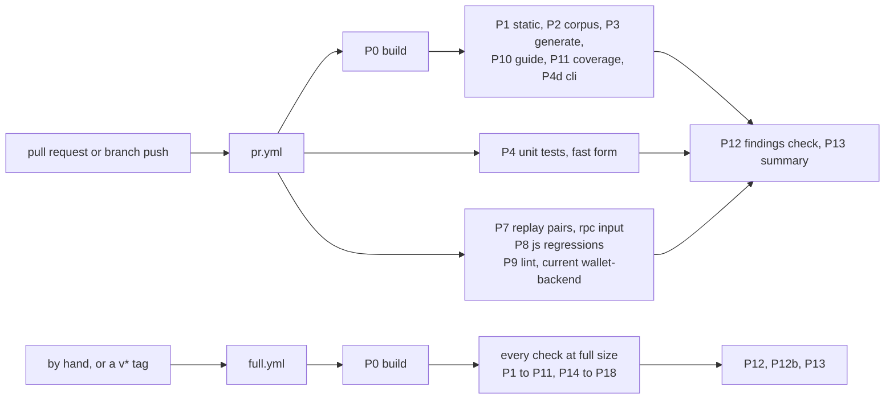

Every check is one `make` target. CI runs exactly that target, so a check that fails in CI fails the same way on a
workstation. This page covers how that is enforced and what each job proves.

## Three rules every job follows

1. **Everything is pinned in one file.** `pins.toml` names every version the kit builds against or tests:
   stellar-core 30.0.0 (commit, `.deb` sha256, binary sha256, image digests), the XDR definitions tag `v30.0`,
   rs-stellar-xdr 30.0.0, the Go, Rust, Node and Python toolchains, every SDK column, wallet-backend's commits,
   stellar-etl v2.8.35, and the SeaweedFS and TimescaleDB images by digest. `xdrcheck pins check` fails when a
   version is named anywhere else (a lock file, a toolchain file, a Dockerfile, a constant in the code) or differs
   from the pin. It also reads the dated `[[schedule]]` events (the mainnet vote on Protocol 30 on 2026-11-23, the
   testnet reset on 2026-12-16) and fails once an event's day has passed and its pin has not moved.
2. **One networked step: `make fetch`.** It downloads everything into caches, each item checked by hash. It is
   split into parts (`scripts/fetch.sh`), and a job fetches only the parts its target reads with
   `make fetch FETCH_ONLY="…"`:

   | Part | What |
   |---|---|
   | `cargo`, `gomod`, `py` | the workspace crates, the Go modules of `go/` and `lint/`, the Python check packages |
   | `core` | the stellar-core package and its runtime libraries |
   | `goldens` | stellar-core's golden tree at v30.0.0 (153 MB) |
   | `conform`, `conform-pr` | driver packages of the `public` or `pr` column set |
   | `wallet-backend` | the seven wallet-backend builds, the clone, and the TimescaleDB and SeaweedFS images |
   | `lint-sources` | the wallet-backend and stellar-etl trees xdrlint runs on, and stellar-etl's Go toolchain |
   | `docs` | the stellar-docs repository at the pinned commit |
   | `mainnet` | the mainnet tier's 6,150 lake objects, about 1 GB |

   Source: `docs/ci-timings.md`, "Fetch parts".
3. **Every check runs with the network cut.** `make <target> OFFLINE=1` wraps the run in `scripts/offline-run.sh`:
   `unshare --user --map-root-user --net --mount`, a private network namespace with only loopback up, and name
   lookups cut too (`/etc/resolv.conf` bind-mounted empty, `/run/systemd/resolve` hidden). Where user namespaces are
   not allowed, `XDRCHECK_OFFLINE_FALLBACK=docker` runs the command in a pinned container with `--network none`.
   Inside the namespace, wallet-backend's TimescaleDB runs in a container with `--network none` reached through a
   Unix socket, and the S3 store runs as the pinned image's own `weed` binary. A check that tries to download
   something fails.

## The two tiers

Both tiers run on GitHub's standard runners (2 vCPUs, 7.7 GiB), with `permissions: contents: read` and no secrets.
The build job runs `make build` once (itself under `offline-run.sh`) and hands the tools to the other jobs as an
artifact.

### Pull-request CI (`.github/workflows/pr.yml`)

Trigger: every pull request, every push to a branch other than main, and by hand. Locally: `make verify-pr`.

| Job | Target | What it proves |
|---|---|---|
| P0 build | `make build` | every tool builds offline from the fetched caches |
| P1 static | `make verify-static` | every manifest and chain index matches its schema; every blob's hash and length; every sidecar's hash; entry IDs registered; `xdrcheck pins check` |
| P2 corpus | `make verify-corpus` | the round trip, pinpoints, recomputed hashes, the reference extractor, the golden import and the golden mirror ([Corpus](/architecture/corpus)) |
| P3 generate | `make verify-generate` | the scenarios in `corpus/scenarios/pr.list` regenerate on the pinned stellar-core, on both passphrases, to the committed chains |
| P4a, P4b, P4e | `make test-rust-fast`, `make test-go-fast` | the Rust tests, and the Go tests of `go/` and `lint/` with `-short` |
| P4c a to e | `make test-drivers DRIVERS=…` | every driver's own tests, in five groups (Python; JavaScript and stellar-core; Go v0.7.x; Go v0.8.0, v0.9.0 and soroban-spec; Rust and XDR-JSON) |
| P4d cli | `make test-cli` | `docs/cli.md` equals the built tools' `--help` |
| P7 replay | `make verify-replay-pr` | the wallet-backend#729, #731, #716 pairs on the `rpc` input, with the row-by-row assertions ([Replay](/architecture/replay)) |
| P8 conformance-js | `make verify-conformance-js` | js-stellar-sdk#1766, #1785, #1789 on 17.2.0, 17.2.1, 17.3.0 |
| P9 lint | `make verify-lint-pr` | the linter fixtures, and the run on wallet-backend `f0c00cf5` equal to its frozen list |
| P10 guide | `make verify-guide` | the guide's tables and claims equal their sources; stellar-docs' checks pass |
| P11 coverage | `make verify-coverage` | `corpus/COVERAGE.md` is current; every CAP row has an entry or a stated reason |
| P12, P13 | `make verify-findings`, summary | every failure row of the jobs above is linked to an upstream issue or declared; one table of every job's result |

Measured: about 15 minutes with warm caches, 25 cold; the longest path is P4a (`docs/ci-timings.md`, measured
2026-11-19).

### Full CI (`.github/workflows/full.yml`)

Trigger: by hand (`workflow_dispatch`) and on `v*` release tags. No schedule and no run on a push. Locally:
`make verify` plus the full-size targets below. It runs P0 to P4 and P10, P11 as above (P4 at full size: `make
test-rust` with `XDRCHECK_REQUIRE_CORE=1`, so the tests that run stellar-core cannot skip), and adds:

| Job | Target | What it proves | Time |
|---|---|---|---|
| P5 harness-selftest | `make harness-selftest` | seeded-bug indexers land in their documented classes; the baseline passes | 6 min |
| P6 memory | `make verify-memory` | the harness's memory stays bounded in a 256 MiB group; a non-streaming control fails | 10 min |
| P7 replay | `make verify-replay` | the three wallet-backend pairs and the current commit on both `rpc` and `sep54-s3` | 14 min |
| P8 conformance | `make verify-conformance` | the js-stellar-sdk regressions, then the 16-column `pr` matrix and `xdrcheck conform check` | 22 min |
| P9 lint | `make verify-lint` | fixtures, wallet-backend, the before/after table, stellar-etl, the linter self-test | 18 min |
| P14 replay-full | `make replay-full` | the whole corpus through wallet-backend `f0c00cf5` on both inputs, each entry judged from stored rows | 21 min |
| P15 replay-etl-known | `make replay-etl-known` | the entries that declare a stellar-etl divergence, at `7e3fc9af` | |
| P16 conformance-public | `make verify-conformance-public` | the 21-column `public` set, including the JavaScript 16.x line and stellar-core's decoder | 30 min |
| P17 sdk-ci-recipes | `make sdk-ci-recipes` | the Go, Rust, Python and npm recipes in `examples/sdk-ci/` run against the pinned SDKs | |
| P18 mainnet | `make verify-mainnet` | the 6,158 mainnet-tier transactions re-cut and re-tokenised from their lake objects, holding all 15,186 tokens ([Mainnet scan](/architecture/mainnet-scan)) | 11 min |
| P12, P12b, P13 | findings checks, summary | every failure row of every job is linked; on a release tag no row may be undecided | |

Times: `README.md`, "Check every claim yourself" (jobs on a 2-CPU GitHub runner); about 40 minutes wall time with
jobs side by side. The local emulation of both tiers from cold caches (`make ci-local`, 2 CPUs, 7 GiB per job) is in
`docs/ci-timings.md`.

## Manual workflows

None of these gates a pull request, and none has a schedule.

| Workflow | Job | Target | What it checks |
|---|---|---|---|
| `nightly-goldens.yml` | N1 | `make nightly-regenerate` | every scenario under `corpus/scenarios/`, at every protocol and network it declares, regenerates to the committed chains |
| | N2, N3 | `make verify-goldens-nightly` | stellar-core's own test binary (`stellar/unsafe-stellar-core:30.0.0-3642.0e49751aa.noble-buildtests` by digest) runs `test '[tx]' --rng-seed 12345 --check-lcm` against the golden tree with no network and a memory limit (about 21 minutes on 8 CPUs); then the bulk tier decoded and re-encoded by the oracle and by every `public` SDK column at L0 |
| | N6 | `make nightly-early-warning` | stellar-core's `test-lcm-next` goldens at `master` decode, re-encode and JSON-round-trip in the pinned oracle; counts only, because the branch is not pinned |
| | N8 | `make nightly-refetch` | `make fetch` into an empty cache, `xdrcheck pins check`, the golden tree against `corpus/bulk/`, every vendored lake object against the lake |
| `vnext-core.yml` | | `make vnext-core` | stellar-core master built with `--enable-next-protocol-version-unsafe-for-production` in a pinned container, checked to support a protocol above `max_supported` |
| `watch-drift.yml` | | `make watch-network` | mainnet and testnet protocol versions (Horizon `current_protocol_version`), testnet resets and dated events against `pins.toml` |
| `watch-canary.yml` | | `make nightly-canary` | how far each pin is behind upstream; a canary column for the newest release of each SDK family, diffed with the newest pinned column |
| `release.yml` | | `make release`, `make dist-bin`, `make release-assets` | the release artifact (below); publishes nothing |

## Release artifacts

`release.yml` (on a `vMAJOR.MINOR.PATCH` tag, or by hand as a dry run) produces one workflow artifact:

- `xdrcheck-<version>.tar.gz`: the corpus with `SHA256SUMS` and `PROVENANCE.json` (`xcc.release/v1`: source
  commit, pins, entry counts, tool versions). Built from `git archive <commit>`, with fixed timestamps, owners and
  modes, `tar --sort=name` and `gzip -n -9`; `make release` builds it twice and requires identical bytes.
- the npm package of the corpus;
- prebuilt binaries for linux-amd64, linux-arm64, darwin-amd64 and darwin-arm64;
- `SHA256SUMS` over the assets, and a container image smoke test.

The corpus version's MAJOR is the highest protocol it covers (`30.y.z` covers Protocol 30), so a consumer pinned to
`^30.0.0` never receives the Protocol 31 release by accident. A `-next` channel (`31.0.0-rc.N`) carries the next
protocol's shapes before it ships ([Protocol upgrades](/architecture/protocol-upgrades)).

## In your own CI

`action.yml` is a composite GitHub Action with three modes: `replay` (your indexer through your adapter),
`conform` (your SDK's drivers) and `lint` (`xdrlint`, with SARIF output). It downloads the prebuilt tools and the
corpus of one pinned release and checks them against the release's `SHA256SUMS` (optionally against a sha256 of that
file you pin in your own repository) before anything runs. Without the action, an SDK uses a loader and an
expected-failure list ([Conformance](/architecture/conformance#using-it-in-your-sdks-ci)).

Guides: [CI recipes](/guides/ci), [GitHub Action](/guides/ci#github-action), [CI timings](/reference/ci-timings).

## Limits

- The full CI runs by hand and on tags only; a push to main runs neither tier.
- The golden emission proof (N2) takes about 21 minutes on 8 CPUs and is not part of the full CI.
- The release provenance is not signed yet.
