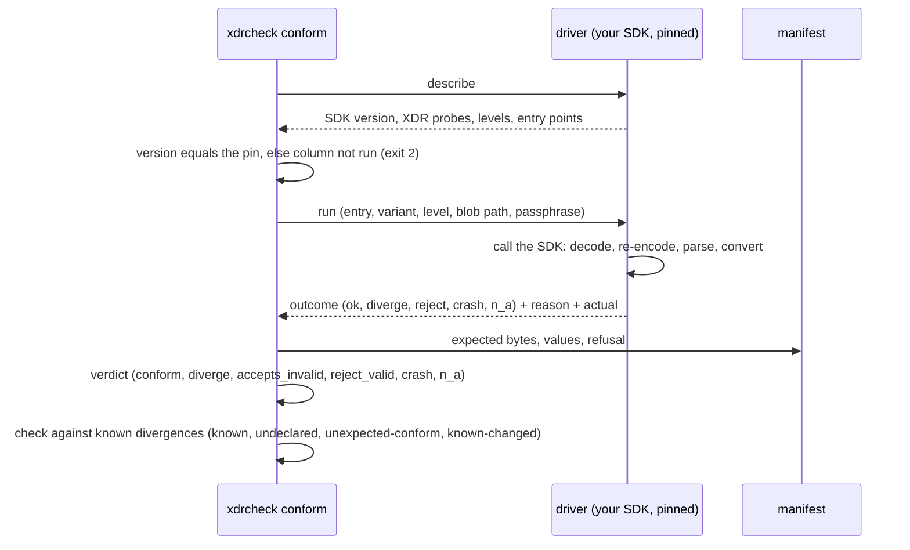

`xdrcheck conform` puts every corpus entry through every pinned SDK version and writes a matrix
`entry × SDK@version × level`. Each cell is judged against the manifest, never against another SDK. The
specification is [Driver protocol](/reference/driver-protocol) and [Conformance protocol](/reference/driver-protocol#conformance-rules).

## One cell, from request to check

## Step 1: the driver

A driver is a small program in the SDK's language that wraps exactly one SDK at exactly one version
(`drivers/<language>/<version>/`). It speaks `xcc.driver/1`: one JSON request per line on stdin, one response per
line on stdout. **It never sees expected values and never reads the manifest.** It reports what the SDK did; the
orchestrator judges. A driver therefore cannot pass a cell by agreeing with the expectation.

`describe` answers from the installed package at run time:

- `sdk.version` must equal the column's pin in `pins.toml` `[conformance.columns]`, or the column is not run and
  the command exits 2.
- `xdr_schema.probes`: what the SDK's generated XDR can represent, probed from its enums at start-up, for example
  `sc_address_type_muxed_contract` (CAP-84) and `stellar_value_signed_ms` (CAP-88). A variant that `requires` a
  feature the SDK lacks is **beyond reach**: the only accepted outcome is a clean refusal
  (`union_arm_undeclared`, `enum_undeclared`), recorded `n_a`. A crash is still a failure.
- `object_parsers`, `native_converters`: the entry points per XDR type, for example
  `{"TransactionEnvelope": "TransactionBuilder.fromXdr"}`.

Each driver process runs under a per-request timeout (default 20 s plus 20 s per MiB), a memory cap (default 1 GiB)
and no network. A driver that dies is recorded `crash` and replaced. Entries built to stress a reader run in a fresh
process each.

## Step 2: what one cell checks

| Level | Question | Compared with | Example |
|---|---|---|---|
| L0 codec | decode the bytes as the named type, re-encode: identical bytes, all bytes consumed | the blob's sha256 and length | a trailing byte accepted |
| L1 object | for a ledger, does every envelope of the transaction set go through the SDK's transaction parser | `derived.l1`: transaction count, operation count, hashes, focus transaction | js-stellar-sdk#1766: bytes round-trip, `TransactionBuilder.fromXdr` throws `Assets are not in lexicographic order` |
| L2 values | does the decoded value equal the oracle's at the entry's pinpoints | `expect.values[]` (JSON Pointers into the SEP-51 sidecar) | a 64-bit ID through a float |
| L3 native | does the SDK's native conversion keep the value | `expect.native` | js-stellar-sdk#1789: colliding `SCV_MAP` keys merged in `scValToNative` |
| L4 API | for `api` and `strkey` entries: does building or encoding give the expected bytes or the expected refusal | `expect_xdr_hex`, `expect_value`, `expect_reject` | js-stellar-sdk#1785: an offer ID re-encoded as a different ID |
| spec | does the contract-spec reader return the entries the Wasm holds, and refuse two `contractspecv0` sections | the `spec` entry's expectation | |
| json | does a converter's SEP-51 JSON validate against its schema and encode back to the same bytes | the blob | |

Driver outcomes: `ok`, `diverge` (accepted, and the driver itself saw a mismatch), `reject` (refused through the
SDK's normal error channel), `crash` (fault-class error or dead process), `n_a` (no API for this level, under narrow
rules). Refusal reasons are a closed list of codes (`decode_error`, `trailing_bytes`, `length_exceeds_max`,
`union_arm_undeclared`, `ordering`, `strkey_checksum`, `stack_overflow`, …). The SDK's error text is kept in
`reason.message` and never used to classify.

## Step 3: verdicts and checks

The orchestrator turns each answer into a **verdict against the manifest**: `conform`, `diverge` (accepted with
bytes or values that differ), `accepts_invalid`, `reject_valid`, `crash` or `n_a`. It then **checks** the verdict
against the entry's declared divergences for the column's target, version and profile:

| Cell | Inside a declared range | Outside every range |
|---|---|---|
| declared outcome observed | `known` | — |
| conforms | `unexpected-conform` | `conform` |
| anything else | `known-changed` | `undeclared` |

`xdrcheck conform check` fails on `undeclared`, `unexpected-conform` and `known-changed`. So a run fails on a new
divergence, and also when a declared defect no longer shows where it should (the fix landed in an earlier version
than declared, or the corpus stopped reproducing it).

**A declared divergence** (`conformance.known_divergences[]` in the entry): `target` (for example
`stellar/js-stellar-sdk`), `versions` (a range), `level`, the expected `outcome`, and optionally a `match` block
(`reason`, `envelopes_parsed`, `rejected_tx_index`) the driver's report must equal, the upstream `reference`, and
`fixed_in`.

**Diverges from the network, diverges from each other.** A cell that differs from the manifest diverges from the
network: the manifest's values trace to stellar-core's bytes. Accepting columns are also grouped by a fingerprint of
what they returned (L0 the re-encoding hash; L1 transactions, operations and hashes; L2 the pinpoints; L3 the map
entries and re-encoding; L4 the value and bytes). Columns that accept and disagree are listed in `cross-sdk.md`.

## The columns

`drivers/sets.toml` defines named sets; each column is one SDK at one version (and for Rust one decode profile).

| Set | Columns | Role |
|---|---|---|
| `required` | `js@17.4.0`, `go@v0.9.0`, `rust@30.0.0:limits-default`, `rust@30.0.0:limits-none` | gates CI |
| `pr` (default) | `required` + js 17.2.0, 17.2.1, 17.3.0; go v0.7.1, v0.7.2, v0.7.3, v0.8.0; rust 28.0.0 and 28.0.1 (both profiles); python 17.0.1 | 16 columns |
| `public` | `pr` + js 16.3.0, 16.3.1, 16.4.1; python 17.0.0; `core@30.0.0` | 21 columns |
| `views` | go v0.8.0 and v0.9.0 through the SDK's zero-copy XDR views | outside `pr` |
| `spec`, `json` | contract-spec readers; rs-stellar-xdr's XDR-JSON converter at 30.0.0 and at a main-branch commit | outside `public` |

**The Rust decode profiles.** The `stellar-xdr` crate has no default limits, so its columns run under two:
`limits-default` (the Soroban host's default XDR limits, `DEFAULT_XDR_RW_LIMITS` in soroban-env-host, with the
length budget set to the input size) and `limits-none` (`Limits::none()`, what the crate's CLI uses).

**The stellar-core column.** `core@30.0.0` (`drivers/core`) runs the pinned stellar-core binary offline as a decoder
(`stellar-core print-xdr`, and `dump-xdr` on a one-record stream for `LedgerCloseMeta`). It answers L0 only. It shows
how stellar-core decodes bytes, not what core admits to the network. A negative entry that core's decoder accepts
records `core_behaviour.accepts: true`; the SDK columns must still refuse it. Result: 346 cells agree, 0 diverge,
96 not run (`evidence/results/conformance-matrix.json`, `totals`).

## The three js-stellar-sdk regressions

`make verify-conformance-js` (every pull request) runs the js-stellar-sdk defects on `js@17.2.0`, `js@17.2.1` and
`js@17.3.0`, without the rest of the matrix. Each pre-fix cell must be the declared divergence observed inside its
range, with the facts the assertion names; each fixed cell must conform. Removing a declared divergence from its
entry fails the run.

| Issue | Entry group | Level | Pre-fix | Fixed |
|---|---|---|---|---|
| js-stellar-sdk#1766 | `cap-0038/pool-issuers-order-by-bytes-not-strkey` | L1 | 17.2.0: `reject`, reason `ordering`, from `TransactionBuilder.fromXdr` | 17.2.1, 17.3.0 conform |
| js-stellar-sdk#1785 | muxed account IDs and offer IDs (`api` entries) | L4 | 17.2.0, 17.2.1: a different ID encoded | 17.3.0 conforms |
| js-stellar-sdk#1789 | `SCV_MAP` with colliding keys | L3 | 17.2.0, 17.2.1: `scValToNative` merges colliding keys | 17.3.0 conforms |

Evidence: `evidence/js-1766/`, `evidence/js-1785/`, `evidence/js-1789/`.

## A defect in one SDK becomes a check on the others

Entries are SDK-neutral. When a defect is found in one SDK, its entry runs on every column of every family on the
next run. `findings/SIBLINGS.md` records the result per defect class and family, read from executed cells
(34 classes × 9 families: 38 reproduce, 43 not affected, the rest not run or outside the runs).

Example, liquidity-pool asset order compared as strkey text instead of bytes:

| Family | Result |
|---|---|
| JavaScript 17.x | reproduces on 17.2.0; passes from 17.2.1 |
| JavaScript 16.x | reproduces on 16.3.0; passes from 16.3.1 |
| Go | reproduces on v0.7.1; passes from v0.7.2 |
| Python | reproduces on 17.0.0; passes from 17.0.1 |

For your SDK this means: a defect someone found in another language is already a cell in your column. If your
SDK has it, your next run shows it as a new failure.

## Using it in your SDK's CI

Two ways, both offline after one download:

1. **Your own test, your own language.** A loader (`packages/go`, `packages/rust`, `packages/python`,
   `packages/npm`) opens one pinned release archive, checks its sha256, and yields each entry's blob (refused unless
   its sha256 and length match), its expected SEP-51 JSON, and whether a decoder must refuse it. Recipes:
   `examples/sdk-ci/`.
2. **The full matrix.** `xdrcheck conform run --columns '<your column>'`. For an unreleased branch of a Go, Rust
   or Python SDK, run `xdrcheck conform fetch`, `build` and `run` with `--columns <id> --sdk <checkout>`.

**The expected-failure list.** `xdrcheck conform run --columns <id> --write-expected-failures FILE` records your
column's failing cells, one line per cell (`<entry> <variant or -> <level>`), committed in your repository. With
`--expected-failures FILE` the run passes only when the failing cells equal the list: a new failure fails
(`NEW-FAILURE`), a listed cell that now passes fails (`UNEXPECTED-PASS`: remove the line when you fix the bug).
`--require-all-read` fails when your column never read an entry variant (every level `n_a`).

Guides: [Run the corpus in your SDK's CI](/start/for-sdk-maintainers), [Using the corpus in an SDK's CI](/guides/sdk-ci).

## What a run writes

`xdrcheck conform run --report DIR`: `SUMMARY.md` (only rows that need a look: new divergences, known divergences,
SDK disagreements, each with the expected value, every column's answer and a rerun command), `matrix.json`,
`matrix.md`, `cross-sdk.md`, `report.json`, `cells.ndjson`, `describe.json`.

## Limits

- **The Rust column is the oracle.** `rust@30.0.0` runs the same crate that writes the corpus sidecars. Its
  agreement is the oracle agreeing with itself; what it adds is the decode profiles and refusals of negative
  entries. Pinpoints (hand-written) are the independent check.
- **Rust has no L1.** The crate has no transaction object layer; the L1 comparison holds JavaScript and Go only.
- **No floor on judged cells.** A column whose every cell is `n_a` passes `conform check`. Use
  `--require-all-read` to catch it.
- **Java and .NET are not driven.** Their rows in `findings/SIBLINGS.md` come from records, not executed cells.

Related: [Driver protocol and rules](/reference/driver-protocol), [SDK matrix](/results/sdk-matrix).
