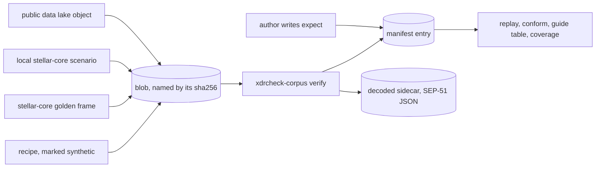

This page explains where every corpus byte comes from and how each entry's expected values are established and
checked without any reader under test.

The corpus is a directory of plain files: one JSON manifest per entry under `corpus/manifest/`, the XDR bytes
under `corpus/blobs/`, the decoded values under `corpus/decoded/`. Any SDK's or indexer's CI can read it without
this kit's tools. Counts on this page are from `corpus/COVERAGE.md` and `corpus/index.json` (corpus `30.0.0-dev`).



## Entries

446 entries (`corpus/COVERAGE.md`). An entry is one pattern; its bytes exist per network and protocol as
**variants**.

| Kind | Entries | One variant is |
|---|---|---|
| `ledger` | 328 | one full `LedgerCloseMeta` (v0, v1 or v2), with a `focus` naming the transaction and operation the pattern is in |
| `strkey` | 45 | an address text and its expected payload or refusal (SEP-23 vectors v1.4.0 and additions) |
| `api` | 33 | an SDK-neutral call (build, encode) and its expected bytes or refusal |
| `xdr` | 24 | one standalone XDR value, possibly a slice of a ledger (`slice_of`); may be negative (invalid on purpose) |
| `spec` | 16 | a contract's Wasm and the `contractspecv0` entries a spec reader must return |

Source: `corpus/index.json`, field `kind`.

## Where the bytes come from

| Source (`variants[].source.kind`) | Entries with a variant from it | How the bytes are produced | Reproduce by |
|---|---|---|---|
| `local-core` | 138 | A scenario (`corpus/scenarios/*.yaml`) runs on the pinned stellar-core 30.0.0 as a private standalone node | `xdrcheck-corpus gen --check <scenario>` |
| `history` | 141 | One object copied unmodified from the public data lake (`s3://aws-public-blockchain/v1.1/stellar/ledgers`), vendored under `corpus/objects/` | `refetch`, decompress, cut at `blob_offset` |
| `core-golden` | 53 | One record-marked frame of a stellar-core `--check-lcm` golden file at tag v30.0.0 | `git show v30.0.0:<file>`, split record marks, take `frame_index` |
| `synthetic` | 33 | Built from a recipe (`corpus/schema/recipe.schema.json`): a base entry plus an edit, or a literal construction, with a `reason` stellar-core cannot or would not emit it | apply the recipe |
| `contract-code` | 3 | A `CONTRACT_CODE` entry's Wasm read from the network | `getLedgerEntries` |
| `history-archive` | 2 | A record cut from a bucket file of a public history archive | fetch, cut at `byte_offset` |

Source: `corpus/index.json`, field `sources` (an entry with variants from two sources counts in both). 111 entries
carry `synthetic: true`: the 33 recipe entries plus `strkey` and `api` entries, which have no stellar-core bytes by
nature.

### Local stellar-core runs

`xdrcheck-corpus gen <scenario>` (`crates/xdrcheck-gen`):

1. Writes a stellar-core configuration with `RUN_STANDALONE=true`, `MANUAL_CLOSE=true`, the network passphrase,
   no peers, an HTTP port on loopback, and `METADATA_OUTPUT_STREAM` pointing to a file in the run directory.
   The meta flags are the **lake profile**: the flags the public data lake's objects were written with
   (`EMIT_CLASSIC_EVENTS`, Soroban meta extension v1).
2. Starts the release binary pinned in `pins.toml` (`stellar_core.binary_sha256`) from genesis.
3. Brings the chain up to the target protocol: ledger 2 upgrades `protocolversion=N`; from Protocol 20, ledgers
   3 to 12 install Soroban settings through two `ConfigUpgradeSet`s with fixed salts.
   Scenario steps start at ledger 13.
4. For each step: builds the transaction from its SEP-51 JSON template, signs it with keys derived from public
   labels, submits it with `tx?blob=`, arms upgrades if any, and closes the ledger with `manualclose`.
   A step marked `simulate: true` is simulated first with the pinned soroban-env-host against the node's own
   state; no stellar-rpc is involved.
5. Reads each `LedgerCloseMeta` from the record-marked meta stream and writes it as a blob named by its sha256,
   with the SEP-51 sidecar, the manifest variant and a chain index (`corpus/chains/<scenario>/`).

Every scenario runs twice: once on the testnet passphrase and once on the mainnet passphrase, from the same seed
labels. Account IDs, sequence numbers and muxed IDs are equal across the two **twins**; hashes and signatures
differ. The mainnet-passphrase run never touches mainnet: it is a private chain whose transactions use keys anyone
can derive.

**Reproducibility.** stellar-core does not write identical meta twice: ledger-entry changes come from an unordered
map (`LedgerTxn::Impl::getChanges`) and diagnostic events carry timings. `make verify-generate` regenerates the
scenarios in `corpus/scenarios/pr.list` with the network cut and requires equal ledger header hashes, transaction
hashes and results, and equal bytes after stellar-core's own `--check-lcm` normalisation (sorted change lists,
zeroed `core_metrics` timing values). Each local-core variant records this as
`reproducibility: normalised-identical`.

### Public data lake objects

`xdrcheck-corpus capture <network> <ledger> --tx <hash> --entry <id>` copies the object at its original key with
its sha256, its decompressed sha256, the lake's object metadata and the stellar-core version that wrote it. The blob
relation is fixed: the object is a zstd `LedgerCloseMetaBatch`, so the blob is the decompressed bytes from offset
12 (`startSequence`, `endSequence`, array length) to the end. The replay harness serves the original object, byte
for byte. Testnet objects carry `perishable: true` (the next reset is 2026-12-16, `pins.toml`); after it the
vendored copy is the only one.

The lake's older ledgers were rewritten by a recent stellar-core, so a Protocol 1 to 22 ledger there carries
`TransactionMeta` v4 with backfilled events. Such entries record `regenerated: true`.

## How expected values are established

Three layers, in the manifest of each entry (`docs/manifest.md` section 6.1, [Manifest](/reference/manifest)):

| Layer | Field | Established by | Checked by |
|---|---|---|---|
| Bytes | `variants[].blob` (sha256, length) | the source above | sha256 of the file; re-encoding must reproduce it (L0) |
| Decoded value | `variants[].decoded` | rs-stellar-xdr 30.0.0 renders SEP-51 XDR-JSON; stored as a zstd sidecar with the sha256 of the uncompressed JSON | compared as a JSON value, never as text |
| Semantic facts | `expect` | written by the entry's author, then checked against the reference extractor | `xdrcheck-corpus verify` fails on any disagreement |

`expect` holds: whole-ledger receipts (`expect.ledger`: transactions, operations, events, entry changes), every
transaction's hash, result code and fee (`expect.transactions`), pinpoints (`expect.values[]`: a JSON Pointer into the
decoded value and the value it must equal), participants, state changes, movements, stored addresses, and
explicit negative facts (`must_not_include`).

**The reference extractor** (`xdrcheck-corpus extract`, `crates/xdrcheck-meta`) derives participants, state
changes and movements from what stellar-core changed:

- It reads ledger-entry changes (fee processing, before and after changes, operation changes) and consensus
  events. It never reads diagnostic events.
- It uses the envelope for two things only: to label a change with its operation type, and to attach a muxed
  alias to a participant the meta already established. It never adds a participant from the envelope.
- A failed transaction's participants are its fee payer and source only. Every other address in its envelope
  becomes a `must_not_include` candidate.
- A token-shaped event yields a movement keyed on the emitting contract. Only a contract whose ID equals the
  Stellar Asset Contract ID of a classic asset counts as that asset.

The author writes `expect`; `verify` requires every stated value to be one the extractor derives. A value no
ledger field carries is marked `unverified: "<reason>"` instead of being guessed. Pinpoints are hand-written, so
they check the oracle independently of the fact that the oracle shares rs-stellar-xdr with the Rust SDK column.

## What `make verify-corpus` checks

`xdrcheck-corpus verify` runs these checks on every variant (`docs/manifest.md` section 11):

1. Schema, ID and registry: the file path equals `id`; the ID is in `corpus/plan.json`.
2. Blob: exists, its name is its sha256, `blob.bytes` matches.
3. **Round trip**: decode with explicit limits, re-encode, identical bytes; JSON to XDR reproduces the blob. A
   negative `xdr` entry must instead be refused with the entry's reason class.
4. Pinpoints resolve and equal; `derived.ledger_hash` equals the header hash; `derived.tx_hash` is recomputed from
   the envelope under the stated passphrase.
5. Receipts and the transaction list match the blob.
6. Source: a golden frame equals the golden file's record; a lake variant's decompressed sha256 and offset hold.
7. The reference extractor agrees with `expect`.
8. Golden agreement (below).
9. Nothing left over: every blob and sidecar belongs to a variant.

The round trip can be repeated with the stock `stellar-xdr` CLI at 30.0.0
(`cargo install --locked stellar-xdr --version 30.0.0 --features cli`); the commands are in
[Manifest](/reference/manifest).

## Agreement with stellar-core's goldens

stellar-core checks its own `LedgerCloseMeta` goldens (`test-lcm-current`) in CI with `--check-lcm`.
`--check-lcm` re-runs core's own tests and cannot check anyone else's bytes, so agreement is four mechanical
checks:

| Check | Statement | Where it runs |
|---|---|---|
| Pinned import | every `core-golden` variant's bytes equal the named frame of the named golden file at v30.0.0, byte for byte | `make verify-corpus` |
| Emission proof | the pinned stellar-core test image runs core's `[tx]` tests with `--rng-seed 12345 --check-lcm` against the cached golden tree, with no network, and accepts it | `make verify-goldens-nightly` (manual nightly workflow) |
| Decoder consistency | every golden decodes and re-encodes byte-exactly in the oracle and in every SDK driver | `make verify-corpus` for the curated tier; `make verify-goldens-nightly` for the whole golden set |
| Golden mirror | a local-core entry whose focus transaction has the shape of a golden transaction is compared with it | `make verify-corpus` (needs the golden cache) |

**The golden mirror, exactly.** For each local-core variant, two measures of the focus transaction are recomputed
from its blob and from the golden on every run:

1. The **profile-free skeleton**: every union arm, enum value, boolean, array length and `Symbol` kept, every
   other leaf replaced by its type name, and the parts that exist only because a meta flag is set removed
   (diagnostic events, transaction-level and classic-operation events, `soroban_meta.ext`).
2. The **reduced shape tokens** of the mainnet scan's grammar (`xcc.shape/v1`): optional presence, the fields each
   updated entry changed, flag transitions, operation-versus-effect relations, event signatures. Type-level
   tokens, meta-flag parts and `seqLedger`/`seqTime` are removed.

An entry is **mapped** only when both measures equal those of one golden transaction. `corpus/mirrors.json`
(written by `xdrcheck-corpus verify --checks ag4 --write-mirrors`) records the mapping:

| Of 138 local-core entries | Count |
|---|---|
| mapped to a golden transaction | 20 |
| not mapped | 118 |
| of those, every operation has a golden operation of the same reduced shape (reported separately; not agreement of the entry) | 15 |
| of those, no transaction to compare | 7 |

Source: `corpus/mirrors.json`, `counts`. Agreement is of shape. It never compares values or bytes: a local entry
and a golden come from different runs, accounts and ledgers.

## One entry walked through: `cap-0040/signed-payload-signer-added`

File: `corpus/manifest/cap-0040/signed-payload-signer-added.json`.

| Field | Value |
|---|---|
| `title` | SetOptions adds an ed25519 signed-payload signer to an account |
| `caps`, `protocol.introduced` | `[40]`, 19 |
| `synthetic`, `validity` | `false`, `valid` |
| variant | `testnet`, protocol 28, ledger 4437357, `LedgerCloseMeta` v2, `TransactionMeta` v4, profile `lake` |
| `source` | `history`: key `FFBC9DFF--4416000-4479999/FFBC4A92--4437357.xdr.zst`, written by stellar-core 28.0.1 |
| blob | `582e694b…7c4e0e`, 58,256 bytes |
| `focus` | transaction 0 (`d9f78749…`), operation 0, path `/v2/tx_processing/0/tx_apply_processing/v4/operations/0/changes/1/updated/data/account/signers/0` |
| `expect.ledger` | 12 transactions, 12 operations, 27 events, 108 entry changes |
| `expect.values` | the signer key equals `PBCK2RYY…AANMS` (a `P…` strkey), weight 1, `num_sub_entries` 1 |
| `conformance.levels` | L0, L1, L2 |
| `replay` | `unit: single`, `indexer_scope: all` |

Check the bytes yourself:

```sh
O=corpus/objects/testnet/4437357/FFBC4A92--4437357.xdr.zst
sha256sum "$O"                          # 24fc6077…e4001b = source.object_sha256
zstd -dc "$O" | sha256sum               # e9fe329b…1c1846 = source.decompressed_sha256
zstd -dc "$O" | tail -c +13 | sha256sum # 582e694b…7c4e0e = blob sha256
```

The entry declares two known divergences for `stellar/wallet-backend`, both at level `replay`:

| Range | Outcome | What was executed |
|---|---|---|
| `6e5a5910..2a0a84ea` | `halt` | wallet-backend#729: five persist attempts, exit code 2, cursor stays at 4437356, no rows for the ledger |
| `..79ea2acd` | `wrong_value` | wallet-backend#716: ingestion completes; the signer is stored as 33 bytes, the signed payload dropped |

At the fixed commits (`2c873353`, `bb0b162b`) the same entry must pass. How that is asserted: [Replay](/architecture/replay).

## Limits

- 118 of 138 local-core entries have no golden transaction of the same shape.
- 33 entries are recipe-built (`synthetic`); `strkey` and `api` entries have no ledger bytes by nature.
- The reference extractor proposes; an author decides. Its rules are documented in `docs/manifest.md` section 6.11,
  not proved complete.

Related: [CAP coverage](/caps/overview), [Manifest and index format](/reference/manifest),
[How to read a corpus entry](/start/read-an-entry), [Authoring entries](/guides/add-corpus-entries#authoring-reference).
