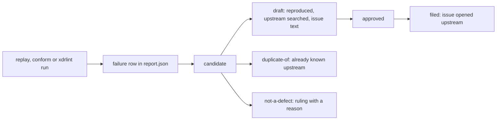
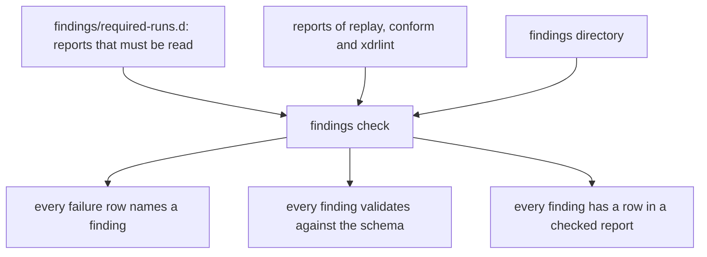

This page explains how a failing result of the replay harness, the conformance runner or the linter becomes a
finding with a severity, a corpus entry and an upstream state, and how you can re-run one. The list of findings is
on [Findings](/results/findings).

## From a failing row to an upstream issue



1. **A tool reports a failure row.** Every tool writes its results as `xcc.report/v1` rows
   (`corpus/schema/report.schema.json`). A failure row names the tool, the target and its version, the entry and
   variant, the level, and the expected and observed values.
2. **A finding is created from the row.** One finding is one defect in one target project. The same defect in
   several projects is several findings that share a `defect_group`.
3. **It is reproduced and searched for upstream.** A finding leaves `candidate` only with an independent
   reproduction, a search of the target's issue tracker, and evidence. A `draft` carries the issue text; it becomes
   `approved` when a person approves that text and the channel it goes to.
4. **It ends in one of three states.** `filed`: the maintainers of this kit opened the upstream issue.
   `duplicate-of`: the defect was already reported or fixed upstream, and the finding names where. `not-a-defect`:
   the reviewed behaviour is correct or by design, with the reviewer's reason.
5. **The row is linked back.** The manifest's known divergence, or the linter suppression, that the row matched
   names the finding's ID. From then on every run checks that the defect still shows where it is declared and
   nowhere else.

No tool in the repository files, comments on or reports anything upstream. The tools write a draft and print the
command a person would run. The public tree holds a finding only after the affected project has been told
(`SECURITY.md`).

## What one finding holds

One directory per finding: `findings/<id>/finding.json`, schema `xcc.finding/v1`
(`corpus/schema/finding-record.schema.json`). IDs are assigned in order and never reused.

| Field | Holds |
|---|---|
| `title` | the symptom in the target project's own terms |
| `target` | `project`, `package`, `versions_affected` and `versions_tested` (the columns or commits that were run) |
| `component` | `sdk`, `xdr-library`, `pipeline`, `core`, `specification` or `documentation` |
| `class` | what goes wrong: `halt`, `crash`, `hang`, `wrong_value`, `silent_drop`, `partial_drop`, `accepts_invalid`, `rejects_valid`, `encode_mismatch`, `resource_exhaustion`, `hardening` or `documentation` |
| `severity`, `severity_basis` | `critical`, `high`, `medium` or `low`, and one or two sentences on why, including what is and is not verified about reachability |
| `caps` | the CAPs the defect's shape belongs to; when empty, `caps_note` says why no CAP applies |
| `entries` | the corpus entries that demonstrate the defect, each with `expected` and `observed`. The first is the minimal reproducing entry |
| `evidence` | the make target or command that showed it, the report files, and `report_rows`: the keys of the failure rows this finding accounts for |
| `reproduction` | who reproduced it independently, when, how, and the result |
| `upstream_search` | the date, the queries run against the target's tracker, and the result |
| `upstream` | the URL of the upstream issue, when it was filed, its state and when that state was last checked |
| `state`, `history` | the current state and an append-only list of state changes with dates |
| `siblings`, `defect_group` | the findings for the same defect in other projects |

Schema rules tie the fields to the state: a finding past `candidate` must carry `reproduction`, `upstream_search`
and `evidence`; a `filed` finding must carry `upstream.url` and `upstream.filed_at`; a `duplicate-of` finding must
carry `upstream.url` and how this kit's evidence reached that item; a `not-a-defect` finding must carry a
`resolution` with a reason, the reviewer and a date.

Counts today (`evidence/results/findings.json`, `totals`): 92 findings; by state 48 `filed`, 34 `duplicate-of`, 10
`not-a-defect`; by severity 1 critical, 7 high, 41 medium, 43 low; by component 44 `sdk`, 38 `pipeline`, 10
`xdr-library`.

## The checks that tie rows to findings



| Check | Command | Fails when |
|---|---|---|
| Rows to findings | `make verify-findings` | a failure row on an `sdk`, `pipeline` or `core` target carries no finding ID, or the ID does not resolve |
| Findings to rows | the same | a finding fails its schema, or no row of the checked reports refers to it. A finding observed by source reading only, on a target no driver runs, says so in `evidence.observed` and is listed by the check instead of failing it |
| Terminal states | `make verify-findings-acceptance` | the above, or any finding is not `filed`, `duplicate-of` or `not-a-defect`, or a required report is missing |
| Declared divergences | `xdrcheck conform check`, `xdrcheck replay --assert-known` | a declared divergence does not show inside its version range, or shows outside it |
| Linter suppressions | `make lint-wallet-backend` | a report is not in the frozen expected list, or a suppression has no reason |
| Published data | `make results-check` | `evidence/results/findings.json` differs from the `findings/` tree |

`findings/required-runs.d/` names the make targets whose reports the check must read, one file per area
(`conformance.json`, `corpus.json`, `lint.json`, `replay.json`). The full CI runs the acceptance form on every
release tag, so a release cannot be cut while a failure row has no finding in a terminal state.

## The sibling matrix

A defect found in one SDK is looked for in every other SDK the kit drives. `make results-siblings` writes
`evidence/results/sibling-matrix.json` and renders it as `findings/SIBLINGS.md`. Each row is one defect class; each
cell is read from the executed conformance runs of the `pr` and `public` column sets, not from reading the SDK's
code.

| Cell state | Meaning |
|---|---|
| reproduces | a version that was run fails one of the class's cells; the page lists the versions that fail and the first later version that passes |
| differs, not a defect | the family fails the cells and its finding shows the behaviour is the network's own or by design |
| record only | the runs do not reach the cells, but a public finding shows the defect in this family by other means |
| not affected | the family's columns judged the cells and none failed |
| not applicable | the family has no counterpart API for this class; the reason is in `findings/siblings-not-applicable.json` |
| not run | no column of the family judged a cell |

Today: 34 classes across 9 families (JavaScript 17.x, JavaScript 16.x, Go, Rust under two decode profiles, Python,
Java, .NET, stellar-core). 38 cells reproduce, 43 are not affected, 59 not applicable, 142 not run, 23 record only,
1 differs without being a defect (`sibling-matrix.json`, `totals`). `make results-siblings-check` fails when the
page and the JSON disagree. The same matrix is rendered on [Findings](/results/findings).

To look for one finding's defect in the other SDK families without running anything:

```sh
xdrcheck conform siblings --finding <id> --offline --plan
```

## Re-run a finding from its corpus entry

Each row of [Findings](/results/findings) links the entries that reproduce it. Build the tools once
(`make fetch && make build`, then `export PATH="$PWD/bin:$PATH"`), then run the entry against the affected version.

<Steps>

<Step title="An SDK finding: one entry, one column">

js-stellar-sdk#1766 on its pre-fix release:

```sh
xdrcheck conform run --columns 'js@17.2.0' --entries cap-0038/pool-issuers-order-by-bytes-not-strkey
```

Expected: the L1 cell is `reject` with reason `ordering`. On `js@17.2.1` the same command conforms.

</Step>

<Step title="An indexer finding: one entry, one commit">

wallet-backend#729 on its pre-fix commit (needs Docker):

```sh
xdrcheck replay --adapter bin/wallet-backend-adapter \
  --target-version 2a0a84ea12523b6c92e278c0c84b443041240095 \
  --input rpc --entries cap-0040/signed-payload-signer-added
```

Expected: `mishandled · halt`. At the fixed commit `2c873353` the entry passes.

</Step>

<Step title="Check the bytes yourself">

`xdrcheck entry cap-0040/signed-payload-signer-added` prints the entry's variants, expected values and declared
divergences. [Read an entry](/start/read-an-entry) shows how to verify the blob's hash and decode it with the stock
`stellar-xdr` CLI, without this kit.

</Step>

<Step title="Hand it to a maintainer">

`xdrcheck repro pack` cuts one result of a run into a bundle: the ledger, the transaction, the one command that
reproduces it and a standalone script. `xdrcheck repro run` runs the bundle on another machine and exits 0 when the
result came back.

</Step>

</Steps>

If a run does not show the declared result, the tool says so: `unexpected-conform` in the conformance check, an
unexpected `pass` in replay. That is itself a failure of the kit's checks, because a declared defect that no longer
reproduces means the fix landed or the entry stopped demonstrating it.

Related: [Findings](/results/findings), [Conformance](/architecture/conformance#step-3-verdicts-and-checks),
[Replay](/architecture/replay#step-5-known-divergences), [Threat model](/reference/threat-model).
