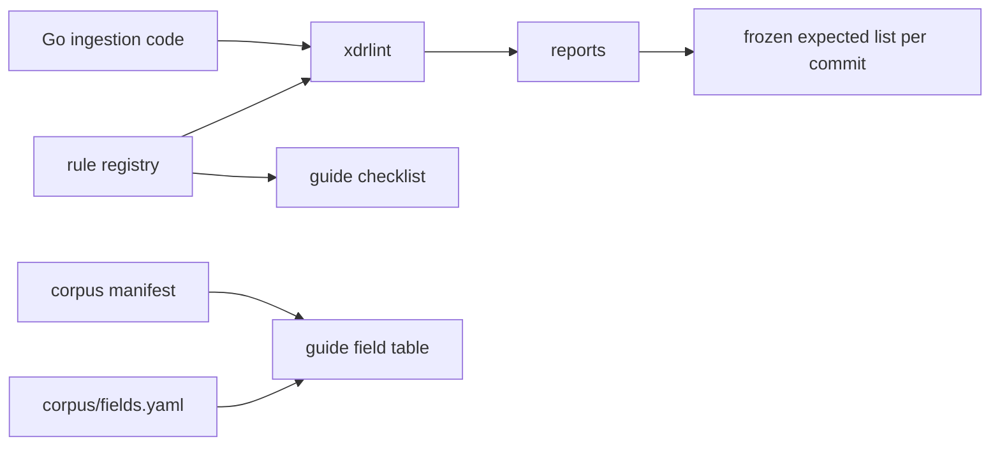
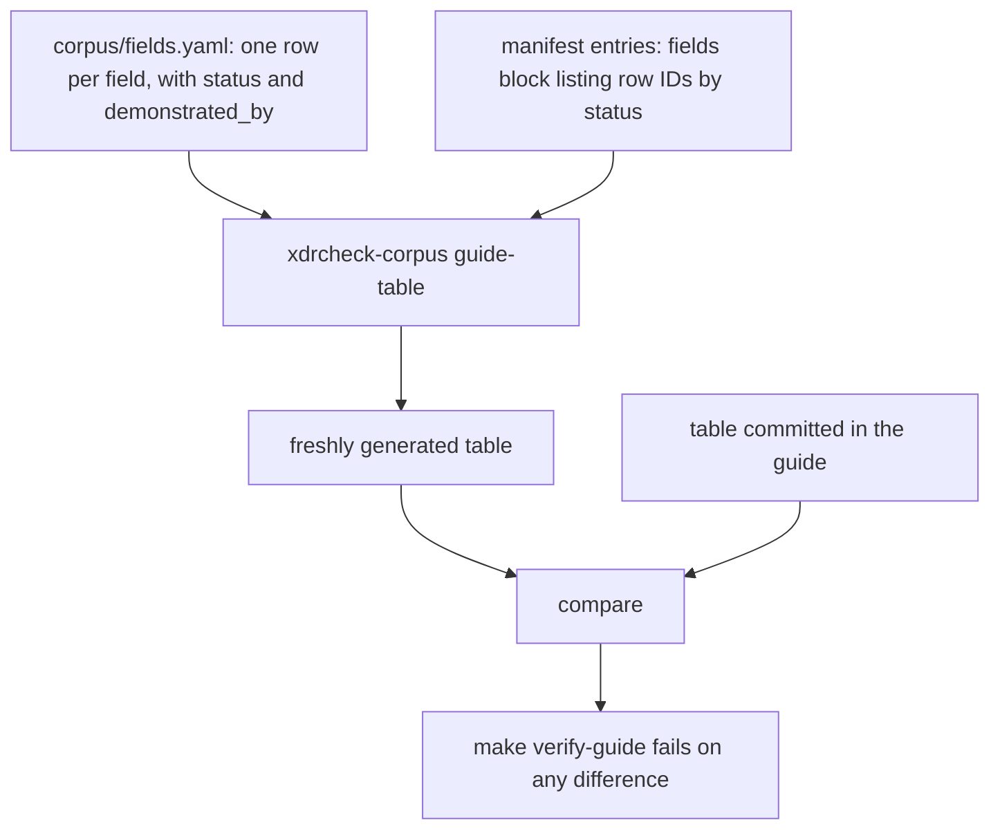

This page explains what `xdrlint` reports and how it is checked, and how the indexer-hardening guide is kept equal
to the corpus. Replay finds what an indexer gets wrong on given bytes; the linter finds the code patterns that
produce those errors before a ledger arrives; the guide states the rules both are built on.



## xdrlint

`xdrlint` (`lint/`) is a set of analyzers on `golang.org/x/tools/go/analysis` v0.52.0 for Go code that reads ledgers
with go-stellar-sdk's `xdr`, `ingest`, `processors/token_transfer` and `strkey` packages. It follows values from
those packages to sinks (SQL calls, participant sets, map keys, allocations) and reports where code assumes
something about the ledger without checking it.

## The three mistakes, in code

Each example is taken from the linter's fixtures under `lint/testdata/`. The first block is reported; the second is
not.

### Mistake 1: trusting a field stellar-core does not validate (XDR103)

A text memo has only an XDR length bound. The guide's field table lists the memo as passed through: stellar-core
does not check that it is UTF-8 or free of NUL bytes (`corpus/fields.yaml`, row VF-19; demonstrated by
`cap-0067/to-muxed-id-text-non-utf8-memo`). PostgreSQL rejects such text, so one memo can fail a whole persist
transaction.

```go
// lint/testdata/xdr1xx/xdr103/bad.go
// (a) Memo text into a database/sql parameter.
func storeMemo(db *sql.DB, memo xdr.Memo) error {
	text, ok := memo.GetText()
	if !ok {
		return nil
	}
	_, err := db.Exec(`INSERT INTO memos (text) VALUES ($1)`, text)
	return err
}
```

```go
// lint/testdata/xdr1xx/xdr103/good.go
// (b) Invalid UTF-8 replaced and NUL bytes stripped.
func storeMemoSanitised(db *sql.DB, memo xdr.Memo) error {
	text := strings.ReplaceAll(strings.ToValidUTF8(memo.MustText(), "�"), "\x00", "")
	_, err := db.Exec(`INSERT INTO memos (text) VALUES ($1)`, text)
	return err
}
```

### Mistake 2: walking a recursive structure with no bound (XDR201)

The host examines only the authorization entries a `require_auth` call matched, so the shape of an unmatched
`SorobanAuthorizedInvocation` tree is the submitter's choice. A walk with no bound does work in proportion to a
tree the submitter shaped.

```go
// lint/testdata/xdr2xx/xdr201/bad.go
// (a) A named function over SubInvocations.
func countContracts(inv xdr.SorobanAuthorizedInvocation) int {
	n := 0
	if inv.Function.Type == xdr.SorobanAuthorizedFunctionTypeSorobanAuthorizedFunctionTypeContractFn {
		n++
	}
	for _, sub := range inv.SubInvocations {
		n += countContracts(sub)
	}
	return n
}
```

```go
// lint/testdata/xdr2xx/xdr201/good.go
// (a) A depth parameter compared with a bound from configuration.
func walkBounded(cfg config, inv xdr.SorobanAuthorizedInvocation, depth int) error {
	if depth > cfg.MaxAuthDepth {
		return errTooDeep
	}
	for _, sub := range inv.SubInvocations {
		if err := walkBounded(cfg, sub, depth+1); err != nil {
			return err
		}
	}
	return nil
}
```

A bound silences XDR201 only. XDR207 then reports a constant bound that is below what stellar-core admits, and
XDR206 checks what the code does past the bound.

### Mistake 3: participants from the envelope instead of the meta (XDR302)

A failed transaction still lands in the ledger and its fee is charged, but its operations were not applied: a
failed payment never touched its destination (demonstrated by `cap-0015/fee-bump-inner-failed`). Code that adds
operation accounts before the success check records accounts the transaction did not touch.

```go
// lint/testdata/xdr3xx/xdr302/bad.go
// (c) The success check exists but comes after the envelope accounts were
// taken (the shape fixed upstream by moving the check up).
func opParticipants(tx ingest.LedgerTransaction, op xdr.Operation) []string {
	_ = tx.FeeChanges
	participants := []string{}
	for _, a := range destinations(op) {
		participants = append(participants, a.Address())
	}
	if !tx.Successful() {
		return participants
	}
	return participants
}
```

```go
// lint/testdata/xdr3xx/xdr302/good.go
// (a) The same as bad (c) with the check first: a failed transaction is
// attributed to its source and fee-bump source only.
func opParticipantsGated(tx ingest.LedgerTransaction, op xdr.Operation) []string {
	_ = tx.FeeChanges
	if !tx.Successful() {
		sourceOnly := []string{tx.Envelope.SourceAccount().ToAccountId().Address()}
		if tx.Envelope.IsFeeBump() {
			sourceOnly = append(sourceOnly, tx.Envelope.FeeBumpAccount().ToAccountId().Address())
		}
		return sourceOnly
	}
	participants := []string{}
	for _, a := range destinations(op) {
		participants = append(participants, a.Address())
	}
	return participants
}
```

## The rules

| Family | Mistake | Rules |
|---|---|---|
| XDR1xx | trusting fields stellar-core never validated | XDR101 address built from a memo; XDR102 unnormalised address used as an identity key; XDR103 unvalidated bytes or string into text storage; XDR105 `Must<Arm>()` on a multi-arm union without a discriminant check (opt-in) |
| XDR2xx | walking self-referential structures with no depth or size bound | XDR201 recursion over a self-referential XDR type with no bound; XDR202 unbounded worklist; XDR203 decoded integer as an allocation size or loop bound; XDR204 persisted recursive value with no length check (opt-in); XDR205 decoder with limits disabled; XDR206 behaviour at a bound differs from the declared policy; XDR207 bound below what stellar-core admits |
| XDR3xx | deriving participants from the envelope instead of the meta | XDR301 participants from the authorization tree or invocation arguments; XDR302 envelope operation fields used without a success gate; XDR303 participant builder that never reads meta; XDR304 token-shaped contract event trusted without checking the emitting contract |
| XDR4xx | assumptions about the ledger's form, ranges and outcomes | XDR401 one `TransactionMeta` version assumed; XDR402 wide integer narrowed and stored; XDR403 error discarded on a stored value; XDR404 event topics trusted by position; XDR405 rows from diagnostic events or failed transactions; XDR406 closed switch over an XDR enum with no default (opt-in) |
| XDR000 | suppression hygiene | a suppression without a reason, for an unknown rule, or suppressing nothing |

Source: `lint/docs/README.md`. 21 rules and XDR000; 18 are in the default set and 3 are opt-in. Each rule has a page
with what it reports, why, both examples and its limits: [xdrlint rules](/reference/lint-rules).

## Running it and accepting a report

```sh
xdrlint ./...
```

`xdrlint` also runs as a `go vet -vettool` and as a golangci-lint v2.15.0 module plugin. Output is text, `-json`,
`-sarif FILE` (for code scanning) or `-report FILE` (`xcc.report/v1` rows).

| Exit | When |
|---|---|
| 0 | no unsuppressed report at or above `-fail-on` (default `error`) |
| 1 | at least one such report, or a difference from the `-expect` list |
| 2 | a usage or loading error, or no loaded package imports go-stellar-sdk's `xdr` package, so nothing was analysed |

A report you have checked is suppressed with a reason: `//xdrlint:ignore XDR201 <reason>` on the reported line, or
an entry in an external suppression file for code you cannot edit. XDR000 reports a suppression without a reason.
`-expect FILE` compares the run with a frozen list (rule, file, function, suppressed, count) and fails on any
difference in either direction.

## How the linter is checked

| Target | What it checks |
|---|---|
| `make lint-fixtures` | every rule on its seeded-violation fixtures under `lint/testdata/`: each expected diagnostic must fire and compliant code must stay silent |
| `make lint-wallet-backend` | wallet-backend at `f0c00cf5` with the `wallet-backend` profile: the run must equal the frozen list of that commit in `lint/expected/wallet-backend/`. Today that is 3 reports (XDR301 and XDR201 in `ContractDeployProcessor.ProcessOperation`, XDR402 in `EffectsProcessor.parseSigners`), each suppressed with a reason |
| `make lint-before-after` | 12 rows over 11 wallet-backend commits (`lint/expected/wallet-backend/plan.json`): for each fix wallet-backend made upstream, the rule reports the recorded count at the commit before the fix and the recorded count after it. Rules covered: XDR102, XDR201, XDR301, XDR302, XDR303 |
| `make lint-stellar-etl` | stellar-etl at `7e3fc9af`, built with its own Go 1.27.3, against its frozen list: 10 reports of XDR101, XDR103, XDR402 and XDR405, each suppressed with a reason |
| `make lint-selftest` | the pinned run can fail: an added report, a new report in a suppressed function, a widened or stale suppression each turn it red |

The before/after table is the evidence that a rule detects a real defect class: the pattern is present at a commit
wallet-backend later fixed, and absent after.

For your own indexer: run `xdrlint ./...` in your module, fix or suppress with a reason, then freeze the result
with `-expect` in CI. Guide: [Lint Go code](/guides/lint-go).

## The indexer-hardening guide

`guide/indexer-hardening.mdx` is written for developers.stellar.org. It tells an indexer author what to trust in a
ledger and what not to.

| Section | What it says |
|---|---|
| Validated versus unvalidated fields | stellar-core's validation stages with source lines at v30.0.0, then one row per field: who controls it, what core checks, what a reader may and must not assume |
| Caps | what stellar-core admits for recursive values, measured SDK defaults, and what to do at a bound (a declared trade-off, not one fixed rule) |
| Participants from meta | deriving participants from `LedgerEntryChanges` and events; where envelope and meta disagree; failing closed at protocol boundaries |
| Muxed and signed-payload handling | every SEP-23 address form, storage widths, muxed accounts and contracts (CAP-27, CAP-84), `SIGNER_KEY_TYPE_ED25519_SIGNED_PAYLOAD` (CAP-40), 64-bit IDs |
| Checklist | one item per linter rule (`HC-101` and on), generated from the rule registry, plus the items a code analyzer cannot see |

## How the field table is checked against the manifest



The table is never written by hand. The guide holds marker comments, and `xdrcheck-corpus guide-table` generates
the rows between them.

1. **The source of a row** is `corpus/fields.yaml`: 53 fields, of which 35 are `validated`, 14
   `partially_validated` and 4 `passed_through`. Each row gives who controls the field, what stellar-core checks
   and at which stage, what a reader may and must not assume, and `demonstrated_by`: the corpus entries that show
   it.
2. **The manifest cites rows back.** An entry's `fields` block lists the row IDs it demonstrates under
   `validated`, `partially_validated` or `passed_through`. `xdrcheck-corpus verify` and `make repo-checks`
   (`scripts/py/check_fields.py`) fail when an entry lists a row under a status other than the row's own, so a
   field cannot be called passed through in one place and validated in the other.
3. **The committed table must equal a fresh build.** `make verify-guide` runs `xdrcheck-corpus guide-table --check`
   and writes `reports/guide-table.json`, one row per entry that cites the table. A table that cites an entry
   that does not exist, or lags behind `corpus/fields.yaml`, fails.
4. **Every normative sentence has a source.** A sentence with "must", "never", "should" or "do not" carries a claim
   tag (`C-6101`, for example) that resolves to a record in `guide/claims.yaml` with its source: stellar-core code
   at a pinned commit, a CAP or SEP section, a corpus entry, or an executed probe. A sentence without a tag fails
   `make repo-checks`.
5. **The docs repository's own checks run too.** `make verify-guide` runs stellar-docs' format and link checks
   (`pnpm format:mdx`, `pnpm check`, `pnpm check:links`) in a clone at the pinned commit `48259204`, offline.

`guide/claims.yaml` holds 462 claims: 407 facts and 55 recommendations. How each claim was checked by its authors is
`guide/VERIFICATION.md` ([Verification](/hardening/verification)).

## Limits

- **The guide is not reviewed.** All 462 claims are `reviewer_status: unreviewed`. Publication waits for review by a
  stellar-core or platform engineer, recorded per claim.
- **The linter covers Go on go-stellar-sdk only.** Indexers in other languages use the guide's checklist.
- **Static analysis has limits.** Each rule page lists what the rule cannot see (a check in another package, a
  sanitizer the configuration does not name).

Related: [xdrlint rules](/reference/lint-rules), [Lint Go code](/guides/lint-go), [Hardening guide](/hardening/overview).
