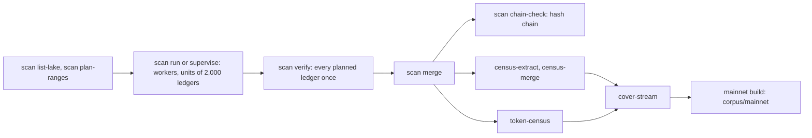

This page explains how every pubnet ledger from 2 to 65,505,999 was read, checked and reduced to shape tokens, and
how the mainnet tier was selected from the result.

The corpus holds rare shapes one entry at a time. The scan describes the other side: which shapes real pubnet
traffic contains, and how often each occurs, so an indexer operator can see what the indexer will meet. It read every pubnet
ledger from 2 to 65,505,999 from the public data lake, checked each one, and reduced every transaction to a set of
**shape tokens**. The aggregate output is committed in `evidence/mainnet-scan/` with a `SHA256SUMS` file. Every
number on this page is from that folder's `README.md` and files unless another source is named.

## What was read

| Item | Value |
|---|---|
| Source | the public SEP-54 data lake, `https://aws-public-blockchain.s3.us-east-2.amazonaws.com/v1.1/stellar/ledgers/pubnet`, read over HTTPS |
| Range | ledgers 2 to 65,505,999, fixed before the run; before the Protocol 30 upgrade, so header protocols 1 to 29 (pubnet has no Protocol 14 ledger) |
| Size | 65,505,998 ledgers, 10,869,626,939 transactions (`chain-summary.txt`) |
| Run | 2026-11-16, in 32,753 work units of at most 2,000 consecutive ledgers, shared by parallel workers |

By `LedgerCloseMeta` arm (`census-facts.tsv`, summed per arm):

| Arm | Ledgers | Transactions | Ledger range |
|---|---|---|---|
| v0 | 50,457,423 | 6,369,607,572 | 2 to 50,457,424 |
| v1 | 8,305,093 | 2,437,514,597 | 50,457,425 to 58,762,517 |
| v2 | 6,743,482 | 2,062,504,770 | 58,762,518 to 65,505,999 |

## How the scan ran



Every step is a subcommand of `xdrcheck-corpus scan`; the full command list is in `evidence/mainnet-scan/README.md`.
The whole-run steps stream unit by unit with bounded memory.

## What was checked on every ledger

`scan run` refuses a ledger, recording why, when any of these fails:

1. the zstd frame of the lake object;
2. the decode of the `LedgerCloseMetaBatch` and its byte-exact re-encode;
3. the walk of every byte against the pinned XDR definitions (stellar-xdr `v30.0`);
4. the header's stored hash against the SHA-256 of the `LedgerHeader`;
5. the join of every transaction result to an envelope, hashed under the pubnet passphrase.

It also records per ledger whether the header's `txSetHash` and `txSetResultHash` match the transaction set and
results the ledger carries, whether the object's metadata (`protocol-version`, `start-ledger`) matches the header,
and whether the object's MD5 equals its ETag. `scan chain-check` then reads every ledger in order and checks that each
header's `previousLedgerHash` equals the hash of the ledger before it, across unit boundaries.

| Check | Failures |
|---|---|
| Ledgers refused by any per-ledger check | 0 |
| Header hash chain: 65,505,997 links, 32,752 of them between units | 0 mismatches |
| Missing ledgers, gaps, duplicates or out-of-order ledgers | 0, 0, 0 |
| Transaction-set hash; result-set hash | 0; 0 |
| Lake object metadata against the header | 0 |
| Object MD5 against its ETag; objects without an ETag | 0; 0 |

The chain is open at its first end: ledger 2's previous hash names ledger 1, which is not in the run.

**What this proves.** The lake as served on 2026-11-16 holds every pubnet ledger in the range exactly once, each
one decodes and re-encodes byte for byte with rs-stellar-xdr against the v30.0 definitions, and the ledgers form one
unbroken hash chain whose transaction sets and results match their headers.

## The shape grammar `xcc.shape/v1`

Implemented in `crates/xdrcheck-corpus/src/cmd/scan/shape.rs`, rules in `crates/xdrcheck-corpus/data/scan-rules-v1.toml`.

**Components.** Each transaction is cut into parts: `E` the envelope without its operations, `A` its
authorization entries, `O` one operation with its result and its meta, `R` the result without the operation
results, `F` the fee processing, `M` the transaction meta frame. Each ledger adds one `L` component (header,
upgrades, transaction set structure).

**Tokens.** Each component is walked against the definitions into a set of tokens, each one string
`<kind>|<class>|<body>`:

| Kind | Records |
|---|---|
| `T` | a union arm, enum value or optional state anywhere |
| `A`, `O`, `E` | an arm, an optional state, an enum value at a field path |
| `L`, `V` | a length class (`0`, `1`, `2`, `3-4`, `5-16`, `17-100`, `>100`, `=max`); a value class (muxed ID band, zero, header version) |
| `S`, `K` | a summary of a recursive value (`SCVal`, authorization invocations, claim predicates): arm set and size classes; the first arm and arm set of a vector of unions |
| `X` | a contract event's signature |
| `D` | a ledger-entry change and which fields of the entry it changed |
| `R` | an operation-versus-effect relation, such as a `change_trust` that did or did not create a trustline |

Two examples:

```text
T|arm|Type::ARM
A|arm|env.….SIGNER_KEY_TYPE_ED25519_SIGNED_PAYLOAD
```

No token holds bytes taken from the ledger (keys, addresses, amounts, contract IDs), apart from two closed
vocabularies of event names and data-map keys.

**Levels.** A level is a filter on the same tokens: G0 keeps `T`; G1 adds `A O E`; G2 adds `L V S K X`; G3 adds
`D R`. A component shape is the hash of its sorted token set; a whole-transaction shape is the hash of its E, R, F,
M (and A) shapes, the set of its distinct O shapes with a repeat class, and an operation-count class. Operation
order is not part of it.

## What the census found

At G3 (`census-summary.tsv`, column `distinct`; `token-classes.tsv`; `cover-summary.tsv`):

| What | Distinct |
|---|---|
| Transaction-level component shapes (A 2,186 + E 18,544 + F 679 + M 11,964 + O 3,236,582 + R 97) | 3,270,052 |
| Ledger-level component shapes (L) | 33,705 |
| Whole-transaction shapes | 26,418,998, of which 18,066,711 occur in exactly one transaction |
| Tokens | 15,884; 15,186 of them occur in transaction-level components |

The first count measures the parts transactions are made of; the second counts distinct combinations of those parts.

## The mainnet tier: 6,158 transactions that hold every transaction-level token

`corpus/mainnet/` lists 6,158 pubnet transactions from 6,150 ledgers. Together they hold all 15,186
transaction-level tokens. Their bytes are not committed; each line locates one transaction in its lake object.

**How it was selected.** `scan cover-stream` computes a greedy cover: starting from the rarest token, take a
transaction that carries it, add every token that transaction holds, repeat until every token is held
(`cover-summary.tsv`, row `TOK rare`: 6,158 transactions in 6,150 ledgers). `xdrcheck-corpus mainnet build` then
walks every selected object again with the scan's own code and writes nothing unless each row's count of new tokens
and rarest occurrence equal the cover's.

**One line of `corpus/mainnet/tier.jsonl`:** `ledger`, `tx_index` (apply order), `tx_hash`, `protocol`,
`lcm_version`; the lake key, the object's sha256 and size; `blob_offset` of the `LedgerCloseMeta` in the
decompressed object; `parts` (envelope, result pair, meta, each fee change: XDR type, JSON path, byte offset,
length, sha256); `tokens` (the token IDs this line adds); `rarity` (an upper bound on how many transactions in the
range carry the rarest token; 1 means one transaction).

**What `make verify-mainnet` re-checks**, from the cache only (`make mainnet-fetch` fills it, about 1 GB):

1. each object's sha256 and size;
2. decompression, the batch split and the byte-exact re-encode of the ledger;
3. that the ledger starts at `blob_offset`;
4. each part's sha256, and its byte-for-byte round trip through rs-stellar-xdr as its XDR type;
5. that cutting the transaction again gives exactly the line's parts;
6. the transaction hash under the pubnet passphrase, the header protocol and the `LedgerCloseMeta` arm;
7. a fresh token walk of every ledger: each line's tokens are exactly those no earlier line holds, and the union
   is 15,186.

A fetch that receives other bytes than the line names keeps them as `<key>.drift` and fails.

**What it gives you.** 6,158 real transactions, about 1 GB of lake objects, that exercise every transaction-level
token pubnet produced in the range. Run them through your indexer with `xdrcheck replay --tx` or a service rig,
and every arm, optional state, length class, entry-change pattern and event signature mainnet has carried reaches
your code at least once.

## How the scan feeds the rest of the kit

| Output | Used for |
|---|---|
| `entry-prevalence.json` | per corpus entry, the mainnet occurrences of its rarest token. Of 326 walked entries, 117 hold a token pubnet never produced: those shapes exist only because a local stellar-core emitted them. Shown on each [CAP page](/caps/overview) |
| the mainnet tier | `make verify-mainnet` in the full CI; replays of real traffic |
| token census and locate index (not in the repository) | `xdrcheck find --token`, `--class`, `--tag`: the `(ledger, transaction)` pairs that hold a shape, for `xdrcheck data fetch` and `xdrcheck replay --tx` ([CLI](/reference/cli/xdrcheck-data#xdrcheck-find)) |
| `evidence/results/mainnet-coverage.json` | the curated corpus holds 2,422 of the 15,186 transaction-level tokens; the mainnet tier holds all 15,186 |

## What the scan does not claim

- **Pipelines were not replayed over all of mainnet.** The scan computes shapes, tokens and the checks above. It
  does not run wallet-backend, stellar-etl, Horizon or any SDK.
- **Shapes are those of the lake as served today.** The lake's older ledgers were rewritten by a recent
  stellar-core: 58,552,310 of the scanned ledgers carry the `core-version` metadata of stellar-core 23.0.1
  (`chain-groups.tsv`, column `core`). A meta arm that only older stellar-core versions wrote is absent from the
  census even where the network once produced it.
- **The tier covers tokens, not combinations.** It holds every token, not every whole-transaction shape, and not the
  698 tokens that occur only in the ledger-level component `L`.
- **No CAP tags on tokens.** A reliable map from XDR types to CAPs does not exist yet, so the tier does not claim one.
- **The per-ledger output is not in the repository.** It is tens of gigabytes. The token table, the covers and the
  locate index are kept outside it; the committed files are the aggregates, and the commands to rebuild them.

Related: [Mainnet scan results](/results/mainnet-scan), [CAP coverage](/caps/overview), [Replay](/architecture/replay).
