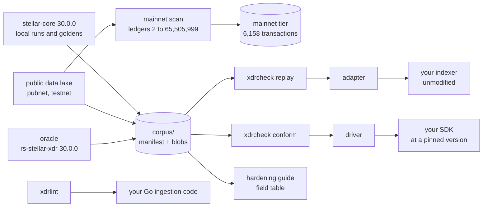

XDRCheck tests two kinds of Stellar software against the same set of ledger bytes: **SDKs and XDR libraries**
(js-stellar-sdk, go-stellar-sdk, rs-stellar-xdr, py-stellar-base) and **indexers** (wallet-backend, stellar-etl,
Horizon, and any third-party indexer). This tab explains how it works, step by step, so you can judge what a
passing or failing result means for your code.

## The problem in Stellar terms

A ledger reader meets three kinds of input that ordinary test fixtures rarely contain.

1. **Fields stellar-core passes through without checking.** stellar-core validates an envelope in stages
   (`TransactionFrame::commonValidPreSeqNum`, `commonValid`, each operation's `doCheckValid`), but not every field.
   `corpus/fields.yaml` lists 53 envelope and event fields: 35 validated, 14 partially validated, 4 passed through.
   The four passed through are the memo (any arm, any bytes), the `id` of a `KEY_TYPE_MUXED_ED25519`
   `MuxedAccount`, the `fee` of the inner transaction of a fee bump, and the `to_muxed_id` of CAP-67 classic events.
   A reader that stores a memo as SQL text, or treats a muxed ID as meaningful, trusts input nobody checked.
2. **Envelope versus meta.** The `TransactionEnvelope` states what the submitter asked for. The
   `TransactionMeta` (`LedgerEntryChanges` per operation, fee processing, contract events) states what happened.
   A failed transaction still lands in the ledger with its envelope. A `SorobanAuthorizationEntry` can name an
   address that authorized nothing: an unmatched entry is never authenticated and its nonce is not consumed
   (`corpus/fields.yaml`, VF-48). Participants and balances must come from the meta.
3. **Rare shapes.** Protocol-gated union arms and edge values: a `SIGNER_KEY_TYPE_ED25519_SIGNED_PAYLOAD` signer,
   `TransactionMeta` v2, v3 and v4 in one history, fee bumps whose inner transaction fails, `SCV_MAP` keys that
   collide after native conversion. Of the 326 corpus entries the mainnet scan could walk, 117 hold a shape token
   that never occurs in pubnet ledgers 2 to 65,505,999 (`evidence/mainnet-scan/entry-prevalence.json`, `totals`).
   A reader can run on mainnet for years before meeting one, then halt on it.

## Design decisions, and why they matter to you

| # | Decision | What it means for you |
|---|---|---|
| 1 | **Corpus bytes come from stellar-core or the network.** Each entry is a `LedgerCloseMeta` (or a smaller XDR value) emitted by stellar-core 30.0.0 on a local standalone node, imported from stellar-core's own `--check-lcm` goldens, or copied unmodified from the public SEP-54 data lake. Bytes built by hand are marked `synthetic: true` with the reason | A failure is a failure on bytes your reader can receive. The corpus is not a fuzzer |
| 2 | **Expected values never come from a reader under test.** They come from the bytes (rs-stellar-xdr 30.0.0, the oracle), from hand-written pinpoints, and from a reference extractor that reads `LedgerEntryChanges` and consensus events, never the envelope | Your SDK or indexer cannot pass by agreeing with itself or with another SDK. A driver or adapter never sees the expected values |
| 3 | **Your indexer runs unmodified, through an input it already reads.** The harness serves ledgers as a SEP-54 (Galexie) data lake on disk or behind an S3-compatible store, or as a mock stellar-rpc `getLedgers` | No test hook in your code. The same ledgers reach your indexer the way production ledgers do |
| 4 | **Verdicts are computed from what your indexer stored.** An adapter reads your database rows or exported files back and reports them as neutral observations. The harness decodes stored addresses itself and compares exact values. Log text is never parsed | A wrong row is caught even when your indexer logs nothing. A crash, a halt and a silent drop are told apart |
| 5 | **Known defects are declared data.** An entry names the target, the version range and the expected outcome of each known divergence. Inside the range the outcome must be observed; outside it the entry must pass | Your CI fails on a new divergence, and also when a declared defect stops reproducing. A fix is confirmed, not assumed |
| 6 | **Everything is pinned, and every check runs offline after one fetch.** `pins.toml` names every version and image digest; `make fetch` downloads them once; `OFFLINE=1` runs a check in a network namespace with only loopback | A run is reproducible. A check that needs the network fails instead of fetching silently |
| 7 | **One `make` target per check, and the same target in CI.** | You can run locally exactly what CI runs, and read its report |
| 8 | **Unknown input fails closed.** The oracle refuses a ledger above protocol 30 or a `LedgerCloseMeta` arm above v2; drivers report an unknown arm as `union_arm_undeclared` | A protocol upgrade shows up as a named failure, never as a silently skipped entry |

## How the parts fit together

Every arrow out of `corpus/` reads the same manifest (`corpus/manifest/<group>/<entry>.json`) and the same
content-addressed blobs (`corpus/blobs/<aa>/<sha256>.xdr`). No tool keeps a private list of cases.

## If you maintain an SDK or an XDR library

1. [The corpus](/architecture/corpus): where each entry's bytes come from, and how its expected values are
   established without your SDK.
2. [Conformance](/architecture/conformance): what one cell checks (decode, re-encode, identical bytes, values,
   strkeys), how a known divergence is declared, and when a run fails.
3. [CI](/architecture/ci): the loaders and the expected-failure list for your own CI.
4. [Protocol upgrades](/architecture/protocol-upgrades): how a new protocol's shapes reach your CI before the
   mainnet vote.

## If you run or write an indexer

1. [Replay](/architecture/replay): how ledgers reach your indexer, what the adapter does, and how a verdict is
   computed from the rows you stored.
2. [Mainnet scan](/architecture/mainnet-scan): what the scan of all pubnet history says about real traffic, and
   the 6,158-transaction tier that holds every transaction-level shape token.
3. [Linter and guide](/architecture/linter-and-guide): what `xdrlint` catches in Go code built on go-stellar-sdk,
   and what the hardening guide tells you to trust.
4. [CI](/architecture/ci): wiring replay and the linter into your pipeline.

[Stellar integration](/architecture/stellar-integration) lists every Stellar component the kit consumes, its pinned
version, and what the kit gives back.

## Limits stated up front

- **The guide has not been reviewed** by a stellar-core or platform engineer. All 462 claims in
  `guide/claims.yaml` are `reviewer_status: unreviewed`.
- **Golden agreement is of shape, and partial.** Of 138 local-core entries, 20 match a transaction in stellar-core's
  golden set; 118 do not (`corpus/mirrors.json`, `counts`).
- **Horizon is not pinned.** The Horizon rig builds whatever `--version` names; `pins.toml` has no Horizon entry.
- **Pipelines were not replayed over all of mainnet.** The scan computes shapes and integrity checks only.
