This page explains the whole kit in one place: each part, how the parts connect, and where the detail is.

XDRCheck is a test kit for software that reads the Stellar ledger. It tests two kinds of reader against the same
bytes: **SDKs and XDR libraries** (js-stellar-sdk, go-stellar-sdk, rs-stellar-xdr, py-stellar-base) and
**indexers**, the programs that read every closed ledger and store rows from it (wallet-backend, stellar-etl,
Horizon, or your own).

Four terms are used on every page of this tab:

| Term | Meaning |
|---|---|
| XDR | External Data Representation, the binary encoding Stellar uses for transactions, results and ledger data |
| `LedgerCloseMeta` | the XDR value stellar-core emits for each closed ledger: the header, the transaction set, and for each transaction its result and its meta (ledger-entry changes and events) |
| CAP | Core Advancement Proposal, a numbered change to the Stellar protocol. A CAP can add union arms, enum values or meta versions that a reader must handle |
| shape | one structural pattern in ledger data, for example a signer of type `SIGNER_KEY_TYPE_ED25519_SIGNED_PAYLOAD` (CAP-40) or a fee bump whose inner transaction fails |

## How the parts fit together

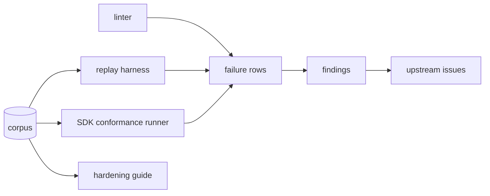

The **corpus** is a set of rare but valid ledger shapes, one entry per shape, each with the values a correct reader
must produce. Three tools use it or the rules behind it:

- The **replay harness** (`xdrcheck replay`) feeds corpus ledgers to an unmodified indexer and judges the rows it stored.
- The **conformance runner** (`xdrcheck conform`) puts every entry through every pinned SDK version.
- The **linter** (`xdrlint`) reads Go ingestion code and reports the patterns that cause the failures replay finds.

Every failing result is a row in a report. Each row is tied to a finding under `findings/`, and each finding to an
upstream issue or a ruling. The **hardening guide** states the rules for indexer authors, with a field table
generated from the corpus. The corpus holds 446 entries (`corpus/COVERAGE.md`). The public tree holds 92 findings: 48 filed upstream by this
kit, 34 already known upstream, 10 ruled not a defect (`evidence/results/findings.json`, `totals`).

## Corpus and generator

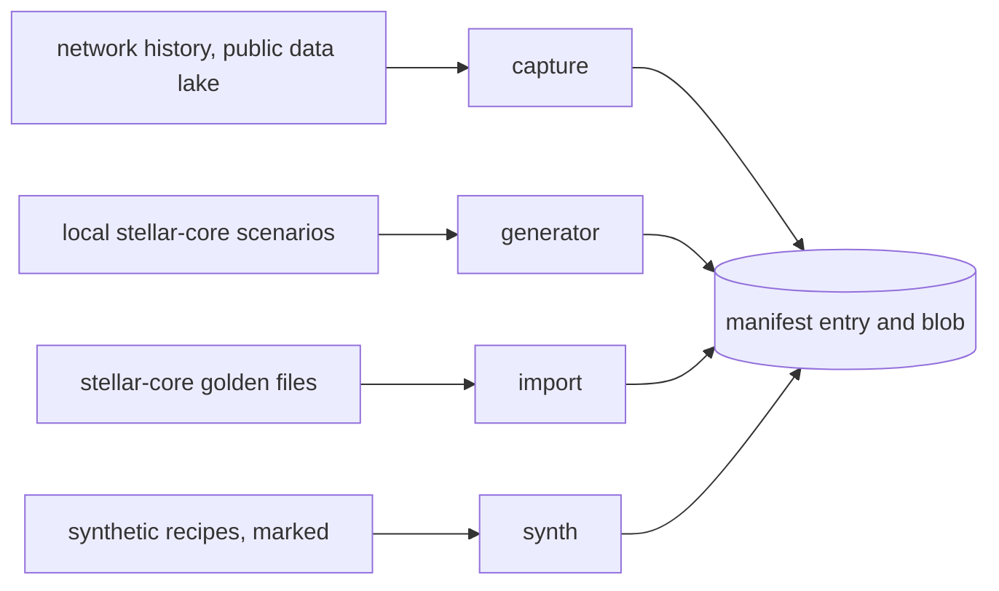

An entry's bytes come from one of these sources (`corpus/index.json`, field `sources`; an entry can have variants
from more than one):

| Source | Entries | What it is |
|---|---|---|
| `history` | 141 | one object copied unmodified from the public SEP-54 data lake (pubnet or testnet) |
| `local-core` | 138 | a scenario run on the pinned stellar-core 30.0.0 as a private standalone node |
| `core-golden` | 53 | one frame of a stellar-core `--check-lcm` golden file at tag v30.0.0 |
| `synthetic` | 33 | built from a recipe, with the reason stellar-core does not emit it; the entry carries `synthetic: true` |
| `contract-code`, `history-archive` | 3, 2 | a contract's Wasm read from the network; a record cut from a history-archive bucket file |

A **manifest entry** (`corpus/manifest/<group>/<entry>.json`) holds the entry's `id`, its `caps`, the protocol that
introduced the shape (`protocol.introduced`), one `source` per variant, the `synthetic` flag, and `expect`: the
decoded values and facts a correct reader must produce. The bytes are content-addressed files under `corpus/blobs/`.

**Generation is reproducible.** Every `local-core` scenario runs on both the testnet and the pubnet passphrase from
the same seed labels; 138 entries have such twins. `make verify-generate` regenerates the scenarios with the network
cut and requires equal header hashes, transaction hashes and results, and equal bytes after stellar-core's own
golden normalisation.

Details: [Corpus](/architecture/corpus), [Manifest format](/reference/manifest).

## Ground truth

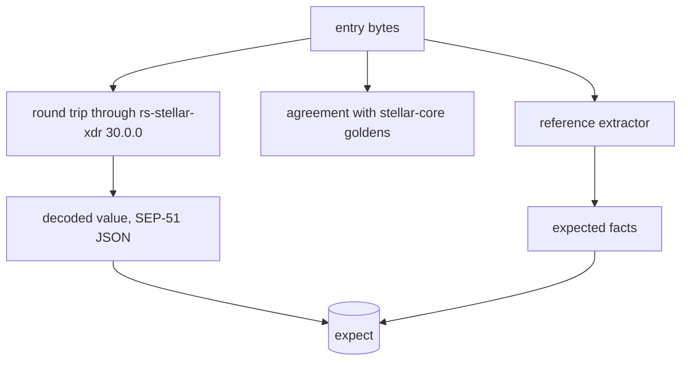

Expected values never come from a reader under test. `make verify-corpus` establishes them in three ways:

1. **Round trip.** Every positive entry decodes with explicit limits in rs-stellar-xdr 30.0.0 and re-encodes to the
   same bytes; every negative entry is refused for its declared reason. The decoded value is stored as SEP-51
   XDR-JSON.
2. **Golden agreement.** stellar-core checks its own `LedgerCloseMeta` goldens with `--check-lcm`. Imported golden
   entries must equal the named frame of the golden file byte for byte. A `local-core` entry is compared by shape
   with the golden transactions: 20 of 138 match one, 118 do not (`corpus/mirrors.json`, `counts`). The pinned
   stellar-core test binary re-checks the golden tree with `--check-lcm` in `make verify-goldens-nightly`.
3. **Reference extractor.** `xdrcheck-corpus extract` derives participants, state changes and movements from
   ledger-entry changes and consensus events, never from the envelope. Every fact in `expect` must be one it derives.

Details: [Corpus: expected values](/architecture/corpus#how-expected-values-are-established).

## Replay harness

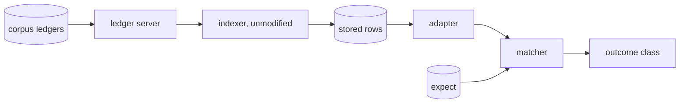

**Adapter interface.** An adapter is a small program that knows one indexer. It speaks `xcc.adapter/1`, one JSON
message per line on stdio, with five methods: `describe`, `prepare`, `ingest`, `observe`, `teardown`. It reports
what the indexer stored and never judges.

**Ledger delivery.** The repository supports three inputs. `xdrcheck` does not serve the layout over a GCS API; the
stellar-etl adapter runs its own GCS emulator over `sep54-dir`.

| Input | What the indexer reads |
|---|---|
| `sep54-dir` | a directory in the SEP-54 data-lake layout, one zstd `LedgerCloseMetaBatch` per ledger |
| `sep54-s3` | the same layout behind an S3 API (a pinned SeaweedFS image) |
| `rpc` | a mock stellar-rpc on loopback that answers `getHealth` and `getLedgers` |

**Outcome per entry.**

| Class | Sub-classes |
|---|---|
| `pass` | every expected fact matched, at least one of them positive |
| `mishandled` | `crash`, `hang`, `halt`, `wrong_value` |
| `dropped` | `silent`, `partial`, `refused` (a declared gate, confirmed by the manifest, nothing written) |
| no result about the indexer | `not_applicable`, `not_reached`, `harness_fault`, `flaky` |

**Rigs.** wallet-backend (the reference adapter, built at any commit against a fresh TimescaleDB), stellar-etl
(its export commands), and Horizon (its own `db reingest range` over a lake directory). On wallet-backend at
`f0c00cf5`, 319 entries run per input: 302 `pass`, 7 `mishandled`, 5 `dropped`, 5 not run
(`evidence/results/replay-summary.json`).

Details: [Replay](/architecture/replay), [Adapter protocol](/reference/adapter-protocol).

## SDK conformance

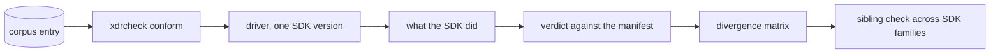

A **driver** wraps one SDK at one version and speaks `xcc.driver/1`. It never sees expected values. Each driver is a
**column** (`drivers/sets.toml`):

| Set | Columns |
|---|---|
| `required` | js-stellar-sdk 17.4.0, go-stellar-sdk v0.9.0, rs-stellar-xdr 30.0.0 under two decode profiles |
| `pr`, 16 columns | `required`, plus js-stellar-sdk 17.2.0, 17.2.1, 17.3.0; go-stellar-sdk v0.7.1, v0.7.2, v0.7.3, v0.8.0; rs-stellar-xdr 28.0.0 and 28.0.1 under both profiles; py-stellar-base 17.0.1 |
| `public`, 21 columns | `pr`, plus js-stellar-sdk 16.3.0, 16.3.1, 16.4.1; py-stellar-base 17.0.0; stellar-core 30.0.0 as a decoder |

- **Levels.** L0 decode and re-encode to identical bytes; L1 the SDK's transaction layer; L2 decoded values against
  the entry's pinpoints; L3 native conversion; L4 building or encoding through the SDK's API.
- **Divergence matrix.** The output is `entry × column × level`. A cell that differs from the manifest diverges
  from the network. An entry declares each known divergence with its target, version range and expected outcome; a
  run fails on an undeclared divergence and on a declared one that no longer shows.
- **Sibling check.** A defect found in one SDK is run on every other SDK family: 34 defect classes across 9
  families, 38 cells reproduce (`evidence/results/sibling-matrix.json`, `totals`).

Details: [Conformance](/architecture/conformance), [Driver protocol](/reference/driver-protocol).

## Linter

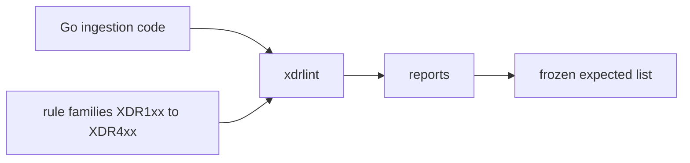

`xdrlint` analyses Go code built on go-stellar-sdk. Its first three rule families are the three ingestion mistakes:

| Family | Mistake |
|---|---|
| XDR1xx | trusting fields stellar-core never validated |
| XDR2xx | walking self-referential structures with no depth or size bound |
| XDR3xx | deriving participants from the envelope instead of the meta |
| XDR4xx | assumptions about the ledger's form, ranges and outcomes |

**Fixtures.** Every rule has seeded violations and compliant code under `lint/testdata/`; `make lint-fixtures`
requires each rule to report exactly the seeded violations.

**Current pipelines.** `make lint-wallet-backend` runs the linter on wallet-backend at `f0c00cf5` and compares the
result with a frozen list: 3 reports, each suppressed with a reason. `make lint-stellar-etl` does the same for
stellar-etl at `7e3fc9af`. `make lint-before-after` shows each rule reporting at the commit before a wallet-backend
fix and silent after it.

Details: [Linter and guide](/architecture/linter-and-guide), [xdrlint rules](/reference/lint-rules).

## Hardening guide

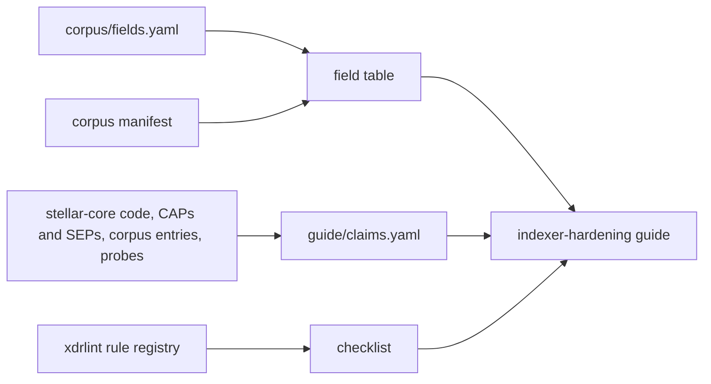

`guide/indexer-hardening.mdx` tells an indexer author what to trust in a ledger. It covers:

- **Validated versus unvalidated fields**: one row per field, with what stellar-core checks and what a reader may assume.
- **Depth and size caps** for recursive values.
- **Participants from meta**, not from the envelope.
- **Muxed and signed-payload addresses.** A muxed account is an ed25519 key plus a 64-bit ID; stellar-core uses
  only the key and accepts any ID. A signed-payload signer is an ed25519 key plus a payload of 1 to 64 bytes (CAP-40).
- **A checklist**, one item per linter rule, for indexers in any language.

**Each claim is tied to a source.** Every normative sentence carries a claim tag that resolves to a record in
`guide/claims.yaml`: 462 claims, each citing stellar-core code at a pinned commit, a CAP or SEP section, a corpus
entry or an executed probe. `make verify-guide` fails when the field table differs from the one generated from
`corpus/fields.yaml` and the manifest. The guide has not yet been reviewed by a stellar-core or platform engineer.

Details: [Linter and guide](/architecture/linter-and-guide#the-indexer-hardening-guide),
[Hardening guide](/hardening/overview), [Verification](/hardening/verification).

## Findings pipeline

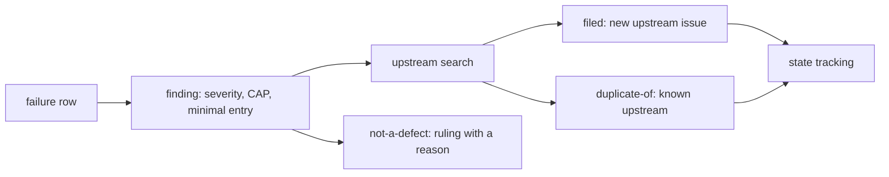

A failure row is one failing result in a tool's report. A finding (`findings/<id>/finding.json`) is one defect in
one project: its severity, its CAPs, the corpus entries that demonstrate it (the first is the minimal one), the
reproduction and the upstream state.

A finding ends in one of three states: `filed` (this kit opened the upstream issue), `duplicate-of` (the defect was
already reported or fixed upstream) or `not-a-defect` (a ruling with the reviewer's reason). The findings check
(`make verify-findings`) fails when a failure row has no finding or a finding has no row.

Details: [Findings pipeline](/architecture/findings), [Findings](/results/findings).

## Mainnet scan and the mainnet tier

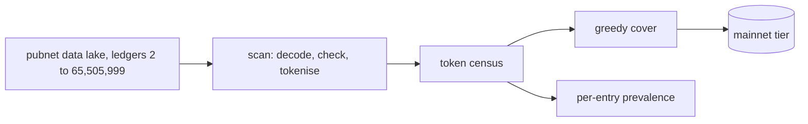

The scan read 65,505,998 pubnet ledgers (10,869,626,939 transactions), checked each ledger's decode, re-encode,
header hash and hash chain, and reduced every transaction to **shape tokens**: strings that record an arm, an
optional state, a length class or an entry-change pattern, without any ledger data.

The **mainnet tier** (`corpus/mainnet/`) lists 6,158 pubnet transactions that together hold all 15,186
transaction-level tokens. `make verify-mainnet` re-cuts and re-tokenises them from their lake objects. The curated
corpus holds 2,422 of those tokens (`evidence/results/mainnet-coverage.json`), and 117 of its 326 walked entries
hold a token pubnet never produced (`evidence/mainnet-scan/entry-prevalence.json`, `totals`).

Details: [Mainnet scan](/architecture/mainnet-scan), [Scan results](/results/mainnet-scan).

## CI tiers and offline runs

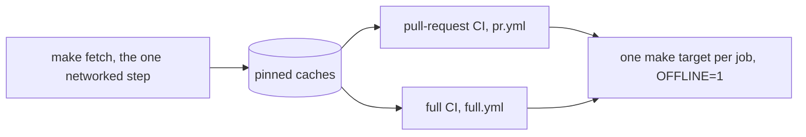

Every check is one `make` target, and CI runs that same target. `pins.toml` names every version; `make fetch`
downloads everything once, checked by hash; `OFFLINE=1` then runs a check in a network namespace with only loopback.

| Tier | Trigger | Scope |
|---|---|---|
| Pull-request CI (`pr.yml`, `make verify-pr`) | every pull request and branch push | static, corpus, generation, guide and coverage checks at full size; replay, conformance and linter in reduced form |
| Full CI (`full.yml`, `make verify-acceptance`) | by hand and on release tags | every check at full size, plus the whole corpus through wallet-backend, the `public` column set and the mainnet tier |

Details: [CI](/architecture/ci), [CI timings](/reference/ci-timings).

## Protocol 30, the next protocol and maintenance

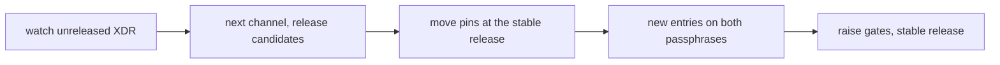

- **Protocol 30 coverage.** The three Protocol 30 CAPs that change what a reader sees each have entries
  (`corpus/COVERAGE.md`): CAP-84 muxed contract addresses (16), CAP-87 ML-DSA host functions (2), CAP-88
  millisecond-resolution close times (7).
- **Gates.** `pins.toml` sets `protocol.max_supported = 30`. The oracle refuses a ledger above it, and drivers
  report an unknown arm as `union_arm_undeclared`, so a new protocol shows up as a named failure.
- **Next-protocol channel.** A `-next` release (`31.0.0-rc.N`) carries the next protocol's shapes before the
  protocol ships; the stable channel leaves them out until `max_supported` is raised.
- **Maintenance.** `docs/maintenance.md` commits to one year from the production release, and in any case through
  the first protocol upgrade after it.

Details: [Protocol upgrades](/architecture/protocol-upgrades), [Maintain the kit](/guides/maintain-kit).

## Security model

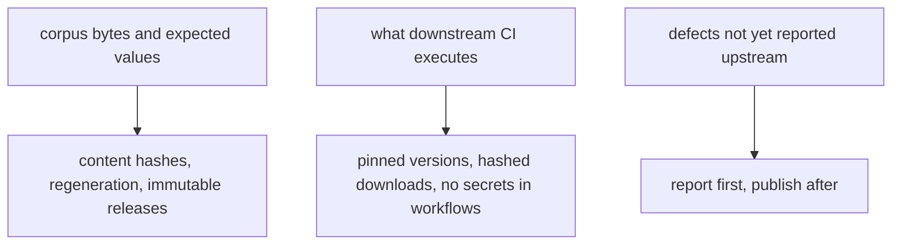

The kit is offline: command-line tools, data files and CI workflows, with no service and no user data. The threat
model lists each threat, its control and where it is implemented, and the risk that remains.

Details: [Threat model](/reference/threat-model), [Stellar integration](/architecture/stellar-integration).

## Limits stated up front

- **The guide has not been reviewed** by a stellar-core or platform engineer. All 462 claims in
  `guide/claims.yaml` are `reviewer_status: unreviewed`.
- **Golden agreement is of shape, and partial.** 20 of 138 `local-core` entries match a golden transaction.
- **Horizon is not pinned.** The Horizon rig builds whatever `--version` names; `pins.toml` has no Horizon entry.
- **Pipelines were not replayed over all of mainnet.** The scan computes shapes and integrity checks only.
