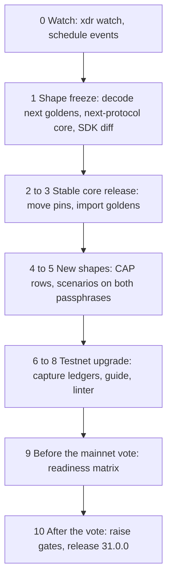

This page explains what the kit covers at Protocol 30, how it fails when a newer protocol appears, how it sees an
upgrade coming, and the procedure that turns a new protocol into corpus entries before the mainnet vote.

Each protocol upgrade adds union arms, enum values and meta versions that your SDK must decode and your indexer must
store correctly. Every command: [Maintenance and protocol upgrades](/guides/maintain-kit).

## Protocol 30 today

| Item | State (`pins.toml`) |
|---|---|
| Stack | stellar-core 30.0.0, XDR definitions `v30.0`, rs-stellar-xdr 30.0.0, soroban-env-host 30.0.0, stellar-rpc and Galexie v30.0.1, go-stellar-sdk v0.9.0, js-stellar-sdk 17.4.0, py-stellar-base 17.0.1 |
| Gate | `protocol.max_supported = 30`; `corpus.json` `max_protocol` 30 and `max_ledger_close_meta_version` 2 |
| Networks | Testnet upgraded to Protocol 30 at ledger 5540313; mainnet on Protocol 29 when pinned, with the mainnet vote on Protocol 30 recorded as a dated event for 2026-11-23 |
| Corpus version | `30.y.z`: the MAJOR is the highest protocol covered; the first release is `30.0.0` |

The Protocol 30 CAPs that change what a ledger reader sees each have a coverage row. Each row holds at least one
entry that the pinned stellar-core emitted at Protocol 30, with testnet and mainnet twins:

| CAP | What changes for a reader | Page |
|---|---|---|
| CAP-84 | Muxed contract addresses: an `SCAddress` arm older XDR does not have | [CAP-84](/caps/overview#cap-84) |
| CAP-87 | Host functions for ML-DSA signature verification: post-quantum keys and signatures reach ledgers only as large `SCV_BYTES` call arguments | [CAP-87](/caps/overview#cap-87) |
| CAP-88 | Millisecond-resolution close times: new `StellarValue` extension arms in the ledger header | [CAP-88](/caps/overview#cap-88) |

Variants that use these shapes declare it in `requires` (`sc_address_type_muxed_contract`,
`stellar_value_signed_ms`). Each conformance driver probes its SDK's generated XDR for the same features, so an SDK
released before Protocol 30 is excused from decoding them, and an SDK that claims Protocol 30 is not.

## Fail loudly, never silently

Every place where the kit encodes Protocol 30 fails when a new protocol arrives:

| Where | What happens |
|---|---|
| The oracle | Refuses a ledger above `max_protocol` or `max_ledger_close_meta_version` with a typed error naming the value found and the maximum |
| `crates/xdrcheck-meta` | Its matches over `TransactionMeta`, `LedgerEntryData` and `OperationBody` have no catch-all, so new arms in rs-stellar-xdr stop the build until each arm's facts are decided |
| Drivers | Report an arm their SDK does not know as `union_arm_undeclared` or `enum_undeclared`; an SDK whose XDR is newer than the driver's probes reports no protocol, so its refusals are judged, not excused |
| `xdrcheck pins check` | Names every constant still at the old protocol once `protocol.max_supported` is raised |
| `make release` | Refuses a release whose MAJOR is not `protocol.max_supported` |

The tools that read the live network (`xdrcheck-corpus capture`, `xdrcheck-corpus mine`) are the one exception: they
read a ledger above the gate with a warning, so an upgrade made with little notice does not stop them, and they never
make a corpus entry from it. A `LedgerCloseMeta` v3 has been drafted on a stellar-xdr branch but is in no
stellar-core release; the meta-version gate refuses it until it is reviewed.

## How the kit sees an upgrade coming

Measured over Protocols 22 to 30 (`docs/maintenance.md`, section 5.5):

| Signal | Lead before testnet | What the kit does |
|---|---|---|
| New feature-gated XDR (`#ifdef CAP_…`) on the stellar-xdr main branch | 6 to 14 weeks | `xdrcheck xdr watch` reports it under its CAP, with the arms it adds |
| stellar-core's next-protocol goldens (`test-lcm-next`) re-recorded | 4 to 7 weeks | The early-warning job decodes them in the pinned oracle and names the arms core's XDR has that the pins lack |
| stellar-core master building the next protocol | from the previous release | `vnext-core.yml` builds it (below) |
| XDR shape freeze: the `vNN.0` tag, rs-stellar-xdr within a day | 2 to 4 weeks | `xdrcheck pins latest` and Renovate see the tag and the crate |
| Stable stellar-core release | 1 to 30 days | Pin moves |
| Status-page maintenance and the SDF upgrade guide | 14 to 23 days | Recorded as `[[schedule]]` events in `pins.toml`; `xdrcheck pins check --network` warns about one that is missing |
| SDK releases | 0 to 4 weeks | The latest-SDK canary builds a throw-away column and diffs it |
| `current_protocol_version` on Horizon | 0 | The network-state job fails above `max_supported` |

Upgrades without XDR changes come with the least notice: about two days for Protocol 24, none for Protocol 29.

### Upgrade tooling

| Tool | What it does |
|---|---|
| `xdrcheck xdr diff <base> <head>` | A structural diff of two XDR definition sets: types, enum members, struct fields, union arms, constants. Each change carries its `#ifdef` gate, that gate's CAP, and the readers it reaches (`LedgerCloseMetaBatch` for indexers, `TransactionEnvelope` for SDKs) |
| `xdrcheck xdr watch` | Every source of unreleased XDR against the pins: main with every feature on, other branches and open pull requests, the XDR diffs inside CAP documents not yet implemented, and standing items such as `LedgerCloseMeta` v3 |
| `xdrcheck xdr candidates` | Candidate rows for `corpus/caps.toml`, `corpus/arms.toml` and `corpus/plan.json`, one per new arm, marked as candidates |
| `xdrcheck xdr ceilings` | Each driver's enum ceilings, generated into the driver's language from the pinned definitions (`make xdr-ceilings`) |
| `make vnext-core` (`vnext-core.yml`) | Builds stellar-core master with `--enable-next-protocol-version-unsafe-for-production` in a pinned build container, checks that the binary supports a protocol above `max_supported`, and keeps it by commit with a manifest (commit, flags, binary sha256, protocol). The generator can run scenarios on it to draft next-protocol entries before the release |
| `make nightly-early-warning` | Decodes `test-lcm-next` in the pinned oracle; prints counts only |
| `make nightly-canary` (`watch-canary.yml`) | For each SDK family, a canary column for the newest release, run against the curated corpus and diffed with the newest pinned column |
| `make watch-network` (`watch-drift.yml`) | Mainnet and testnet protocol versions from Horizon, the status page's scheduled maintenance, testnet resets |

All of these run by hand. None has a schedule and none gates a pull request.

## The next upgrade, step by step: Protocol 30 to 31

Each step has an output that can be inspected.

| Step | When | Action | Output |
|---|---|---|---|
| 0 | Continuously | Run the XDR watch; record each announced vote or reset as a `[[schedule]]` event | A watch-log entry per change; the dated events `xdrcheck pins check` enforces |
| 1 | XDR shape freeze | Decode `test-lcm-next` through the oracle; run the generator on the next-protocol stellar-core; run the conformance matrix with SDK releases built from the new XDR and compare it with the pinned one (`xdrcheck conform diff`) | A list of new union arms and decode failures; a first readiness matrix |
| 2 | Stable stellar-core release | Move the pins: stellar-core, the XDR definitions, rs-stellar-xdr, then each SDK as it releases; one pull request per pin move with its differential report | `pins.toml` updated; `xdrcheck pins check` green |
| 3 | Same | Import the new golden set by test name; review every golden whose structural skeleton changed | Updated golden entries and a skeleton diff |
| 4 | Same | Read each new CAP's XDR diff at the tag and list the new shapes | New rows in `corpus/caps.toml` and `corpus/plan.json` |
| 5 | Same | Write scenarios for the new shapes and run them at the new protocol on both passphrases | New `local-core` entries with twins; `make verify-generate` |
| 6 | Testnet upgrade | Capture the upgrade ledger and the first ledger after it from the public lake | New `history` entries, marked perishable |
| 7 | Same | Update `corpus/fields.yaml` for any field whose validation changed; regenerate the guide's table; re-verify changed claims at the new tag | `make verify-guide` |
| 8 | Same | Teach the linter the new types; extend the wallet-backend profile | `make verify-lint` |
| 9 | Before the mainnet vote | Run the full conformance matrix and the harness against the pipelines' new versions; publish the readiness matrix (`xdrcheck conform readiness --protocol 31`) | Which SDK versions and pipeline commits read the new protocol |
| 10 | After the vote | Raise the gates; release corpus `31.0.0`; status update | Release |

Rules that hold throughout: released entries are never edited; entries at older protocols stay and keep being
verified; an expectation whose meaning changes at the new protocol becomes a new entry with its protocol range.

**Number-only upgrades.** When `xdrcheck xdr diff <old tag> <new tag>` is empty (as for Protocols 24 and 29), the
upgrade takes a day: move stellar-core, raise the gates and the constants `xdrcheck pins check` names, regenerate,
capture the upgrade ledger on both networks, run the corpus and conformance checks, and release.

**Dated events already recorded.** The mainnet vote on Protocol 30 (2026-11-23) and the next testnet reset
(2026-12-16) are `[[schedule]]` events in `pins.toml`. From 14 days before each, `xdrcheck pins check` warns; after
the day it fails until the pin has moved. Testnet `history` entries are vendored with their epoch, so the corpus
stays complete after the reset.

## What an SDK gets at each upgrade

Before the protocol ships, a `-next` release (`N.0.0-rc.K`) carries the new shapes; after it, the stable `N.0.0`. Your
SDK's CI runs the release with a loader and your committed expected-failure list: every Protocol N entry your SDK
cannot read shows as a new failure until your update lands, and a listed entry that starts to pass fails the run
until you remove its line. An unreleased branch can be tested with `--sdk <checkout>`. Text for a per-SDK protocol
compatibility issue: [Protocol upgrades for SDKs](/guides/protocol-upgrade-sdk).

## What an indexer gets at each upgrade

The upgrade ledger and the first ledgers after it are captured from the public lake on testnet as soon as testnet
upgrades (step 6), and local-core entries at the new protocol exist from step 5. Replay them through your indexer
before the mainnet vote. An indexer whose pinned go-stellar-sdk cannot decode the new protocol declares that in its
adapter's envelope (`sdk_limit`), so the gap is reported as `not_applicable` per entry, not hidden. The readiness
matrix (step 9) lists which pipeline commits read the new protocol.

## Maintenance

| Item | Commitment (`docs/maintenance.md`, section 2) |
|---|---|
| Maintainer | Tolga Yaycı ([@tolgayayci](https://github.com/tolgayayci)) |
| Duration | 1 year from the production release, and in any case through the first protocol upgrade after it |
| Response | a new issue acknowledged within 5 working days; a corpus correction released within 10 working days of being confirmed; security reports as `SECURITY.md` says |
| Upgrades | a new protocol's XDR changes triaged between the shape freeze and the testnet upgrade; a protocol-upgrade release before the mainnet vote; best effort for an upgrade announced with less than two weeks' notice |
| After the period | the repository stays public under Apache-2.0; the corpus is plain files and both protocols are specified, so another maintainer can take it over |
