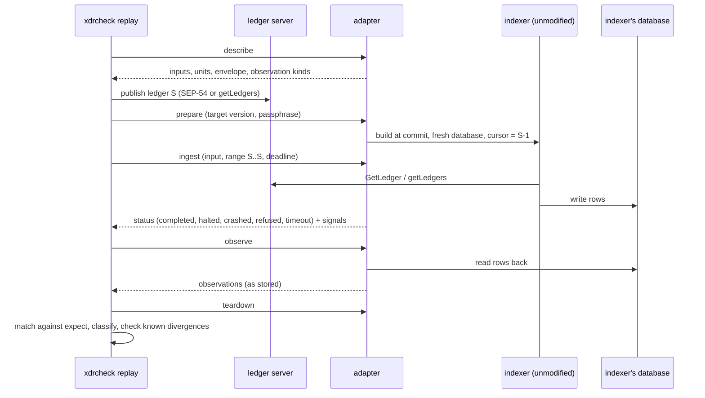

This page explains how the replay harness delivers corpus ledgers to an unmodified indexer and computes each
entry's verdict from the rows the indexer stored.

`xdrcheck replay` feeds corpus ledgers to your indexer through an input it already reads, waits for it to ingest
them, reads back what it stored, and compares that with the entry's `expect`. Your indexer is not modified and needs
no test hook. The specification is [Replay harness](/reference/replay-harness) and
[Adapter protocol](/reference/adapter-protocol); this page explains the mechanism.

## One entry, from ledger server to verdict

## Step 1: the ledger server

The server is a view over the corpus blobs. It never re-encodes a ledger.

| Input | What your indexer reads | Detail |
|---|---|---|
| `sep54-dir` | a directory in the SEP-54 (Galexie) layout | a root `.config.json` (the passphrase, `ledgersPerBatch: 1`, `batchesPerPartition: 64000`) and one zstd `LedgerCloseMetaBatch` per ledger at the key go-stellar-sdk's `support/datastore` derives, for example `FFBC9DFF--4416000-4479999/FFBC4A92--4437357.xdr.zst`. The batch is `uint32 S ‖ uint32 S ‖ uint32 1 ‖ <blob>`, written by concatenation. A captured ledger is served as the original lake object |
| `sep54-s3` | the same layout behind an S3 API | SeaweedFS from the image digest in `pins.toml` (the emulator wallet-backend's own tests use), with a logging reverse proxy in front. Ports on loopback only |
| `rpc` | a mock stellar-rpc on loopback | JSON-RPC 2.0, `getHealth` and `getLedgers` with stellar-rpc v30.0.1 wire types; `metadataXdr` is the blob verbatim. Limit default 50, maximum 200; −32600 and −32602 errors with the real server's text. Always healthy; `xdrFormat: "json"` not served |

The S3 proxy and the mock RPC log every request. That log is the **delivery evidence**: it tells an indexer that
hung on a ledger from a ledger that never reached it. GCS is not served yet; the stellar-etl adapter runs its own GCS
emulator over `sep54-dir`.

**Units.** `single` serves one ledger at its real sequence (the default). `chain` serves a whole local-core scenario
from ledger 2 on one passphrase, a real hash chain, for indexers that need earlier state. `stream` renumbers ledgers
into one consecutive run (header `ledgerSeq` and matching `lastModifiedLedgerSeq` rewritten, as go-stellar-sdk's
`ingest/loadtest` does); stream bytes are transformed, so stream results are used for load and memory tests only.

**Passphrases.** One pass per network passphrase, because readers verify transaction hashes against it.

## Step 2: the adapter

An adapter is a small program that knows one indexer. It speaks `xcc.adapter/1`: one JSON request per line on
stdin, one response per line on stdout, stderr captured and never parsed. Five methods per session:

| Method | The adapter |
|---|---|
| `describe` | declares the inputs the indexer reads, the units it can run, the observation kinds it models, and its **envelope**: the protocols and meta versions it claims, and whether a limit is the indexer's own gate (`indexer_gate`) or what its pinned SDK can decode (`sdk_limit`) |
| `prepare` | builds the indexer at the version under test (cached) and gives it a clean state |
| `ingest` | points the indexer at the input, waits until its own progress cursor reaches the range end or it stops, and returns a status with the facts behind it (`cursor_before`, `cursor_after`, exit code, signal, `failing_ledger`, `rows_for_failing_ledger`) |
| `observe` | reads back what the indexer stored, as an observation set (`xcc.observation/v1`) |
| `teardown` | removes the session's state |

**Observation rules that make verdicts trustworthy.**

- Every address-bearing value carries `as_stored`: the literal bytes or text the indexer keeps, with its encoding
  (`strkey_text`, `version_byte_payload_hex`, `xdr_hex`, `raw_key_hex`). The adapter never computes a base account
  from a muxed one or re-derives a strkey. The harness decodes stored values itself with a strict strkey decoder.
- Amounts and 64-bit IDs are decimal strings. A float or fractional value goes literally into `amount_as_stored`.
- One stored record is one fact. The adapter never merges, splits or fills in records.
- A status never rests on log text. `refused` is accepted only if the gate was declared in `describe`, the manifest
  confirms the entry is outside it, nothing was written for the ledger, and the process did not crash.

## Step 3: matching

The matcher compares the observations with the entry's `expect` (`docs/manifest.md` section 6):

- Exact comparison: amounts, IDs and counts as decimal strings or integers. No tolerance, rounding or prefix match.
- Participants match by base address. A `base_only` indexer's muxed ID is not compared; a `base_and_alias` indexer
  must report the expected one. Identity held only in muxed form is a wrong value.
- Negative facts (`must_not_include`, a movement with `count: 0`) are checked only when the transaction itself was
  observed. A result made of negative facts alone is never a pass.
- A fact the indexer's declared scope excludes (each exclusion citing the indexer's own source or documentation as
  `basis`) is `not_applicable` with that reason.

Each expected fact ends `matched`, `missing`, `wrong` or `not_applicable`.

## Step 4: classification

The first matching row decides (`docs/replay-harness.md` section 7):

| # | Condition | Result |
|---|---|---|
| 0 | Adapter error, protocol violation, or proof the ledger was never served | `harness_fault` |
| 1 | Planned out of scope (outside an `sdk_limit` envelope) | `not_applicable` |
| 2 | Crashed at or before this ledger (signal, runtime fault, memory kill) | `mishandled · crash` |
| 3 | Timed out with progress stopped at this ledger | `mishandled · hang` |
| 4 | Refused at a declared gate, confirmed by the manifest, nothing written | `dropped · refused` |
| 5 | Refused failing any condition of row 4, or halted at this ledger | `mishandled · halt` |
| 6 | Stopped at an earlier ledger of the unit | `not_reached` |
| 7 | Got past the ledger, but the ledger or focus transaction is absent, or a receipt counter is lower, with no error | `dropped · silent` |
| 8 | A fact wrong, a forbidden fact, an extra under an exactness flag, or a receipt counter higher | `mishandled · wrong_value` |
| 9 | A fact missing | `dropped · partial` |
| 10 | Every fact matched or not applicable, at least one positive fact matched | `pass` |

`--confirm K` re-runs a non-pass unit K times; a result that changes is `flaky`. Every unit gets a fresh session,
a fresh ledger view and its own delivery evidence. The adapter's process group runs under `--memory-max` and
`--pids-max` (a cgroup v2 scope where available).

## Step 5: known divergences

An entry may declare that a target diverges in a version range (`conformance.known_divergences`, level `replay`).
For a run against target T at version V:

1. Inside a declared range, the result must be the declared class and qualifier. A pass there is unexpected: the
   corpus no longer reproduces the defect.
2. Outside every range, the result must be `pass`.
3. For repositories without tags, the adapter resolves commit ranges (`A..B` on B's first-parent history) in
   `prepare.resolve_ranges`.

`xdrcheck replay --assert-known` runs only the entries with a divergence for T. Exit 0: every result is the expected
one; 1: at least one unexpected result; 2: the harness could not run.

## wallet-backend: the reference adapter

`go/adapters/walletbackend`, pinned in `pins.toml` `[pipelines.wallet_backend]`.

1. **Build.** `prepare` clones wallet-backend, checks out the commit under test and builds it with Go 1.25.9. The
   binary is cached per commit.
2. **Database.** One TimescaleDB server per adapter process, from `timescale/timescaledb:2.28.2-pg17` by digest.
   The container runs with `--network none`; wallet-backend and the adapter reach it through a Unix socket in a
   directory the adapter bind-mounts, so the same set-up works inside the offline wrapper. The data directory is a
   tmpfs. Each session gets a fresh database; TimescaleDB's telemetry job is switched off.
3. **Input.** `sep54-s3` (wallet-backend reads S3) or `rpc`. The ingest cursor is seeded to `S − 1`.
4. **Observe.** SQL against the session's database, every query returning one JSON value. Rows map to
   participants, transactions, state changes and stored addresses.
5. **Envelope.** `sdk_limit`, from the go-stellar-sdk version in the commit's `go.mod`. Commits before `a9bac8d2`
   decode at most Protocol 29 (`pins.toml`, `max_decodable_protocol_before_a9bac8d2`), so their Protocol 30 variants
   are `not_applicable`, not failures.

**The three regression pairs** (`make verify-replay`, both inputs; the pull-request CI runs the `rpc` input):

| Issue | Pre-fix commit | Result | Fixed commit | Result |
|---|---|---|---|---|
| wallet-backend#729 | `2a0a84ea` | `mishandled · halt`, 2 entries | `2c873353` | `pass` |
| wallet-backend#731 | `764a4f5b` | `dropped`, 1 entry | `c152783c` | `pass` |
| wallet-backend#716 | `79ea2acd` | `mishandled · wrong_value`, 3 entries | `bb0b162b` | `pass` |

Commits: `pins.toml` `[pipelines.wallet_backend]`; results: `evidence/results/replay-summary.json`, identical on `rpc` and
`sep54-s3`. The entries are found from the manifest's declared divergences, not listed in the script. The script
also asserts row by row: every variant the commit can decode has a scored row; pre-fix rows are exactly the declared
class; fixed and current rows pass; nothing is left behind.

**The whole corpus on current wallet-backend** (`make replay-full`, commit `f0c00cf5`): 319 entries per input, 302
`pass`, 7 `mishandled`, 5 `dropped`, 5 not run, the same on `rpc` and `sep54-s3`
(`evidence/results/replay-summary.json`). Per-entry rows: [Replay results](/results/replay).

## stellar-etl

`go/adapters/stellaretl`, v2.8.35 at `7e3fc9af`, built with Go 1.27.3 and `CGO_ENABLED=1` (stellar-etl links
go-stellar-xdr-json). stellar-etl reads only from a GCS datastore, so the adapter serves the `sep54-dir` layout
through fake-gcs-server v1.49.2 (the emulator go-stellar-sdk's datastore tests use) on loopback, and runs every
export: `export_ledgers`, `export_transactions`, `export_operations`, `export_effects`, `export_token_transfer`,
`export_contract_events`, `export_trades`, `export_ledger_entry_changes`, `export_assets`,
`export_ledger_transaction`. It reads the JSON Lines back as observations. `make replay-etl-known` runs the entries
that declare a stellar-etl divergence. Details: [stellar-etl adapter](/reference/replay-harness#stellar-etl-adapter).

## Real ledgers: service rigs and the judge

A corpus entry carries hand-checked `expect`. A real mainnet ledger does not. For those, the expected facts come from
`xdrcheck-judge` (`crates/xdrcheck-judge`), which reads the `LedgerCloseMeta` with rs-stellar-xdr and computes what
every transaction did from the ledger's own entry changes, without go-stellar-sdk or any indexer's code:

- balances from accounts, trustlines, claimable balances, liquidity-pool reserves and Stellar Asset Contract
  `[Balance, address]` entries, split into fee, operation and refund parts, all in i128 (overflow is `unknown`,
  never a wrap);
- a contract counts as a SAC only if its ID equals the asset's contract ID under the passphrase; a contract that
  names itself "USDC" does not;
- an update with no prior state in the ledger is `unknown`, never assumed zero.

`xdrcheck replay --rig wallet-backend|stellar-etl --ledgers A-B --lake DIR --commit SHA` runs the real pipeline over
lake-layout ledgers and exports its rows; `xdrcheck-judge verdict --facts --rows` compares them. Verdicts per
transaction: `ok`, `missing`, `extra`, `wrong_value`, `duplicate`, `unknown`, `out_of_scope`; per ledger `skip` and
`halt`. Each carries a stable class such as `balance_change:wrong_value:int64_wrap`. The judge's own test plants one
bug per run in a toy indexer's rows (dropped row, off-by-one amount, int64 wrap, credit on a failed transaction,
credit from a non-SAC event, skipped ledger, and more) and requires each to be flagged at its place.

**Horizon** (`go/adapters/horizon`) builds an unmodified stellar-horizon as a static binary and runs its own
`db reingest range` with the datastore ledger backend over a lake directory: no captive core, no history archive, no
network. It dumps the history tables and maps them to the judge's rows. Details: [Horizon rig](/reference/replay-harness#horizon-rig).

## How the harness tests itself

| Check | What it shows |
|---|---|
| `make harness-selftest` | the baseline indexer (a correct reader on go-stellar-sdk) passes the corpus; with one seeded bug at a time (`baseline --bug NAME`) it lands in the class its row of `go/adapters/baseline/bugs/table.json` names. Together the bugs reach every class: truncated addresses, participants from the authorization tree, credit from a forged token event and float amounts (`wrong_value`), a silently dropped ledger (`silent`), a dropped trustline (`partial`), a panic (`crash`), an endless loop (`hang`), dirty refusals (`halt`), a real protocol gate (`refused`) |
| `make verify-memory` | four tests in a 256 MiB group with swap off: harness memory flat in corpus size (peak growth under 16 MiB from one to ten repetitions of the sampled bulk tier); a 512 MiB adapter line refused at the 64 MiB line cap; a memory-hogging indexer caught as `crash`; the deepest and largest ledgers served and matched under the limit. A negative control with streaming off must fail |

## Your indexer

1. Write an adapter: start from `go/adapters/minimal` (Go) or `examples/adapter-ts` (TypeScript), or copy
   `go/adapters/baseline` for every observation kind.
2. Run `xdrcheck replay --corpus corpus --adapter <cmd> --target-version <commit> --report reports/x`.
3. Read `reports/x/REPORT.md`: every failing row with the entry, its CAPs, expected against observed, and the
   command that replays that entry alone.

Guides: [Replay the corpus through your indexer](/start/for-indexers),
[Minimal adapter](/guides/go-indexer), [Replaying real ledgers in CI](/guides/ci#replay-real-ledgers-in-ci).

## Limits

- Stream-unit results never count as evidence; a failure seen in a stream must be reproduced as a single or chain.
- `sep54-dir` reads are not logged, so delivery evidence exists only for `sep54-s3` and `rpc`.
- The wallet-backend rig answers `simulateTransaction` only for a zero-argument contract call recorded in the run's
  ledgers; token metadata read by simulation keeps wallet-backend's defaults otherwise.
- Horizon is not pinned in `pins.toml`; a Horizon run names its version on the command line.
