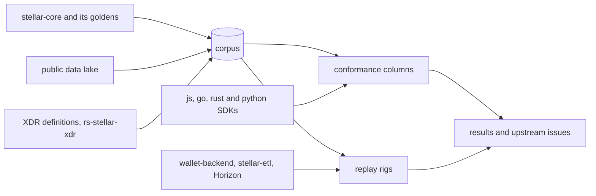

This page lists every Stellar component XDRCheck builds on or tests, with its pinned version, what the kit consumes
from it and what it gives back.

Every version below is from `pins.toml`. `xdrcheck pins check` fails when a version is named anywhere else or a
constant in the code differs from it.

## Reference table

| Component | Pinned | Consumed | Given back | Repository | Page |
|---|---|---|---|---|---|
| stellar-core | 30.0.0, commit `0e49751a`; `.deb` and binary by sha256; release and `buildtests` images by digest | the release binary as a standalone node; `print-xdr`/`dump-xdr` as a decoder column; the test binary for `--check-lcm` | corpus entries emitted at Protocol 30 on both passphrases; a check that the goldens still pass | `crates/xdrcheck-gen`, `drivers/core` | [Corpus](/architecture/corpus) |
| stellar-core goldens | `test-lcm-current` at v30.0.0; `test-lcm-next` at `master`, unpinned | 53 imported entries; the golden mirror; the bulk decoder tier | shape agreement of local entries with core's own tests (`corpus/mirrors.json`) | `corpus/bulk/`, `corpus/mirrors.json` | [Corpus](/architecture/corpus#agreement-with-stellar-core’s-goldens) |
| XDR definitions (stellar-xdr) | tag `v30.0`, commit `4f524bba` | the type system of the scan, the corpus and `xdrcheck xdr diff` | structural diffs per `#ifdef` gate and CAP at each upgrade | `crates/xdrcheck-corpus/data/` | [Protocol upgrades](/architecture/protocol-upgrades) |
| rs-stellar-xdr | crate 30.0.0 (commit `3c2aa43d`); stellar-strkey 1.0.0 | the oracle: decode with explicit limits, re-encode, SEP-51 JSON | Rust conformance columns (28.0.0, 28.0.1, 30.0.0, two decode profiles); XDR-JSON columns | `crates/xdrcheck-xdr`, `drivers/rust`, `drivers/rs-xdr-json` | [Conformance](/architecture/conformance) |
| Public data lake | `s3://aws-public-blockchain/v1.1/stellar/ledgers`, `pubnet` and `testnet/2025-12-18` | `history` entries; the scan of ledgers 2 to 65,505,999; the mainnet tier | an integrity check of the pubnet range (hash chain, set hashes, MD5); the token census | `corpus/objects/`, `corpus/mainnet/`, `evidence/mainnet-scan/` | [Mainnet scan](/architecture/mainnet-scan) |
| SEP-54 layout (Galexie) | Galexie v30.0.1 as layout reference | the layout go-stellar-sdk's `support/datastore` reads | `xdrcheck serve`: any ledger set as a lake on disk or behind S3 | `go/internal/` | [Replay](/architecture/replay) |
| stellar-rpc `getLedgers` | v30.0.1 wire types | `protocols/rpc` structs | a mock `getLedgers` for indexers that read RPC | `go/internal/` | [Replay](/architecture/replay) |
| SEP-23 strkeys | published vectors v1.4.0 | `strkey` entries | added vectors (hash-x, pre-auth, muxed IDs at 2^53+1, 2^63−1, 2^64−1); a strict decoder for stored addresses | `corpus/manifest/strkey/` | [Conformance](/architecture/conformance) |
| SEP-51 XDR-JSON | as rs-stellar-xdr 30.0.0 writes it | the decoded value of every entry | JSON Pointers into it as pinpoints | `corpus/decoded/` | [Corpus](/architecture/corpus) |
| wallet-backend | current `f0c00cf5`; pairs `2a0a84ea`/`2c873353`, `764a4f5b`/`c152783c`, `79ea2acd`/`bb0b162b`; Go 1.25.9; TimescaleDB 2.28.2-pg17 by digest | its own ingestion, unmodified, through S3 or RPC | the whole corpus replayed at each commit; a linter run frozen per commit | `go/adapters/walletbackend` | [Replay](/architecture/replay) |
| stellar-etl | v2.8.35, commit `7e3fc9af`; Go 1.27.3 | its `export_*` commands through a GCS emulator (fake-gcs-server v1.49.2) | replay of its declared divergences; a linter run | `go/adapters/stellaretl` | [Replay](/architecture/replay#stellar-etl) |
| Horizon | **not pinned**; `--version` per run | `db reingest range` with the datastore backend | its history tables judged against ledger facts | `go/adapters/horizon` | [Replay](/architecture/replay#real-ledgers-service-rigs-and-the-judge) |
| go-stellar-sdk | v0.9.0 (commit `5410d341`); columns v0.7.1 to v0.9.0 | conformance columns; the ingest stack the linter analyses; the baseline indexer | per-version conformance results; `xdrlint` rules | `drivers/go`, `lint/`, `go/adapters/baseline` | [Conformance](/architecture/conformance), [Linter](/architecture/linter-and-guide) |
| js-stellar-sdk | 17.4.0; columns 16.3.0 to 17.4.0 | conformance columns | per-version results; the #1766, #1785, #1789 regressions | `drivers/js`, `drivers/js16` | [Conformance](/architecture/conformance) |
| py-stellar-base | 17.0.1; columns 17.0.0, 17.0.1 | conformance columns | per-version results | `drivers/python` | [Conformance](/architecture/conformance) |
| Soroban | soroban-env-host 30.0.0 (29.0.2 for Protocol 29); soroban-sdk 29.0.1 | offline simulation in the generator; test contracts | contract entries built reproducibly from `contracts/` | `crates/xdrcheck-gen`, `contracts/` | [Corpus](/architecture/corpus) |
| stellar-docs | commit `48259204` | its MDX format and link checks | the indexer-hardening guide | `guide/` | [Linter and guide](/architecture/linter-and-guide) |

## Notes per component

**stellar-core as a generator.** The generator runs the pinned release binary with `RUN_STANDALONE=true`,
`MANUAL_CLOSE=true`, no peers, and `METADATA_OUTPUT_STREAM` to a file; it submits with `tx?blob=`, arms upgrades
with `upgrades`, closes with `manualclose`, and reads `LedgerCloseMeta` records from the stream. No change to
stellar-core is needed.

**stellar-core as a decoder.** The `core@30.0.0` column shows how core decodes bytes (L0 only), not what core admits
to the network. Negative entries record what core does with the input in `core_behaviour`.

**XDR versions in the corpus.** `LedgerCloseMeta` v0, v1, v2; `TransactionMeta` v2, v3, v4. Each ledger variant
records both versions, the meta flags that change what is emitted (`EMIT_CLASSIC_EVENTS`,
`BACKFILL_STELLAR_ASSET_EVENTS`, `ENABLE_SOROBAN_DIAGNOSTIC_EVENTS`, the Soroban meta extension) and a profile:
`lake`, `golden-test` (one named core test's flags) or `custom`.

**Passphrases.**

| `network` | Passphrase | Bytes from |
|---|---|---|
| `pubnet` | `Public Global Stellar Network ; September 2015` | lake captures; local-core runs on the mainnet passphrase |
| `testnet` | `Test SDF Network ; September 2015` | lake captures; local-core runs on the testnet passphrase |
| `core-test` | `(V) (;,,;) (V)` | stellar-core's goldens |
| `none` | empty | passphrase-independent values such as a bare `ScVal` |

`network` names the passphrase, not the origin: a local standalone chain on the mainnet passphrase is `pubnet` with
`source.kind: local-core`.

**Testnet resets.** Testnet `history` objects are vendored with their epoch and marked perishable;
`xdrcheck-corpus refetch` checks every vendored object against the lake. The next reset (2026-12-16) is a dated
event in `pins.toml`.

**Defects found.** Divergences the runs find in these components are reported to the project that owns them, and
declared on the corpus entry that shows them, so the next run checks the fix. Lists: [Results](/results/overview).
