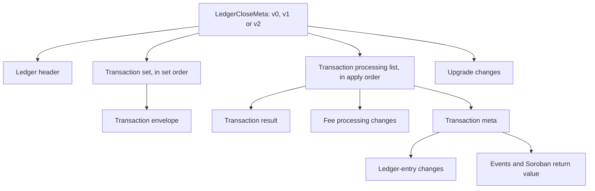

For anyone who reads Stellar ledger data: an indexer author, an SDK maintainer, an operator. After this page you
know what the bytes of one ledger hold, which versions of each structure exist, and which corpus entry shows each
one.

Every entry named on this page opens the same way (after `make build`, with `bin/` on your `PATH`; see
[Quickstart](/quickstart)):

```sh
xdrcheck entry cap-0034/tx-too-late-with-fee-charged                    # tags, variants, expected values
xdrcheck entry --decoded pubnet cap-0034/tx-too-late-with-fee-charged   # the decoded ledger as JSON
```

[Read an entry](/start/read-an-entry) explains every field of the first command's output.

## What XDR is

XDR (External Data Representation, RFC 4506) is the binary encoding Stellar uses for transactions, results and
ledger data. The types are declared in the stellar-xdr definitions; this kit pins them at `v30.0` (`pins.toml`).
The definitions change with the protocol: a CAP (Core Advancement Proposal) is a numbered protocol change, and
[Shapes and CAPs](/concepts/shapes-and-caps) says how one adds to them.

| Term | Meaning | Entry to open |
|---|---|---|
| Union arm | One of the alternatives of a union type, chosen by a discriminant. A protocol upgrade usually adds arms | `cap-0088/first-ledger-with-signed-ms` |
| Definitions version | A reader built on older definitions cannot decode bytes that use a newer arm. Each corpus variant lists such features in `requires` | `cap-0084/sac-transfer-to-muxed-contract` |
| XDR-JSON | The JSON rendering of an XDR value (SEP-51). `--decoded` prints it | any `ledger` or `xdr` entry |
| Strkey | The text form of a key or address (SEP-23). See [Addresses](/concepts/addresses) | `strkey/sep-0023-v1.4.0-vectors.valid-01` |

Decoding checks shape, lengths, padding and union discriminants. It says nothing about meaning: a value that decodes
is whatever the submitter put there unless stellar-core validated it ([What core validates](/concepts/what-core-validates)).

## What a reader receives for each ledger

stellar-core emits one `LedgerCloseMeta` value for each closed ledger. It holds the ledger header, the transactions,
what each transaction did, and the changes of any protocol upgrade.



| Part | What it holds | Forms a reader meets | Entry to open |
|---|---|---|---|
| Ledger header | Protocol version, the close time inside `StellarValue`, hashes | From Protocol 30 the close time is in milliseconds, in a new `StellarValue` arm (CAP-88) | `cap-0088/first-ledger-with-signed-ms` |
| Transaction set | The envelopes of the ledger | A plain list in v0; a generalized set with a classic and a Soroban phase from v1; a parallel Soroban phase from v2 | `protocol-20/first-lcm-v1-generalized-tx-set`, `cap-0063/parallel-phase-single-cluster` |
| Transaction envelope | What the submitter signed: source, fee bid, preconditions, memo, operations, signatures | `ENVELOPE_TYPE_TX_V0` before Protocol 13, `ENVELOPE_TYPE_TX`, and the fee bump `ENVELOPE_TYPE_TX_FEE_BUMP` (CAP-15) | `protocol-13/upgrade-ledger-header-13-envelopes-v0`, `cap-0015/fee-bump-inner-failed` |
| Transaction result | The fee charged, the result code, one result per operation | A failed transaction is in the ledger with its result and its fee | `classic/failed-tx-operations-rolled-back` |
| Fee processing changes | The ledger-entry changes that debit the fee | From Protocol 23 the Soroban refund is applied after all transactions, outside the transaction meta | `cap-0063/post-tx-apply-fee-refund-golden` |
| Transaction meta | Ledger-entry changes before the operations, for each operation, and after them; events; the Soroban return value | `TransactionMeta` v2, v3 or v4, by the stellar-core version and flags that wrote it | `ledger/meta-profile-default-flags-txmeta-v2`, `ledger/meta-profile-default-flags-txmeta-v3`, `cap-0073/sac-trust-creates-trustline` |
| Events | Contract events and the return value are consensus data. Events for classic operations and fees exist only when the node sets a flag. Diagnostic events are not consensus data | Fee events can carry a negative amount, the refund | `cap-0067/fee-events-with-negative-refund.testnet-5277327`, `cap-0046/failed-soroban-tx-with-sac-transfers-in-diagnostics` |
| Upgrade changes | The ledger-entry changes of a protocol or configuration upgrade | One upgrade can change tens of thousands of entries | `cap-0003/p10-upgrade-liabilities-50936-changes` |

A ledger lists its transactions twice, in two orders. The transaction set is in set order. The processing list, with
its results and meta, is in apply order. The two indexes of one transaction usually differ; match them by transaction
hash. In `cap-0027/muxed-source-id-zero` the same transaction is index 187 in the set and index 135 in the
processing list ([Manifest, section 4.2](/reference/manifest/entry-fields#4-2-variants)).

A ledger can also hold no transaction at all, and then has no transaction meta: `ledger/empty-ledger-no-transactions`.

## Which version on which ledger

`LedgerCloseMeta` versions on pubnet, from the scan of ledgers 2 to 65,505,999
(`evidence/mainnet-scan/census-facts.tsv`; [Mainnet scan](/results/mainnet-scan)):

| Pubnet ledgers | Header protocol | `LedgerCloseMeta` |
|---|---|---|
| 2 to 50,457,424 | 1 to 19, and the Protocol 20 upgrade ledger | v0 |
| 50,457,425 to 58,762,517 | 20 to 22, and the Protocol 23 upgrade ledger | v1 |
| 58,762,518 to 65,505,999 | 23 to 29 | v2 |

Two rules follow from the table and from the corpus:

- **The upgrade ledger keeps the old form.** Its header shows the new protocol, but its transactions were applied
  under the old one. Do not pick a parser from the header version: `protocol-20/upgrade-ledger-lcm-v0-header-20`,
  `protocol-23/upgrade-ledger-lcm-v1-header-23`, `cap-0088/upgrade-ledger-header-30-whole-second-value`.
- **The transaction meta version depends on who wrote the bytes.** The public data lake was regenerated by a recent
  stellar-core, so its Protocol 1 to 22 ledgers carry `TransactionMeta` v4 with backfilled events
  (`protocol-01/earliest-ledger-v0-envelope-text-memo`). A node that writes its own meta under default flags emits
  v2 at Protocols 13 and 19 and v3 at Protocols 20 to 22, with no events
  (`ledger/meta-profile-default-flags-txmeta-v2`, `ledger/meta-profile-default-flags-classic-txmeta-v3`).

## Decode, re-encode, round trip

| Step | Input | Output |
|---|---|---|
| Decode | XDR bytes and the definitions | A typed value |
| Re-encode | A typed value | XDR bytes |
| Round trip | XDR bytes | The same bytes, after a decode and a re-encode |

A round trip that changes the bytes means the reader lost or altered something. A ledger header's hash is the
SHA-256 of the header bytes, and a transaction hash is computed from the envelope and the network passphrase, so a
reader that re-encodes differently cannot reproduce them. The corpus checks every entry this way: each valid entry decodes with explicit limits and re-encodes to identical bytes, its XDR-JSON converts back to
the same bytes, and each invalid entry is refused for its declared reason.

```sh
xdrcheck-corpus verify --checks roundtrip --entries 'cap-0034/tx-too-late-with-fee-charged'
xdrcheck-corpus verify --checks reject --entries 'xdr-strict/*'
```

The first command prints:

```text
  roundtrip      1 pass     0 fail
result: PASS (1 rows, 0 failed)
```

Where a round trip breaks in practice:

| Cause | What happens | Entry to open |
|---|---|---|
| A boolean that is not 0 or 1 | Decoders differ on the value they read, and each re-encodes to bytes other than the input | `xdr-strict/bool-value-2` |
| Bytes after the value | Two different inputs parse to the same transaction | `xdr-strict/api-transaction-parse-trailing-bytes.one-byte-in-final-quantum` |
| An undeclared union discriminant | A decoder that accepts it produces a value that does not exist | `xdr-strict/union-discriminant-undeclared.scaddress-type-6` |
| An XDR `string` converted to native text | Invalid UTF-8 is replaced, so the re-encoded bytes differ | `classic/api-memo-text-non-utf8-roundtrip` |

Treat an XDR `string` as bytes, check that every input byte was consumed, and never re-encode a value that went
through a lossy native conversion. A clean decode is also not proof of a correct reader: compare what the reader
stores with expected values, as the entries' `expect` blocks do.

## Where limits come in

A decoder needs three kinds of limit, because the input decides how much work it does.

| Limit | Why | Entry to open |
|---|---|---|
| Length | A variable-length value starts with a 4-byte length. Compare it with the bytes that remain before allocating | `xdr-strict/length-prefix-exceeds-input.6h` |
| Counts | The definitions cap some lists: 20 signatures, 2 extra signers, 100 operations (1 for Soroban), 28 bytes of memo text | `classic/operations-100-signatures-20` |
| Depth | `ScVal` vectors and maps, authorization trees and claim predicates contain themselves. A decoder without a depth limit can exhaust the stack | `cap-0023/claim-predicate-depth-4`, `cap-0046/auth-deep-tree-golden.6253e5d06cf58bd3` |

Each decoder counts depth in its own unit, and SDK defaults differ, so set the depth limit explicitly. A reader of
ledger meta must not set any limit below what stellar-core admitted into the ledger; a service that reads untrusted
input before submission may set a tighter one. No protocol rule caps the size of one ledger's meta. The measured
values and their sources are in the hardening guide's section "Caps" (`guide/indexer-hardening.mdx`, `#caps`; see
[The guide](/hardening/overview)).

## Related

- [Shapes and CAPs](/concepts/shapes-and-caps): how the kit names the patterns inside these structures.
- [What core validates](/concepts/what-core-validates): which of these fields a reader may trust.
- [Manifest and index format](/reference/manifest): every field of an entry.
- [Questions](/concepts/faq)
