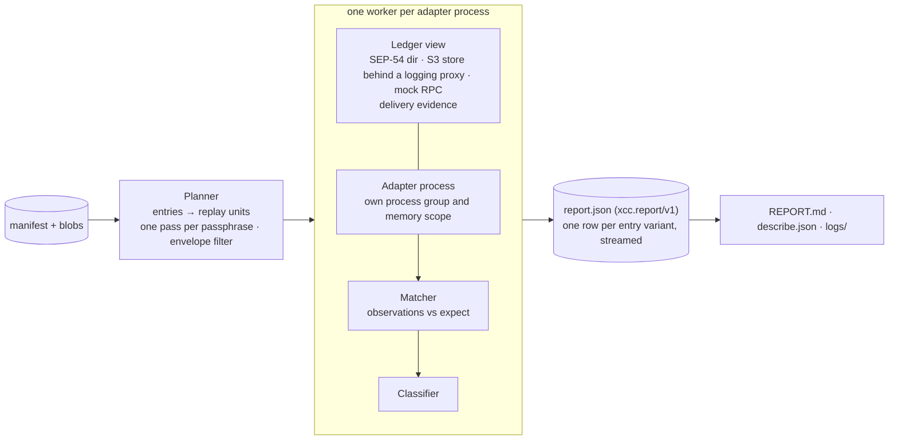

{/* Generated by apps/docs/scripts/generate.py from docs/replay-harness.md, go/adapters/baseline/README.md, go/adapters/stellaretl/README.md and go/adapters/horizon/README.md; edit the source, not this file. */}

For indexer authors and operators who run `xdrcheck replay` against their indexer and need to read the result: how
ledgers are served, how a run is planned, how stored rows are matched and classified, and what the report and exit
codes mean.

The harness feeds corpus ledgers to an indexer through an input the indexer already reads, drives it through an
adapter ([adapter-protocol.md](/reference/adapter-protocol)), compares what it stored with the manifest
([manifest.md §6](/reference/manifest/expected-values#6-expected-values-and-how-they-are-matched)) and classifies every entry. Commands and flags: [cli.md](/reference/cli).

## 1. Shape of the harness



`xdrcheck serve` is the ledger server on its own, for pointing any indexer at the corpus by hand. `xdrcheck replay` plans,
serves, drives an adapter, matches, classifies and reports.

## 2. Ledger server

All inputs are views over the same ledgers. The server never alters a ledger's bytes except in the stream unit
(§3.3), which is a declared transformation.

### 2.1 SEP-54 layout on disk — supported first

Exactly what go-stellar-sdk's `support/datastore` reads and Galexie writes: a root `.config.json` (the compact
JSON the SDK marshals, with the pass's passphrase, `ledgersPerBatch: 1` and `batchesPerPartition: 64000`) and
one zstd-compressed `LedgerCloseMetaBatch` per ledger at the key the SDK derives from the sequence, for example
testnet ledger 4437357 at `FFBC9DFF--4416000-4479999/FFBC4A92--4437357.xdr.zst`. The batch is written by
concatenation (`uint32 S ‖ uint32 S ‖ uint32 1 ‖ <LedgerCloseMeta bytes>`), so corpus bytes are never re-encoded.
A `history` entry is served as the original public-lake object, byte for byte, at its original key, after its
sha256 is checked. Every SDK backend demands strictly consecutive sequences, so a layout is always gap-free.

This reaches go-stellar-sdk's `BufferedStorageBackend` with a filesystem datastore and any other lake reader.

### 2.2 The same layout behind an object store

Pipelines hard-code their store type (wallet-backend reads S3; stellar-etl reads GCS), so the layout is also
served over an object-store API. For S3 the harness runs SeaweedFS — the emulator wallet-backend's own tests
use — from the image digest pinned in `pins.toml` (never pulled during a run), uploads each unit under its own
prefix, and puts a small logging reverse proxy in front of it; consumers are pointed at the proxy, whose request
log is the delivery evidence (§2.5). Where no container can be created, the image's own statically linked `weed`
executable runs as a local process instead (same digest). Every port is bound on loopback only.

GCS is not served by `xdrcheck` yet (`--input sep54-gcs` and `xdrcheck serve --gcs` exit 2). The stellar-etl adapter takes
the `sep54-dir` layout and runs its own GCS emulator (fake-gcs-server, the one go-stellar-sdk's datastore tests
use).

### 2.3 Mock `getLedgers` — supported second

JSON-RPC 2.0 over HTTP on loopback, answering `getHealth` and `getLedgers` with stellar-rpc's wire types (the
go-stellar-sdk `protocols/rpc` structs stellar-rpc itself uses), so Go, JavaScript and other clients decode it
unchanged. Rules copied from the real server: parameters by name only; `getLedgers` limit default 50, maximum
200; a cursor together with a non-zero `startLedger`, a start outside the served range, a limit over 200 or a bad
`xdrFormat` are error −32600 with the real message text; a bad cursor is −32602. `metadataXdr` is the corpus
`LedgerCloseMeta` verbatim; `headerXdr` is the embedded `LedgerHeaderHistoryEntry` re-encoded with the pinned XDR
library.

Deliberate differences: the mock is always healthy (real RPC reports unhealthy when its latest ledger is more than
30 s old, which would stop every client replaying old ledgers), and `xdrFormat: "json"` is not served.
`getLatestLedger`, `getNetwork` and `getVersionInfo` are answered too; every other method gets a well-formed
−32601 error and is logged, because some clients call other methods and carry on after the error.

### 2.4 What known clients request

No SDK ledger backend checks the previous-ledger hash or that a ledger's own sequence equals the requested one;
all demand strictly consecutive sequences, and all enforce the passphrase indirectly by re-hashing envelopes.
After the last served ledger a lake backend retries the next key and an RPC backend polls `getHealth`, so an
adapter decides completion from the indexer's progress marker (`cursor ≥ range.end`), not from the indexer
exiting.

### 2.5 Delivery evidence

To tell an indexer that hangs from a ledger that never reached it, each view records what it served: the mock RPC
logs every request, and the S3 proxy logs every object request (uploads and the harness's own read-back check go
to the store directly and are not delivery records). Reads of a `sep54-dir` layout are not observed. The
classifier uses this evidence (§7, row 0); `xdrcheck serve --delivery-log FILE` writes it for hand runs.

## 3. Replay units

| Unit | Served | Bytes | Used for |
|---|---|---|---|
| **single** | one ledger at its real sequence, range `[S, S]` | verbatim | the default; `history` and `core-golden` entries; known-divergence checks (§9) |
| **chain** | a whole local-core scenario run, from ledger 2, on one passphrase | verbatim; a real, contiguous hash chain | entries that set `replay.unit: "chain"` or `requires_prior_state`; indexers that need earlier state |
| **stream** | every planned ledger of the pass, renumbered into one consecutive run | **transformed** | load and memory tests only |

### 3.1 single

The server publishes exactly one ledger. The adapter sets the indexer's start to `S` (for wallet-backend, by
seeding its cursor to `S − 1`). Entries that share one ledger share a unit. An entry that needs earlier ledgers
sets `replay.requires_prior_state: true` and is never served outside its chain.

### 3.2 chain

A scenario run starts at genesis on a fresh network, so everything a later ledger depends on is in the chain. Its
ledgers, passphrase, protocol and settings come from its chain index (`corpus/chains/<scenario>/…json`,
[manifest.md §8.2](/reference/manifest/divergences-and-replay#8-2-chain-indexes)). All entries produced by that run are scored from one session. If the indexer
stops at ledger K, entries before K are scored from their facts, the entry at K takes the stop's class, and
entries after K are `not_reached`.

### 3.3 stream — the exact transformation

For the i-th ledger of the stream (base sequence `B`, default 1000, `--stream-base`): the header's `ledgerSeq`
becomes `B + i`; every `lastModifiedLedgerSeq` inside the meta that equalled the original sequence becomes `B + i`,
and so does an account's `seqLedger` when it equalled it. Nothing else changes, so transaction hashes are kept
while the ledger hash and the hash chain go stale (no SDK backend checks them). TTLs, time bounds and other ledger
arithmetic keep their original numbers. This mirrors go-stellar-sdk's `ingest/loadtest`. Stream bytes are never
written into the corpus, and stream results are **never** used for known-divergence assertions or findings: a
failure first seen in a stream must be reproduced as a single or chain.

## 4. Planning a run

1. **Select** `ledger` entries whose `replay.indexer_scope` is not `sdk-only`, filtered by `--entries`, `--caps`
   and `--network`.
2. **Split by passphrase**: one pass per network; each variant is planned in the pass of its network.
3. **Apply the envelope** from `describe`, using manifest facts only, never decoding: with `sdk_limit` (or
   `--out-of-envelope skip`) an out-of-envelope variant is not run and is `not_applicable`; with `indexer_gate` it
   is run, to probe the gate.
4. **Choose units**: single by default; chain when the entry asks for it or `--unit chain` is given; stream only
   with `--unit stream`.
5. **Choose the input**: `--input`, else the first of `sep54-s3` (only when the pinned store image is present
   locally), `sep54-dir`, `rpc` that the adapter declares.
6. **Order** units deterministically: pass by network, then unit kind, first served sequence, first entry ID.
7. **Size deadlines** from the adapter's `describe.timing`, unless `--deadline` is given.

## 5. Running

Per unit, on one worker: publish the unit on a fresh ledger view → `prepare` → `ingest` → `observe` (always,
whatever `ingest` returned) → `teardown` → match → classify → judge against known divergences → write one row per
entry variant.

- **Isolation.** A fresh session, a fresh ledger view and its own delivery evidence per unit. Each worker
  (`--parallel N`, capped by the adapter's `max_parallel_sessions`) has its own adapter process; an adapter that
  breaks the protocol, does not answer or dies is killed and a fresh one is started for the next unit.
- **Limits.** The adapter's group runs under `--memory-max` and `--pids-max` (cgroup v2 scope, or an
  address-space limit with resident-memory polling where no user cgroup is available; the report names the
  mechanism). Deadlines as in [adapter-protocol.md §6](/reference/adapter-protocol).
- **Bounded memory.** After `ingest` a unit is observed in windows of consecutive ledgers, and each window's
  entries are matched, classified and written before the next window is requested, so the harness holds one
  window's observation set at a time. Adapter response lines are capped at 64 MiB.
- **Confirmation.** `--confirm K` re-runs a unit with a non-pass result K more times; results that differ are
  `flaky`.
- **Network.** The harness opens only loopback sockets. Run under `make … OFFLINE=1` (or
  `scripts/offline-run.sh`) the whole run, adapter and indexer included, has no route out.

## 6. Matching observations against `expect`

The matcher implements [manifest.md §6](/reference/manifest/expected-values#6-expected-values-and-how-they-are-matched), which is normative. In short:

- **Exact comparison everywhere.** Amounts, IDs and counts are compared as decimal strings or integers; no
  tolerance, rounding, case folding or prefix matching.
- **Stored values are decoded by the harness** with its own strict strkey decoder, according to the declared
  `as_stored.encoding`; an adapter's interpreted fields are used only where no stored form is given.
- **Scope.** Facts belong to the focus transaction or to the transaction an item names; other transactions are
  looked at only through the receipts and the transaction list. Ambient facts (balance changes, sequence bumps,
  fee and refund movements) satisfy an item that lists them and are never extras.
- **Presence.** Kinds and sub-kinds the adapter does not provide are `not_applicable`; an `only_if` item is
  required only when the adapter declares that modelling choice.
- **Declared scope.** An expected participant, stored address or state change that meets a rule of the
  capability's `out_of_scope` list (by address type, role, the asset type of a participant's movements, kind, asset type, detail or cause; each rule cites the
  indexer's own statement as `basis`) is `not_applicable` with that basis as its reason
  ([adapter-protocol.md §8.1](/reference/adapter-protocol#8-1-wallet-backend’s-declared-scope)). Negative facts and extras
  are never excused; a malformed list makes the match fail.
- **Identity.** Participants match by base address. A `base_only` reader's muxed ID is never compared; a
  `base_and_alias` reader must report the expected one. Identity held only in muxed form is a wrong value.
- **Negative facts** (`must_not_include`, a `count: 0` movement) are checked only when the transaction is
  positively observed, and a result made of negative facts alone is never a pass.

Each expected fact ends `matched`, `missing`, `wrong` or `not_applicable`; observed facts no expectation accounted
for are `ignored`, `extra` (under an exactness flag) or `forbidden`.

## 7. Classification

The first matching row gives the class and qualifier. "This ledger" for a stop is the ledger the indexer stopped
on: the ingest result's `failing_ledger` when given; else the one after its cursor; for a stop the harness
observed itself (deadline, memory kill), the last ledger the delivery evidence shows served.

| # | Condition | Result |
|---|---|---|
| 0 | Adapter error, protocol violation, or positive evidence the ledger was never served | `harness_fault` (not an indexer result; exit 2 unless `--keep-going`) |
| 1 | Planned `not_applicable` (outside an `sdk_limit` envelope, `--out-of-envelope skip`) | `not_applicable` |
| 2 | Ingest crashed at or before this ledger (signal, runtime fault, memory kill) | `mishandled · crash` |
| 3 | Ingest timed out with progress stopped at this ledger | `mishandled · hang` |
| 4 | Refused at this ledger, gate declared `indexer_gate`, the manifest confirms the entry is outside that gate, nothing written, no crash | `dropped · refused` |
| 5 | Refused failing any condition of row 4, or halted at this ledger | `mishandled · halt` |
| 6 | The indexer stopped at an earlier ledger of the unit | `not_reached` |
| 7 | Got past the ledger, but the ledger or the focus transaction is absent, or a receipt counter is lower, and the indexer recorded no error | `dropped · silent` |
| 8 | A fact wrong, an exactness extra, a forbidden fact, or a receipt counter higher | `mishandled · wrong_value` |
| 9 | A fact missing | `dropped · partial` |
| 10 | Every fact matched or `not_applicable`, at least one positive fact matched | `pass` |
| 11 | No positive fact matched | `not_applicable` |

The report has three result classes, **pass**, **mishandled** and **dropped**, plus four side categories
(`not_applicable`, `not_reached`, `flaky`, `harness_fault`) that say an entry produced no result about the indexer,
and why. A **verified** refusal (`dropped · refused`) is the safe behaviour the guide recommends: it needs no finding
and does not fail a run. A refusal the harness cannot confirm is already a halt (row 5).

## 8. Report

With `--report DIR` a run writes:

| File | Contents |
|---|---|
| `report.json` | `xcc.report/v1` (`corpus/schema/report.schema.json`): a header (tool, versions, pins, run settings) and one row per entry variant with the unit, class and qualifier, expected versus observed facts, the known-divergence match, the verdict and the finding ID. The format every tool of the kit writes |
| `describe.json` | The adapter's `describe` result |
| `REPORT.md` | A readable page, rendered from `report.json`: target, input, adapter and declared envelope; then **Failures** — every failing row and every row whose result is not the expected one, unexpected rows first, each with the entry, its CAPs, the ledgers, what the result means, expected against observed (how the ingest ended when it did not complete, the first missing or wrong facts with their differing fields), and the `xdrcheck replay --entries <id> …` command that replays that entry alone; then **Counts**: the three-column headline (pass, mishandled, dropped), the entries that produced no result about the indexer, and the number of results other than the expected one |
| `logs/` | Adapter stderr per process and delivery logs |
| `evidence/` | The whole evidence of each row whose evidence is over the writer's inline cap (32 KiB), one file per row. The row keeps a shortened copy — the `missing_or_wrong` facts and their `diffs` in full, other long lists (such as each fact's `observed` references) cut to their first ten with the full length in `<key>_total` — and names the file in `full_evidence`, with `truncated: true` and `original_bytes`. When even the shortened copy is over the cap the row keeps only those three keys |

### 8.4 Exit codes

| Code | Meaning |
|---|---|
| `0` | Every result is the expected one |
| `1` | At least one unexpected result (§9); with `--findings DIR`, a failure row with no finding ID that resolves; with `--selftest`, a failed check |

## 9. Known divergences: how they are asserted

An entry's `conformance.known_divergences` may name an indexer with `level: "replay"`
([manifest.md §7](/reference/manifest/divergences-and-replay#7-known-divergences)). For a run against target T at version V:

1. Divergences whose `target` is T and whose `versions` range contains V apply. For packages with tags the harness
   evaluates the range; for repositories without tags the adapter answers through `prepare.resolve_ranges`.
2. **Inside a range** the result must be the declared class and, when given, qualifier. Anything else, a pass
   included, is unexpected: the corpus no longer reproduces the defect.
3. **Outside every range** the result must be `pass`.
4. `xdrcheck replay --assert-known` runs only the entries with a divergence for T and fails on any unexpected result.

`make verify-replay` (`scripts/verify-replay.sh`) runs `--assert-known` with the wallet-backend adapter at each
pinned pre-fix and fixed commit of wallet-backend#729, #731 and #716 (the `acceptance` key of
`[pipelines.wallet_backend]` in `pins.toml`) and at the pinned current commit, on both the S3 and the RPC input. The
entries are found in the manifest, not listed in the script. Besides the exit code it asserts row by row:

| Row | Must be |
|---|---|
| every variant the commit's SDK can decode | present and scored |
| pre-fix commit | exactly the declared class and qualifier |
| fixed and current commit | `pass` |
| any | nothing unexpected; no session state left behind |

The hand-run reproductions these checks were built from are in `evidence/wallet-backend-replay/` and
`evidence/wallet-backend-731/`.

## 10. The memory-bound test

`make verify-memory` (`scripts/verify-memory.sh`) runs four tests, each `xdrcheck replay` in a memory-limited group of
its own (256 MiB, swap off):

| Test | What it shows |
|---|---|
| T-mem-1 | The harness's memory is flat in corpus size: the baseline indexer over the sampled bulk tier as a stream repeated once and ten times (peak growth under 16 MiB, ten times the rows), the tier's ledgers of a megabyte or more, and the corpus's largest ledger repeated a hundred times |
| T-mem-2 | An adapter answering `observe` with a 512 MiB line is refused at the line cap; the harness survives |
| T-mem-3 | The `memory-hog` seeded indexer under a 128 MiB adapter group is caught as `mishandled · crash` |
| T-mem-4 | The corpus's deepest and largest ledgers pass through the server and matcher under the limit |

A negative control then reruns T-mem-1 with streaming switched off and must fail, so the test can tell a streaming
harness from one that is not.

A run's peak is the xdrcheck process's peak resident set (`VmHWM`), which includes about 37 MiB of the binary's own
mapped code. It is read only once the process runs xdrcheck: until the exec through `systemd-run` completes, the new
process can still show the test's own memory, which once was recorded as the run's. The rest is bounded three ways,
so the peak does not depend on the machine's CPU count or on the collector's timing: the harness compresses ledgers
with one zstd encoder rather than one per CPU (each holds about 16 MiB of history); an adapter line is collected in
fragments and joined once, so a line cut at the cap never costs twice its length; and before each slice of work the
Go soft memory limit is set to what the harness holds plus room for the slice, at most 64 MiB, so a stream of
ledgers of megabytes does not grow the heap up to the ceiling taken from the group (87.5 % of it).

## 11. Command-line surface

See [cli.md](/reference/cli) for every flag of `xdrcheck serve` and `xdrcheck replay`, generated from their help output.

## 12. The harness's own test: seeded-bug indexers

`make harness-selftest` (`scripts/harness-selftest.sh`) replays the corpus through the baseline indexer with one
deliberate defect switched on at a time (`baseline --bug NAME`) and requires each to land in the class its row of
`go/adapters/baseline/bugs/table.json` documents; the unmodified baseline must pass the whole corpus. Together the
bugs reach every classification branch: truncated or payload-dropped addresses, fabricated muxed addresses,
participants taken from the authorization tree or the envelope, identity kept only in muxed form, credit from a
forged token event, double-counted transfers, float amounts and void routing read as zero
(`mishandled · wrong_value`); a silently dropped ledger (`dropped · silent`); a dropped contract trustline
(`dropped · partial`); a panic (`mishandled · crash`); an endless loop (`mishandled · hang`); permanent-error exits,
a partial write, fake and dirty refusals (`mishandled · halt`); a genuine protocol gate (`dropped · refused`); extra
fee rows (`pass`: storing more is not a failure); and a memory hog.

## 13. Service rigs (`xdrcheck replay --rig`)

`xdrcheck replay --rig wallet-backend|stellar-etl --ledgers A-B|A,B,C|@FILE --lake DIR --commit SHA --out DIR
[--network pubnet|testnet|PASSPHRASE] [--shards N] [--log-level LEVEL]` runs the real pipeline, built from source at the commit (cached
per commit), over ledgers read from a lake-layout directory. Ledgers the directory lacks are fetched from the public
lake unless `--fetch none`. The run directory holds `manifest.json`, `status.jsonl` (one line per requested ledger:
`ingested`, `halted` with the error text, the ledger it names and the durable cursor, `skipped`, or `harness_fault`),
`rows.jsonl` (the judge's row kinds, sorted by ledger), `rows-other.jsonl` (every other row, so nothing written is
left out), `checks.jsonl` and `summary.json`; each shard keeps its logs and raw tables or exports.

wallet-backend:

- Contiguous ledgers form a segment. Each segment is one live-ingestion process into the shard's single database,
  with one ledger per commit; the cursor is polled, so every commit is observed. Before a segment the rig sets the
  ingest cursor and the history and current-state cursors of every classified protocol to the segment's first
  ledger minus one, which is what a finished `protocol-migrate` leaves. Live mode cannot cross a gap, so a sparse
  list is a series of segments in one database; SEP-41 running totals then start from zero at the first segment.
- A segment that stops short: the ledger after the durable cursor is `halted`, the service is started once more
  without touching the cursor to see whether the halt repeats, and the rest of the segment is `skipped`
  (`--skip-halted` moves the cursor past the halted ledger instead, which production never does).
- Seeding, in place of the history-archive checkpoint that a seeded cursor skips: a `contract_tokens` SAC row for
  every Stellar Asset Contract the ledgers touch (verified by hashing the asset, written as the checkpoint writes
  it) unless the ledgers deploy it; and, from a state seed (`--seed DIR`, built once with `--seed-rpc URL`, with an optional request header
  from `$XDRCHECK_STATE_RPC_HEADER`), the `protocol_wasms` and `protocol_contracts` rows of the WASM contracts the
  ledgers touch. A contract whose instance a replayed ledger changes is bound to the WASM of that change's
  pre-image (its binding at the time); any other contract is bound as the seed has it, which is the network's
  state when the seed was fetched, not at the replayed ledger. Every WASM an instance in the ledgers points at is
  registered and its code served. Nothing is pre-registered (no SAC row, WASM row or binding) for a contract deployed or a WASM
  uploaded inside the replayed ledgers: live ingestion sees those happen and records and classifies them itself. The commit's own `protocol-setup` then classifies them against a local RPC that
  serves the seed's entries.
- Rows: `transactions_accounts` give `participant`; `operations_accounts` give `op_participant`; every balance
  state change gives `balance_change` named by its token's contract (fee rows marked; the judge tells verified
  SACs from other contracts); the other state changes give `entry_change` rows (account, trustline and data
  entries created or removed, and the signer, threshold, flag, home-domain, limit, authorization and data-value
  changes they state, signer keys as stored) beside the verbatim `state_change`; balance tables give `balance`
  (absolute state, not deltas).
- The local RPC answers `simulateTransaction` only for a zero-argument contract call, with the return value of the same call recorded in the run's ledgers; anything else is a failed simulation.

stellar-etl: every `export_*` command the binary lists, over each segment as one range; a one-ledger segment N is
exported as N..N+1 (rows of N+1 are context and are dropped), because a one-ledger range writes no ledger entry
changes. Each requested ledger is checked against what it holds (ledger, every transaction and operation, a fee
transfer per transaction, contract events, changed entry keys); a failed check is a silent drop. Rows: token
transfers give `token_event` and the `balance_change` rows they imply; effects give `effect_balance_change`
(amount-bearing effects) and `entry_change` (entries and attribute values the effects state); an operation's
`asset_balance_changes` give `op_token_event`.


## Baseline adapter

For indexer authors who want to see what a correct reader extracts from a `LedgerCloseMeta`, or who are adding
observation kinds to their own adapter. The baseline is a minimal ledger reader built on go-stellar-sdk v0.9.0, plus
the adapter that lets `xdrcheck replay` drive it. It has two jobs:

- **Reference reader.** It shows what a correct reader extracts from a `LedgerCloseMeta`, and from where. Every
  replayable corpus entry must match it with no missing or wrong facts. When it fails, either the baseline or the
  entry is wrong, and the entry is blocked until that is settled.
- **Complete example adapter.** It maps every observation kind, so it shows how each fact is derived and reported.
  To adapt your own indexer, start from the template [`../minimal`](/guides/go-indexer) (receipts and transactions,
  about 150 lines) and come here for the kinds you add. Both are built on the public package
  `go/adapterkit`, which holds the protocol types, the stdio transport and the test helpers;
  neither the template nor this adapter's protocol code imports anything under `internal/`. The contract stays
  the two schemas `corpus/schema/adapter-protocol.schema.json` and `observation.schema.json`, so an adapter in
  another language needs nothing from this repository ([`examples/adapter-ts`](/guides/any-language-indexer)).

### Build and run

```sh
cd go && go build -o bin/ ./cmd/xdrcheck ./adapters/baseline/cmd/baseline && cd ..
go/bin/xdrcheck replay --adapter go/bin/baseline --target-version 0.1.0 --input sep54-dir --report reports/baseline
```

The one binary has two roles:

- `baseline [--max-protocol N] [--max-lcm-version N] [--min-protocol-with-transactions N]` is the adapter. It
  speaks `xcc.adapter/1`: one JSON request per line on stdin, one response per line on stdout, logs on stderr.
- `baseline index …` is the indexer. The adapter starts it for each `ingest`.

The gate flags lower the indexer's limits for testing, and `describe` always declares exactly the limits the
indexer enforces.

### What the indexer extracts, and from where

| Fact | Source in the ledger | Never from |
|---|---|---|
| receipts | transaction processing list, envelopes, meta: transactions, operations, consensus events, entry changes | — |
| transactions | hash recomputed from the envelope with the pass's passphrase (by the SDK's transaction reader); result pair; result codes in XDR-JSON names (`tx_success`, `set_options.success`) | — |
| participants | owners of every ledger entry changed in fee processing, transaction-level changes and operation changes; the fee payer; the source whose sequence number moved | envelope destinations, memos, Soroban authorization entries |
| muxed identity | a muxed ID only where the ledger carries a u64: a `MuxedAccount` in the envelope of an account the meta already made a participant, or a `to_muxed_id` of type u64 in an event; always an alias beside the base address | text or hash memos; `to_muxed_id` of type string or bytes |
| state changes | created / updated / removed / restored entries, classified by entry type and by diffing before and after (balances, signers, thresholds, flags, limits, sponsorship); the operation type only labels `cause` | effects inferred from operation type alone |
| movements | token-shaped contract events (`transfer`, `mint`, `burn`, `clawback`), each keyed on the contract that emitted it; fees and refunds from fee processing; balance deltas only when the ledger carries no classic events | envelope amounts; an asset named in an event's topics by a contract that is not that asset's contract |
| addresses | every address above, stored as its full strkey text | — |

**Events are trusted only as far as their emitter** (rule M-7 in `docs/manifest.md` §6.7):

- An event is a movement of a classic asset only when the emitting contract is that asset's Stellar Asset Contract
  under the pass's network.
- An event from any other contract that names a classic asset in its topics is a forged claim. Nothing is recorded,
  and the address it names does not become a participant.
- An event that names no classic asset is that contract's own token movement.

The derivation is in `indexer/derive.go` and `indexer/events.go`. Each step is a separate function (`feeStep`,
`txLevelStep`, `opChangesStep`, `eventsStep`, `balanceDeltaStep`, `aliasStep`), so a seeded-bug variant can
replace one step and nothing else. The envelope's claims (source, destinations, memo) are stored beside the facts
under `claimed` and are never mapped to facts.

### Gates (`enforcement: indexer_gate`)

| Gate | Default | Refusal |
|---|---|---|
| `max_protocol` | 30 | the header's protocol is higher |
| `ledger_close_meta_version` | 0–2 | the `LedgerCloseMeta` arm is newer |
| `min_protocol_with_transactions` | 10 | a ledger below it carries transactions |

A gate is checked before anything is written for the ledger. A refusal:

- exits with code 3;
- leaves `exit.json` naming the gate and the observed value;
- leaves the cursor below the refused ledger.

Any other stop:

- a fetch, decode or persist error exits with code 1 and an `exit.json` naming the phase;
- a Go runtime panic exits with code 2.

Every ledger is written whole (to a temporary file renamed into place) before the cursor moves past it, so a stop
never leaves a partial ledger.

### The store

The indexer has no database. Each session's store is `<workdir>/store/`:

- `ledgers/<seq>.json`: one document per ledger, holding its facts in the protocol's neutral vocabulary (one
  record per fact) and the `claimed` block;
- `cursor`: the last ledger stored;
- `exit.json`: written when a run stops on a ledger.

`observe` reads the documents back and sorts the facts by transaction index, operation index and JSON text. The
indexer reads no clock, so two sessions over the same unit give byte-identical observation sets.

### Writing your own adapter

Copy [`../minimal`](/guides/go-indexer) and follow its README. When your indexer is a separate program with a store of
its own, as here, this adapter's protocol handler (`adapter.go`, on `adapterkit.Serve`) is the pattern:

1. **`describe`**: keep `Describe` constant. Declare only the inputs, units and observation kinds your indexer
   really has. Declare its real gates, or `enforcement: none`.
2. **`prepare`**: create an empty store for the session. Refuse a store you did not create.
3. **`ingest`**: start your indexer against the loopback input and range you are given, with a scrubbed
   environment. Read its progress marker and its own structured exit record, never its log text. Report the facts
   behind the status (`ingestResult` shows the order of the rules).
4. **`observe`**: map one stored record to one fact. Pass stored values through as `as_stored`, and do not clean
   them.
5. **`teardown`**: remove the session's store.
6. **Check it**: run `xdrcheck replay --adapter "<your command>" --selftest`.

The tests in this directory do the same: `adapter.Selftest`, then plan → serve → adapter → match over every
replayable corpus entry, on the SEP-54 directory, mock RPC and (where the object store can run) S3 inputs.


## stellar-etl adapter

For stellar-etl operators and for authors of batch-export indexers: how the stellar-etl adapter builds and drives an
unmodified [stellar-etl](https://github.com/stellar/stellar-etl) binary at the version under test through
`xcc.adapter/1`, how it decides a status without a cursor, and how export rows become facts. Executed results:
`evidence/stellar-etl/`.

### Build and run (stellar-etl adapter)

```sh
cd go && go build -o bin/ ./adapters/stellaretl/cmd/stellaretl ./cmd/xdrcheck
bin/xdrcheck replay --corpus ../corpus --adapter bin/stellaretl --target-version 7e3fc9af95359dad6ba939fa88791f49cdf531ae \
  --assert-known --report ../reports/stellar-etl
```

`--target-version` takes a tag (`v2.8.35`, the release `pins.toml` `[pipelines.stellar_etl]` pins) or a full commit.
Options of the adapter itself:

| Option | Meaning |
|---|---|
| `--cache-dir DIR` | cache root when `prepare` names none (default: the user cache directory's `xdrcheck/adapters`, the one `xdrcheck replay` passes) |
| `--repo DIR` | use an existing stellar-etl clone instead of `<cache>/stellar-etl/repo.git` |
| `--etl-binary FILE` | use a prebuilt stellar-etl for every target instead of building one (tests, CI) |
| `--offline` | never clone, fetch or build; use what the cache holds |
| `--halt-oracle FILE` | append one JSON line per export per ledger of every ingest: how that export ended there (`ok`, `halted`, `crashed`, `timeout`, `not_reached`, `not_run`, with exit status, signal, runtime panic, wall time and peak memory). The ledger a failed export stopped at is the first one it fails on when rerun alone on one ledger, from its last rows upward (`failing_ledger_by: probe`, reruns logged to `logs/<export>.probe.log`); when none fails alone or the deadline leaves no time, the ledger after its last rows, else the range start (`failing_ledger_by: rows`) |
| `--export-memory-max BYTES` | memory cap per export command; a command killed at the cap is a crash |

### What it does per session

1. **`prepare`** resolves the target in a blob-less clone of stellar-etl (`<cache>/stellar-etl/repo.git`, cloned on
   first use), builds `bin/stellar-etl-<commit>` once with the Go toolchain the commit's `go.mod` names and cgo on
   (stellar-etl links go-stellar-xdr-json, a cgo wrapper), and answers `resolve_ranges`: `A..B` is every commit
   from A to B on B's first-parent history, `..B` everything up to B. A cold build needs the network once (the
   clone, Go modules, the toolchain); later runs work offline.
2. **`ingest`** serves the harness's `sep54-dir` layout through a GCS-compatible emulator on loopback
   (fake-gcs-server's library, the emulator go-stellar-sdk's own datastore tests use) and runs every export
   stellar-etl has — `export_ledgers`, `export_transactions`, `export_operations`, `export_effects`,
   `export_token_transfer`, `export_contract_events`, `export_trades`, `export_ledger_entry_changes`,
   `export_assets` and `export_ledger_transaction` — over the range, one after the other (a failed export does not
   stop the ones after it), each with `-o <session>/out/<command>/ --datastore-path xdrcheck/lake` and the network flag
   (`--testnet`, `--futurenet`, none for pubnet), in a scrubbed environment (`PATH`, `HOME` and
   `STORAGE_EMULATOR_HOST` only).
3. **`observe`** reads the JSON Lines back and maps them (below).
4. **`teardown`** removes the session's folders.

stellar-etl reads ledgers only from a GCS datastore (the type is fixed in its code, at v2.8.34 and at the pinned
v2.8.35 alike), so `sep54-dir` is the only input declared; the emulator is the adapter's, and the indexer is
pointed at it exactly as it would be pointed at a bucket. Other passphrases than pubnet, testnet and futurenet cannot be configured in stellar-etl and are
answered with `unsupported_input`.

### Status

stellar-etl is a batch tool with no cursor. The adapter's progress marker is the highest ledger in the ledgers
export once every command has exited 0; status rests on exit codes, signals and rows, never on log text.

| Facts | Status |
|---|---|
| every command exited 0 and the ledgers export reaches `range.end` | `completed` |
| a command was still running at the deadline | `timeout` |
| a command ended by a signal, or exited 2 with a Go runtime panic on stderr (`runtime_panic: true`) | `crashed` |
| any other non-zero exit | `halted`: `failing_ledger` is the ledger after the last one the failing command wrote rows for, `rows_for_failing_ledger` counts every export's rows for it |

### Envelope

`sdk_limit`, from the go-stellar-sdk version the target's `go.mod` pins: v0.8.x (including the v0.8.1
pseudo-versions of v2.8.33 and v2.8.34) → `max_protocol` 30; v0.7.x → 29. Without a local clone at `describe` time,
or for any other SDK version, nothing is declared (`enforcement: none`). The pinned v2.8.35 pins go-stellar-sdk
v0.9.0, which the adapter does not classify yet, so at the pin no envelope is declared.

### Row mapping

One stored row is one fact; nothing is derived or repaired.

| Kind | From | Mapping |
|---|---|---|
| receipts | transactions, operations and contract-events exports | the number of rows held for the ledger (`transactions`, `operations`); `events`: the contract-events rows that are operation events (`operation_id` set) or transaction-level fee events (first topic `fee`), never the diagnostic rows the same table holds |
| transactions | transactions export | `transaction_hash`; `index` from the TOID (`id`); `successful`; `transaction_result_code` → XDR-JSON name (`TransactionResultCodeTxFeeBumpInnerSuccess` → `tx_fee_bump_inner_success`), the label kept as `native_label`; `fee_charged` as its token; `inner_transaction_hash`; operation result codes from the operations export (`PaymentResultCodePaymentSuccess` → `payment.success`) |
| participants | transactions (`account`, `fee_account`), operations (`source_account`), effects (`address`), trades (`selling_account_address`, `buying_account_address`, located by `history_operation_id`) | the column as `address`; its `_muxed` column, when set, as `on_chain_form` |
| state changes | effects export | `account_created`, `account_removed`; `account_credited`/`account_debited` → `balance_changed` (amount as `delta_as_stored`); `trustline_created`, `trustline_removed`, `trustline_updated` → `trustline_limit_changed`, `trustline_flags_updated` → `trustline_flags_changed`; `signer_created`/`removed`/`updated` → `signer_added`/`removed`/`changed`; `account_thresholds_updated` → `thresholds_changed`; `sequence_bumped`. Other effect types are not mapped |
| movements | token-transfer export, topics `transfer`, `mint`, `burn`, `clawback` | `amount_raw` as `amount` (the float `amount` only as `amount_as_stored` when there is no raw value); asset `CODE:ISSUER`, `native`, or the emitting contract; `to_muxed` as `to.on_chain_form` and `to_muxed_id` as a `u64` routing ID, exactly as written. Fee rows are not mapped: a refund is a `fee` row with a negative amount |
| addresses | — | not provided: most addresses sit inside per-type detail columns |

`export_ledger_entry_changes`, `export_assets` and `export_ledger_transaction` are mapped onto no fact: they are
judged on how they end (status table above, and the halt oracle). `scripts/replay-etl.sh` (`XDRCHECK_REPLAY_ADAPTER=stellar-etl
scripts/replay-full.sh`) replays the whole corpus with the halt oracle on and fails on any export that did not end ok.

Effects and operations carry no transaction hash; their TOIDs (`ledger<<32 | order<<12 | op`) locate them through
the transactions export.

### Service rig (`xdrcheck replay --rig stellar-etl`)

- **Network and path.** stellar-etl has no passphrase flag: `--testnet` / `--futurenet` / none pick the passphrase and
  the datastore suffix (`<--datastore-path>/<testnet|futurenet|pubnet>`); the layout is fixed at one ledger per file,
  64,000 files per partition. Standalone ledgers closed with the testnet passphrase are exact under `--testnet`. A
  wrong network flag still exits 0 with rows (transaction hashes then come from the wrong passphrase), so the rig
  derives the flag from the lake's passphrase and refuses others.
- **Absent ledgers** are fatal in stellar-etl (exit 1, "ledger object … is missing"), not an empty export. The rig
  passes an absolute output directory (each export runs with its working directory in the segment folder) and
  calls a command that reports successful transforms but wrote no file a harness fault.
- **Status.** `ingested`, `halted`, `skipped`, `harness_fault`, and `dropped`: every export exited 0 but a drop check
  failed (`drop_checks_failed` names them). Nonce entries are left out of the contract-data check (stellar-etl
  discards them by design).
- **Judge rows.** `ledger`, `token_event` and `balance_change` go to the judge: balance changes are derived from
  `export_token_transfer` rows of classic assets (fees included; use `--balance-scope net`), never from effects,
  which have no credit or debit for trades, pool legs, creation and merges. Pass
  `--kinds ledger,balance_change,token_event`: entry changes are compacted per ledger without a transaction
  (`ledger_entry_change`), transactions give only source and fee account, and `approve` is not exported.

### Tests

- `observe_test.go` — the mapping on rows stellar-etl wrote for ledger 64558277 (`testdata/out`), and the harness's
  matcher on them: the mint in that ledger is a wrong routing value.
- `gcs_test.go` — go-stellar-sdk's GCS datastore, the reader stellar-etl uses, reads a layout from the emulator.
- `adapter_test.go` — the protocol selftest, completed and halted ingests, the passphrase refusal and commit ranges,
  with a stand-in for stellar-etl that reads the ledger from the emulator and writes the fixture rows.
- `real_test.go` — with `XDRCHECK_STELLAR_ETL_CACHE` pointing at a cache that holds the clone and the binary of the
  pinned commit: the real stellar-etl over every entry declaring a stellar-etl replay divergence
  (`--assert-known`); skipped otherwise.


## Horizon rig

For Horizon operators and contributors: how to run real ledgers through an unmodified
[stellar-horizon](https://github.com/stellar/stellar-horizon), export what it stored as rows the judge reads, and
what the rig cannot see. Horizon is fed by its own history reingestion with the datastore ledger backend, so no
captive core, no history archive and no network are involved.

### Build and run (Horizon rig)

```sh
cd go && go build -o bin/ ./adapters/horizon/cmd/horizon-rig
bin/horizon-rig --lake LAKE --ledgers list.txt --version v30.0.1 --horizon-src stellar-horizon-clone \
  --out runs/x --shards 8
```

| Option | Meaning |
|---|---|
| `--lake DIR` | ledgers in the SEP-54 lake layout (one ledger per `.xdr.zst` file, 64,000 files per partition); mounted read-only |
| `--ledgers FILE` / `--range S-E` | ledgers to run (first field of each line; other lines are ignored) |
| `--version V --horizon-src CLONE` | tag, branch or commit, built once into `--bin-dir` as `stellar-horizon-<commit>` (static, `CGO_ENABLED=0`, release version string) |
| `--horizon-bin FILE` | a prebuilt static binary instead |
| `--shards N` | parallel workers, one Horizon database each |
| `--group single\|contiguous` | one `db reingest range` per ledger (default), or one per run of consecutive ledgers (`--max-group`) |
| `--passphrase P` | network passphrase (default pubnet); passed as a custom network, with an archive URL that is never contacted |
| `--timeout D` | per reingest call; a timeout is a halt |

`horizon-rig rows --out rows.jsonl [--commit C] RUN/tables` re-exports the common rows from a run's raw dumps.

### What it does

1. Starts Postgres and one long-lived container for the static Horizon binary on an internal Docker network (no
   egress), creates one database per shard and runs `db init` in each.
2. Ledgers whose file is not in the lake are `skipped` and never sent to Horizon. The rest are planned into
   segments and spread over the shards. Each segment is one
   `stellar-horizon db reingest range S E --ledgerbackend datastore --datastore-config &lt;Filesystem datastore>
   --network-passphrase P --history-archive-urls &lt;unused> --db-url &lt;shard>`.
3. A segment that exits 0 marks its ledgers `ingested`. A failing single-ledger segment is `halted` with the error
   Horizon logged. A failing multi-ledger segment commits nothing and its error need not name the ledger, so every
   ledger of it is rerun alone: each becomes `ingested` or `halted` on its own (`attempt: probe`), and
   `stopped_at` keeps the last ledger the backend returned before the segment stopped.
4. Every status is cross-checked against the shard's `history_ledgers`; a mismatch is a harness fault (exit 3), and
   so is a failure of the rig's environment before Horizon reads the ledger (status `harness_fault`). History-archive
   caching is off: concurrent calls in one container otherwise race on Horizon's shared bucket-cache directory.
5. `dump.sql` dumps every history table Horizon fills, with internal ids resolved to addresses, assets, pool and
   claimable-balance ids, into `tables/<table>.jsonl.zst`; `rows.jsonl` maps them to the common rows.

### Run directory

```text
manifest.json        version, commit, binary sha256, lake, counts, shards, segment mode, images, command
status.jsonl         one line per requested ledger: ingested | halted | skipped | harness_fault, segment, shard, error, error_ledger, stopped_at
tables/*.jsonl.zst   raw history tables (integers with every digit; parse them as exact numbers)
rows.jsonl           common rows, sorted by ledger
summary.json         status counts, harness faults, rows per table and kind, setup / ingest / export time, time per ledger
logs/                Horizon's output of every failed call
```

### Common rows

Rows are what the judge (`crates/xdrcheck-judge`, `verdict --rows`) reads, plus the rig row fields: `kind`,
`pipeline` (`horizon`), `commit`, `source` (the table), `ledger`, `tx_index` / `op_index` (0-based apply order;
Horizon's are 1-based), `tx_hash` (outer hash for a fee bump), `exact` (always true), amounts as integer strings in
the smallest unit. Run the judge with `--balance-scope nofee` and `--kinds` limited to what Horizon exports.

| Table | Kind |
|---|---|
| `history_ledgers` | `ledger` |
| `history_transactions` | `tx` (`result_code` decoded from the stored result) |
| `history_operations` | `operation`; each `asset_balance_changes` entry of an `invoke_host_function` → `token_event` (`contract` = the asset's SAC id) |
| `history_effects` | `balance_change` for every amount-bearing effect (`reason` = effect name, signed from the holder's side; `contract_credited` / `contract_debited` → the contract; `liquidity_pool_trade`, deposits and withdrawals → the pool's reserves too; claimable-balance effects → the balance entry `B…`; the taker-side `trade` effects of a path payment are skipped because its debit and credit effects already carry it; `fee` false), `entry_change` (`created` / `updated` / `removed`, `entry_key` = base64 LedgerKey XDR, one per operation, key and change) where the effect states an entry's lifecycle; this is a subset of the entry changes, not all of them |
| `history_transaction_participants` | `participant` (`holder`), one per transaction and account |
| `history_trades`, `history_trades_60000`, `history_operation_participants`, claimable-balance and liquidity-pool link tables | `other` (verbatim) |

### Limits

- `db reingest range` runs Horizon's transaction (history) processors only. The state tables (`accounts`,
  `accounts_data`, `accounts_signers`, `trust_lines`, `offers`, `liquidity_pools`, `claimable_balances`,
  `claimable_balance_claimants`, `asset_contracts`, `contract_asset_balances`, `contract_asset_stats`,
  `exp_asset_stats`) stay empty; they need history-archive checkpoint ingestion, which this rig does not run. The
  1-minute trade aggregation `history_trades_60000` is filled and dumped (as `other` rows).
- History reingestion needs no neighbours: a ledger ingested alone gives the same rows as the same ledger inside a
  dense range, so sparse ledgers are fine.
- Horizon has no fee effects, so its balance changes never include a transaction's fee (`fee` is always false).
- Horizon emits `account_credited` / `account_debited` for an issuer moving its own asset; the judge holds no balance
  for an issuer, so those rows read as extra. A path payment whose source is also a maker of one of its hops loses
  that maker side.
- A Horizon release stops on a ledger whose protocol is newer than the one it supports; that is a `halted` status
  with Horizon's message, not a harness fault.
