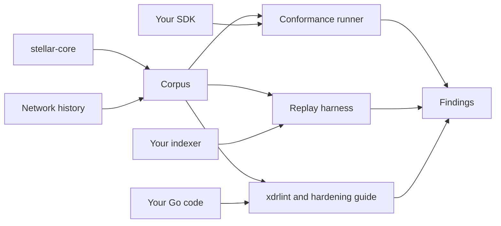

For an SDK maintainer or an indexer author who wants the whole kit on one page before running anything. Each part
below links to the page that explains it in full and to the guide that runs it.

Bytes go in on the left. Your code goes in from below. Every tool writes a report, and a failure that is a defect
becomes a finding.

## Corpus

The corpus is a directory of plain files: one JSON manifest per entry under `corpus/manifest/`, the XDR bytes under
`corpus/blobs/` and the decoded values under `corpus/decoded/`. An entry holds one rare but valid shape, the CAP
and protocol that introduced it, and `expect`: the values a correct reader must produce. The bytes come from a
local, offline stellar-core run under the testnet and the mainnet passphrase, from stellar-core's own goldens, or
from public network history. Hand-made values are marked `synthetic`. The expected values come from the bytes and
from the pinned oracle, rs-stellar-xdr, never from an SDK or indexer under test.

- How it is built and checked: [Corpus](/architecture/corpus)
- Guides: [Read an entry](/start/read-an-entry), [Add corpus entries](/guides/add-corpus-entries)

## Conformance runner

`xdrcheck conform` puts every corpus entry through every pinned SDK version. A driver, one small program per SDK,
decodes the bytes with that SDK and answers the runner. The result is a matrix of entry, SDK version and level.
Each cell is judged against the manifest, never against another SDK. An SDK can also run the corpus in its own
test suite with a loader and a recipe, without any tool from this repository.

- How a cell is judged: [Conformance](/architecture/conformance)
- Guides: [Start here](/start/for-sdk-maintainers), [Add to CI](/guides/sdk-ci)

## Replay harness

`xdrcheck replay` serves corpus ledgers to your unmodified indexer through an input it already reads: a SEP-54
data lake in a directory or behind an S3 API, or a mock stellar-rpc `getLedgers`. An adapter, a small program that
speaks JSON lines over stdin and stdout, starts your indexer and reads back what it stored. The harness compares
those rows with the entry's `expect` and puts each entry in one class: `pass`, or the way it failed.

- How a verdict is computed: [Replay](/architecture/replay)
- Guides: [Start here](/start/for-indexers), [Go adapter](/guides/go-indexer), [Other languages](/guides/any-language-indexer)

## xdrlint and the hardening guide

`xdrlint` reads Go ingestion code built on go-stellar-sdk and reports the code patterns that cause the failures
replay finds, before any ledger arrives. A rule's page names the corpus entry that demonstrates its pattern. The
hardening guide states the same rules for an indexer in any language: which fields stellar-core validates, which
caps to set, where to take participants from. Its field table is generated from the corpus manifest.

- How the linter and the guide are checked: [Linter and guide](/architecture/linter-and-guide)
- Guides: [Lint your code](/guides/lint-go), [Hardening guide](/hardening/overview)

## Findings

Every tool writes its failures as rows of a report, each with the entry, what was expected and what was observed.
A row that shows a defect in an SDK or an indexer becomes a finding: it names the corpus entry that reproduces the
defect and the upstream issue. The divergence is then declared on the entry, so the next run checks that the
defect still shows where it is declared and nowhere else.

- How a row becomes a finding: [Findings pipeline](/architecture/findings)
- The list: [Findings](/results/findings)

## Real mainnet ledgers

The corpus holds rare shapes one entry at a time. Two more parts work on real traffic. The mainnet scan read
pubnet history and counted which shapes occur and how often; `xdrcheck find` turns a shape token, a value tag or a
CAP into mainnet transactions. `xdrcheck replay --target` then runs chosen ledgers through an SDK or through
wallet-backend, stellar-etl or Horizon at any version, and the judge states what each transaction did from the
ledger's own entry changes.

- How the scan ran: [Mainnet scan](/architecture/mainnet-scan)
- Reference: [Find transactions](/reference/find), [Replay real ledgers](/reference/replay-target), [Judge](/reference/judge)

## Next

- Run it: [Quickstart](/quickstart).
- The terms used above (XDR, shape, CAP, meta): [XDR and ledger data](/concepts/xdr-and-ledger-data),
  [Shapes and CAPs](/concepts/shapes-and-caps).
- Every part in depth: [Technical overview](/architecture/overview).
