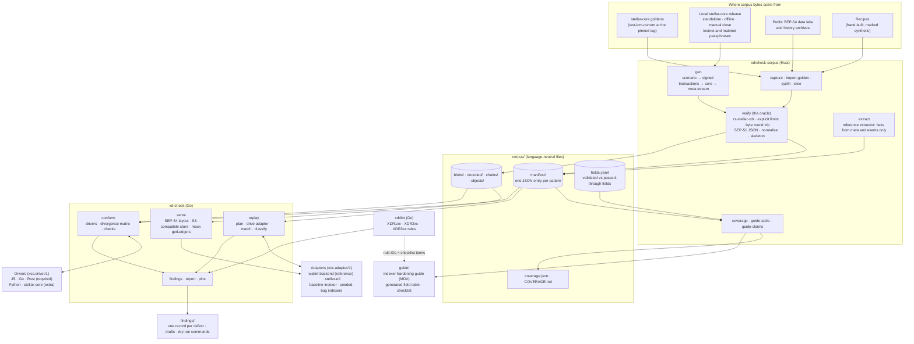
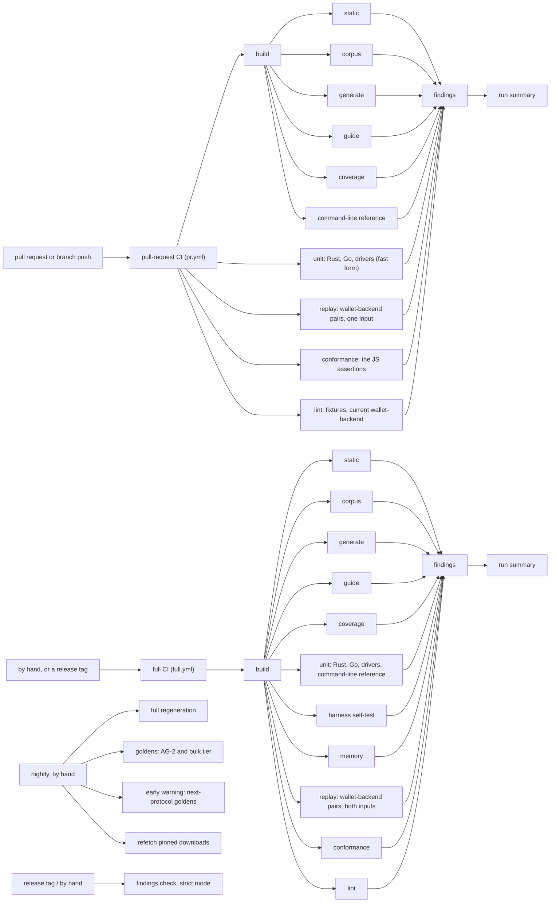

# Architecture

A shared test kit for software that reads the Stellar ledger. At its centre is a **corpus**: rare but valid
ledger data that stellar-core really emitted, one entry per pattern, each tagged with the CAP and protocol that
made it possible and carrying the values a correct reader must produce. Every tool reads the same manifest; none
keeps a private list.

This page is the overview. The specifications it links are normative.

## Components

| Component | Command | Specification |
|---|---|---|
| Corpus and manifest | — | [manifest.md](manifest.md), [entry-ids.md](entry-ids.md), [authoring-entries.md](authoring-entries.md) |
| Generator | `xdrcheck-corpus gen` | [authoring-entries.md §5](authoring-entries.md) (scenario files), `corpus/schema/scenario.schema.json` |
| Oracle | `xdrcheck-corpus verify` | [manifest.md §11](manifest.md) |
| Replay harness and ledger server | `xdrcheck replay`, `xdrcheck serve` | [replay-harness.md](replay-harness.md), [adapter-protocol.md](adapter-protocol.md) |
| Conformance runner | `xdrcheck conform` | [driver-protocol.md](driver-protocol.md), [conformance-protocol.md](conformance-protocol.md), [drivers/README.md](../drivers/README.md) |
| Linter | `xdrlint` | [lint/docs/](../lint/docs/README.md) |
| Guide | `xdrcheck-corpus guide-table`, `guide-claims` | [guide/README.md](../guide/README.md) |
| Findings | `xdrcheck findings` | [findings/README.md](../findings/README.md), [SECURITY.md](../SECURITY.md) |
| Every command and `make` target | — | [cli.md](cli.md) |

## Design principles

1. **Bytes are sacred.** Corpus bytes are stored exactly as stellar-core emitted them or as the public lake served
   them, named by their sha256. Any transformation (a stream renumbering, a batch wrapper) is a separate, declared
   artefact and never becomes corpus bytes.
2. **Expected values never come from the reader under test.** They come from the bytes (the oracle's decoding),
   from a scenario's stated intent, from the reference extractor (which reads ledger-entry changes and events,
   never the envelope), or from a primary source such as stellar-core code at a pinned tag.
3. **One manifest, many consumers.** The oracle, generator, harness, conformance runner, guide generator and
   coverage report all read `corpus/manifest/`.
4. **Fail closed, and say so.** Every tool tells a deliberate refusal from a crash and from a silent drop, in
   machine-readable form, and the tools themselves refuse what they do not know (below).
5. **Offline by construction.** Inputs are read from disk; anything fetched is pinned by hash in `pins.toml` and
   cached by `make fetch`; every other step runs with the network unreachable.
6. **Rust where rs-stellar-xdr is the oracle, Go where the pipelines are.** The round-trip check is defined by
   rs-stellar-xdr; wallet-backend, stellar-etl and the go-stellar-sdk ingest stack are Go.
7. **Every check is one `make` target and one CI job.** The same command runs locally and in CI.

## The corpus

- **Entry kinds.** `ledger` (one full `LedgerCloseMeta`), `xdr` (one standalone XDR value, possibly a slice of a
  ledger entry), `api` (an SDK-neutral call and its expected bytes or refusal) and `strkey` (an address text and
  its expected payload or refusal). `xdr` and `strkey` entries may be **negative**: invalid on purpose, always
  synthetic, never replayed to an indexer.
- **Sources.** `core-golden` (byte-for-byte from stellar-core's committed goldens), `local-core` (a pinned release
  stellar-core running a scenario), `history` (an unmodified public-lake object), `history-archive` (a record cut
  from a public history archive) and `synthetic` (hand-built; `synthetic: true`).
- **Variants.** An entry is a pattern; its bytes exist per network and protocol. A `local-core` scenario runs on
  both the testnet and the mainnet passphrase from the same seed labels, so account IDs, sequence numbers and
  muxed IDs are equal across the twins while hashes and signatures differ; the expectation block is shared and the
  per-network values sit under `derived`.
- **Expected values, three layers.** The bytes (sha256 and length; re-encoding must reproduce them); the decoded
  value (SEP-51 XDR-JSON from the pinned rs-stellar-xdr, stored as a sidecar); and semantic facts (`expect`):
  receipts, transaction results, participants, state changes, movements, addresses and explicit must-not facts.
- **Two tiers.** The curated tier is in the repository and is "the corpus" for every check. The bulk tier is the
  complete golden set at the pinned stellar-core tag, fetched by hash into a cache and used for decoder
  consistency and memory tests.
- **Coverage.** `corpus/coverage.json` and `corpus/COVERAGE.md` are generated from the manifest and the CAP list
  (`corpus/caps.toml`): for every CAP that changed what a ledger reader sees, the entries that cover it, their
  sources, the networks with variants, and any gap with its reason. A CAP row with neither fails CI.
- **Schema versions and their change rule.** The documents other projects read name their format in a `schema`
  field: `xcc.corpus/v1` (`corpus.json`, `corpus/schema/corpus-index.schema.json`), `xcc.release/v1`
  (`PROVENANCE.json` of a release archive, [release.md §5](release.md)) and `xcc.report/v1` (every tool's report,
  `corpus/schema/report.schema.json`); the manifest entry has `xcc.manifest.entry/v1`
  ([maintenance.md §3](maintenance.md#3-versioning-and-releases)). The suffix is a major version, and v1 is
  closed: adding, removing or renaming a field, changing a field's type or meaning, or adding an allowed value is
  a new major (`/v2`), because the kit's readers are strict (the report reader refuses an unknown field) and an
  older reader must fail loudly rather than misread. Only changes that leave every v1 document and every v1 reader
  as they were (descriptions, examples) stay v1. v1 closes with the first release, `30.0.0`: additions made
  before it — the report row's `pending` expectation, the finding record's `evidence.observed` and its values, the
  `reproduction.result` value `source-reading` — are part of v1 as released, not a new major, and no `/v1`
  schema changes in a way this rule forbids after it. A new `xdrcheck.corpus` or `xdrcheck.release` major comes with at least a
  corpus MINOR and a `CHANGELOG.md` entry; `xdrcheck.report` follows the tools' versions, not the corpus's.
- **Corpus MAJOR is the protocol.** The corpus version's MAJOR is the highest protocol it covers (`30.y.z` covers
  Protocol 30). A consumer that pins a range such as `^30.0.0` or `30.x` therefore never receives a release
  covering Protocol 31: 31.0.0 is outside the range by construction, and moving to it is a deliberate change of
  the consumer's pin, not an update it gets automatically.

## What "reproducible" and "agrees with the goldens" mean

A standalone stellar-core does not emit byte-identical meta twice (ledger-entry change order follows a hash map;
diagnostic events carry timings). So the committed blob is the canonical bytes of one real run, and regeneration
(`xdrcheck-corpus gen --check`, `make verify-generate`) must produce the same ledger header hashes, transaction hashes
and results, and the same bytes after stellar-core's own golden-comparison normalisation (sorted entry changes,
zeroed timing events) — the rule stellar-core's `--check-lcm` applies to its own goldens.

`--check-lcm` re-runs stellar-core's own tests and cannot check anyone else's bytes, so agreement is defined as
four mechanical checks:

| Check | Statement | Where |
|---|---|---|
| AG-1 pinned import | Every `core-golden` variant's bytes equal the named frame of the named golden file at the pinned tag | `xdrcheck-corpus verify` (`ag1`), every pull request |
| AG-2 emission proof | The pinned stellar-core test binary, run with `--check-lcm`, accepts the golden tree | `make verify-goldens-nightly` |
| AG-3 decoder consistency | Every golden decodes and re-encodes byte-exactly in the oracle and in every SDK driver | `verify` (`ag3`) for the curated tier; bulk tier nightly |
| AG-4 golden mirror | Every local-core entry whose focus transaction has the shape of a transaction in the golden set (`corpus/mirrors.json`, found by searching the whole set) is compared on its own bytes: both the profile-free structural skeleton (union arms and exact lengths, leaves masked, meta-flag-only parts removed) and the reduced shape tokens of the mainnet scan (optional presence, changed fields, flag transitions, relations, event signatures; meta-flag and run-timing parts removed) equal the golden's. Only the entries that match a golden transaction count as mapped. Entries without such a golden whose every operation has a golden operation of the same reduced shape are compared operation by operation and reported separately (the operation tier: "every operation has a golden operation of the same shape", not agreement of the entry; the envelope, fee processing and transaction-level meta are then not compared); they count as unmapped. The reverse coverage lists every golden operation shape and the entries that hold it. Entries no golden covers are listed and counted; zero rows, or fewer passing entries than either tier lists, fail. Agreement is of shape, never of values or bytes ([manifest.md](manifest.md) §4.7) | `xdrcheck-corpus verify --checks ag4` (needs the golden cache; run by `make verify-corpus`) |

## Replay harness

The harness feeds corpus ledgers to an unmodified indexer through inputs it already reads — the SEP-54 (Galexie)
data-lake layout on disk or behind an S3-compatible store (supported first), or a mock stellar-rpc `getLedgers`
(second) — and talks to the indexer through an **adapter**, a small program speaking newline-delimited JSON on
stdio. The adapter reports what the indexer stored in a neutral vocabulary; it never judges. The harness matches
those observations against the manifest and classifies each entry `pass`, `mishandled` (crash, hang, halt, wrong
value) or `dropped` (silent, partial, or a verified fail-closed refusal), with side categories for entries that
produced no result about the indexer. Details: [replay-harness.md](replay-harness.md) and
[adapter-protocol.md](adapter-protocol.md).

Adapters shipped: **wallet-backend** (the reference adapter; builds the indexer at any commit and runs it against
a fresh TimescaleDB), **stellar-etl** (drives its export commands through a GCS emulator), the **minimal adapter**
(`go/adapters/minimal`, receipts and transactions only: the template for new adapters, with a TypeScript twin in
`examples/adapter-ts`), the **baseline indexer** (a correct reader on go-stellar-sdk with every observation kind:
the complete example) and the **seeded-bug indexers** (the baseline with one defect switched on, used to prove every
classification branch fires).

## Conformance runner

`xdrcheck conform` runs the same entries through one **driver** per SDK version — a small program in the SDK's language
speaking `xcc.driver/1` — at five levels: L0 codec (decode, re-encode, identical bytes), L1 object (the SDK's
transaction or ledger layer), L2 values (field-by-field against the oracle's decoding), L3 native conversion and
L4 API (building or encoding gives the expected bytes or refusal). The output is a matrix
`entry × SDK@version × level`; a cell that differs from the manifest **diverges from the network**, and accepting
columns that disagree with each other **diverge from each other**. Each entry may declare **known divergences**
(target, version range, upstream reference, expected outcome): on a pre-fix version the runner must observe them,
on a fixed version it must not, and anything undeclared fails the check. Details:
[driver-protocol.md](driver-protocol.md) and [conformance-protocol.md](conformance-protocol.md).

## Linter

`xdrlint` is built on `golang.org/x/tools/go/analysis` and scoped to Go indexers on the go-stellar-sdk ingest
stack. Rule families map one to one onto the three ingestion mistakes: **XDR1xx** trusting unvalidated fields,
**XDR2xx** missing depth and size caps on recursive structures, **XDR3xx** deriving participants from the envelope
instead of the meta. It runs standalone, as a `go vet` tool and as a golangci-lint module plugin. "Runs clean" on
wallet-backend is defined against a pinned commit, the shipped profile and a frozen expected list in which every
suppression carries a reason and a finding record. The guide's checklist carries the same rules for readers in
other languages.

## Guide

`guide/indexer-hardening.mdx` is written for developers.stellar.org. Its field-by-field table is generated from
`corpus/fields.yaml` joined with the manifest's field citations, so `make verify-guide` fails if the table and the
corpus disagree. Every normative sentence carries a claim tag that resolves to a record in `guide/claims.yaml` with
its source; publication waits for review by a core or platform engineer, recorded per claim.

## Findings

A finding is one defect in one project. Records live in `findings/<id>/finding.json` with the draft issue text
beside them. Every failure row any tool reports must map to a finding record; at acceptance every record must be
`filed`, `duplicate-of` an existing upstream item, or `not-a-defect` with a reviewer's reason. Nothing is filed
automatically. Defects that are not yet reported upstream are kept out of the public tree (see
[SECURITY.md](../SECURITY.md)).

## Fail-closed gates in the kit itself

| Gate | Behaviour |
|---|---|
| Protocol above `corpus.json` `max_protocol` (equal to `pins.toml` `protocol.max_supported`) | The oracle refuses the ledger with a typed error naming the protocol found and the maximum supported |
| `LedgerCloseMeta` version above `corpus.json` `max_ledger_close_meta_version` | Same |
| An XDR union arm or enum value the pinned XDR library does not know | Decoding fails with a typed reason (`union_arm_undeclared`, `enum_undeclared` in the conformance runner); nothing is guessed |
| A driver whose `describe` does not match its pinned SDK version | Its column is not run and the command exits 2 |
| A version named anywhere but `pins.toml` | `xdrcheck pins check` fails |

Raising a gate is the upgrade procedure in [maintenance.md](maintenance.md), never a one-line change.

## Languages and repository layout

| Path | Language | Contents |
|---|---|---|
| `corpus/` | JSON, YAML, XDR | manifest entries, content-addressed blobs, decoded sidecars, chain indexes, vendored lake objects, scenarios, recipes, schemas, `fields.yaml`, coverage |
| `crates/` | Rust | `xdrcheck-xdr` (decode with explicit limits, framing, hashing), `xdrcheck-meta` (normalisation, skeleton, reference extractor), `xdrcheck-gen` (generator), `xdrcheck-corpus` (the command), `xdrcheck-mutate` (mutants), `xdrcheck-judge` (facts from a ledger's entry changes and verdicts on pipeline rows, for `xdrcheck replay --target`), `xdrcheck-tagger` (tags values the shape grammar does not record) |
| `go/` | Go | `cmd/xdrcheck`, `adapters/` (wallet-backend, stellar-etl, baseline and seeded bugs), `internal/` (adapter client, matcher, classifier, ledger server, mock RPC, conformance orchestrator, findings, reports, pins, service rigs, and under `hunt/` the target replays, run directories, dataset and cross-target diffs) |
| `lint/` | Go | `xdrlint`, its rules, fixtures, profiles and rule pages |
| `drivers/` | JS, Go, Rust, Python | one conformance driver directory per pinned SDK version, the stellar-core column and a stub |
| `contracts/` | Rust (Soroban) | the test contracts the generator deploys, built reproducibly from source |
| `guide/` | MDX, YAML | the guide and its claim-to-source map |
| `findings/` | JSON, Markdown | finding records, issue drafts, the findings reports and the sibling matrix page |
| `evidence/` | scripts, transcripts, JSON | hand-run reproductions the acceptance checks are built on; the mainnet scan's integrity check and census summary (`mainnet-scan/`); the generated results data (`results/`) |
| `apps/` | MDX, HTML, JavaScript, Python | the documentation site (`apps/docs`), the static dashboard and the landing page, which read `evidence/results/` and `evidence/mainnet-scan/` |
| `scripts/` | shell, Python | fetch, offline and memory wrappers, repository checks, CI helpers |
| `.github/workflows/` | YAML | pull-request and full CI (the full CI also runs on release tags), nightly, watch, next-protocol and release workflows |

## How it fits existing Stellar tooling

- Consumes stellar-core's goldens and release package as they are; needs no change to stellar-core.
- Serves SEP-54 and stellar-rpc `getLedgers`, the two inputs current pipelines read, so indexers run unmodified.
- Uses rs-stellar-xdr and SEP-51 XDR-JSON as the neutral value format, and the published SEP-23 strkey vectors.
- The corpus is plain files plus a JSON Schema, so any SDK's or pipeline's CI can read it without this kit's tools.
- Versions: [pins.toml](../pins.toml) lists every version the kit builds against or tests (the Protocol 30 stable
  stack: stellar-core 30.0.0, rs-stellar-xdr 30.0.0, go-stellar-sdk v0.9.0, js-stellar-sdk 17.4.0, …).

## CI

CI has two tiers. Each job of both runs exactly one `make` target with `OFFLINE=1`; the build job runs `make build`
once and passes the tools to the other jobs, which run them as they are. Each job fetches only the parts its target
needs (`make fetch FETCH_ONLY=...`; [ci-timings.md](ci-timings.md) lists them per job), so no job downloads what
another check uses, and no job downloads a data set. Workflows run with read-only tokens and no secrets.

- **Pull-request CI** (`.github/workflows/pr.yml`, `make verify-pr` locally): every pull request and every push to a
  branch other than main, in about 15 minutes on warm caches (25 cold). The static, corpus, generate, guide and coverage checks run at full
  size. The unit tests run in their fast form (`make test-fast`): every Rust test, with the test binaries side by
  side instead of one after another; the Go tests with `-short`; every driver's tests; the command-line reference. The reproductions
  run in reduced form with the same assertions: the wallet-backend pairs (#729, #731, #716) before and after on one
  input, the `rpc` getLedgers mock (`make verify-replay-pr`); the three js-stellar-sdk assertions (#1766, #1785,
  #1789) on their three JavaScript columns without the rest of the matrix (`make verify-conformance-js`); the linter
  on its fixtures and on the pinned current wallet-backend commit (`make verify-lint-pr`). The findings check reads
  what these jobs made. Each job writes the key lines of its reports to its job summary, and the run summary job
  prints one table of every job's result and key numbers.
- **Full CI** (`.github/workflows/full.yml`, `make verify` and `make test` locally): by hand (workflow_dispatch) and on
  release tags;
  every check at full size: `make test` in eight jobs (Rust, Go, five groups of drivers, the command-line reference), the harness self-test, memory, the
  wallet-backend replay pairs on both inputs, the conformance matrix of the `pr` column set, the whole linter (before/after
  pairs, stellar-etl, the self-test), then the findings check and the run summary.

What moved from every pull request to the full CI: the `sep54-s3` input of the replay acceptance, the conformance
matrix around the `sdk-regression` assertions, the linter's before/after pairs, stellar-etl run and self-test, the harness
self-test, the memory test, the minimal adapter's template-module build (skipped by `-short`) and the Rust test
that reads the golden tree (the pull-request unit job does not fetch it; the corpus job runs the same AG-4 check).
None of them changed: the full CI runs them as before.

### Nightly jobs

The nightly workflow `nightly-goldens.yml` (regenerate-all, goldens, early-warning, refetch) runs by hand only (`workflow_dispatch`; it has
no schedule). None of its jobs gates a pull request. Each job is one `make` target that runs the same way on a workstation. A job prints one summary line per
part (`PASS`, `FAIL`, `BLOCKED` or `SKIPPED`, with its time) and writes its logs and reports under
`reports-nightly/`; a `BLOCKED` part fails the job like a failed check.

| Job | Target | What it checks | Network |
|---|---|---|---|
| regenerate-all | `make nightly-regenerate` | `xdrcheck-corpus gen --check --all`: every scenario under `corpus/scenarios/`, at every protocol and network it declares, regenerates to the committed chains (the pull-request check runs `pr.list`) | none |
| goldens | `make verify-goldens-nightly` | AG-2: the pinned stellar-core test image runs core's `[tx]` tests with `--rng-seed 12345 --check-lcm` against the cached golden tree, in a container with no network. AG-3 on the bulk tier: `xdrcheck-corpus verify --tier bulk --checks hashes,roundtrip,ag3`, then `xdrcheck conform run --tier bulk --levels L0` on the `public` column set | none in the run step; `make fetch-nightly` pulls the test image and the driver packages |
| early-warning | `make nightly-early-warning` | stellar-core's `test-lcm-next` goldens at `master` (a blobless, sparse checkout) decode, re-encode and JSON-round-trip in the pinned oracle; the protocol gate is raised to the tier's protocol for this check only. The branch is not pinned, so the job prints counts only and uploads nothing | the fetch only |
| refetch | `make nightly-refetch` | `make fetch` into an empty cache (and the public driver packages), then `xdrcheck pins check`, the fetched golden tree against `corpus/bulk/`, and `xdrcheck-corpus refetch` over every vendored public-lake object | all of it |

`make <target> OFFLINE=1` wraps the run steps in `scripts/offline-run.sh`, as for the pull-request checks. The
jobs that need driver packages or the test image fetch them with `scripts/nightly/fetch.sh` after the shared setup.
`XDRCHECK_NIGHTLY_SKIP` (comma-separated: `ag2`, `bulk-oracle`, `bulk-drivers`) skips parts on purpose (reported `SKIPPED`). Public nightly runs never load the private
overlay; on a maintainer's machine `XDRCHECK_OVERLAY` runs on the `all` set with the overlay's columns and writes those
reports under the overlay, outside the working tree. A nightly failure files nothing upstream.

AG-2 runs the published test image `stellar/unsafe-stellar-core:30.0.0-3642.0e49751aa.noble-buildtests` by the
digest in `pins.toml`, with no network, a memory limit (`AG2_MEMORY`, default 12g; an out-of-memory kill is reported
as one) and its scratch directory on disk. Run locally, `test '[tx]' --rng-seed 12345 --check-lcm` accepts the whole
golden tree at v30.0.0 in about 21 minutes. When the image is missing the part reports `BLOCKED` and says how to
fetch it.

### Acceptance run

`make verify-acceptance` (the full CI, `.github/workflows/full.yml`, runs it on every `v*` release tag) is `verify` with the
findings check in acceptance mode, plus `make replay-full` (the whole corpus against wallet-backend at its pinned
current commit), `make replay-etl-known` (the entries that declare a stellar-etl divergence, against stellar-etl at
its pinned commit) and `make verify-conformance-public`: the conformance run on the `public`
column set (the `pr` set plus the JavaScript 16.x line, the older Python release and stellar-core's own
decoder) into `reports/conformance-public/`. Some finding records' rows come only from those columns, so
`make verify-findings-acceptance` depends on it; otherwise those records would count as orphans. It is not part of
`verify`, because it repeats every `pr` cell and adds about two minutes. The acceptance
findings check then fails only on what waits for people: rows pending finding review and records that are not yet
filed. The acceptance table (`reports/acceptance.md`) reads each row from that check's own verdict artefact; its
`findings-linked` row is the acceptance-mode findings check's own result (the same code path), so the two always agree. A row that
waits on people outside the build is still `not met`, and its text names the outside action apart from what the
build must fix. Rows a committed pending list names carry the expectation `pending` in their reports.
