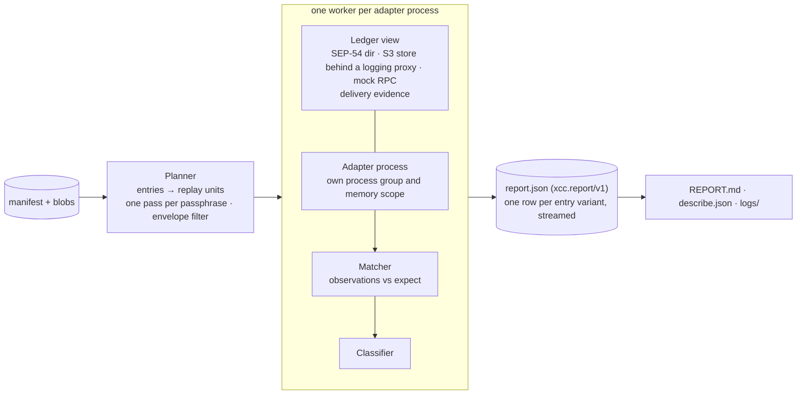

# Replay harness — `xdrcheck serve` and `xdrcheck replay`

For indexer authors and operators who run `xdrcheck replay` against their indexer and need to read the result: how
ledgers are served, how a run is planned, how stored rows are matched and classified, and what the report and exit
codes mean.

The harness feeds corpus ledgers to an indexer through an input the indexer already reads, drives it through an
adapter ([adapter-protocol.md](adapter-protocol.md)), compares what it stored with the manifest
([manifest.md §6](manifest.md)) and classifies every entry. Commands and flags: [cli.md](cli.md).

## 1. Shape of the harness

`xdrcheck serve` is the ledger server on its own, for pointing any indexer at the corpus by hand. `xdrcheck replay` plans,
serves, drives an adapter, matches, classifies and reports.

## 2. Ledger server

All inputs are views over the same ledgers. The server never alters a ledger's bytes except in the stream unit
(§3.3), which is a declared transformation.

### 2.1 SEP-54 layout on disk — supported first

Exactly what go-stellar-sdk's `support/datastore` reads and Galexie writes: a root `.config.json` (the compact
JSON the SDK marshals, with the pass's passphrase, `ledgersPerBatch: 1` and `batchesPerPartition: 64000`) and
one zstd-compressed `LedgerCloseMetaBatch` per ledger at the key the SDK derives from the sequence, for example
testnet ledger 4437357 at `FFBC9DFF--4416000-4479999/FFBC4A92--4437357.xdr.zst`. The batch is written by
concatenation (`uint32 S ‖ uint32 S ‖ uint32 1 ‖ <LedgerCloseMeta bytes>`), so corpus bytes are never re-encoded.
A `history` entry is served as the original public-lake object, byte for byte, at its original key, after its
sha256 is checked. Every SDK backend demands strictly consecutive sequences, so a layout is always gap-free.

This reaches go-stellar-sdk's `BufferedStorageBackend` with a filesystem datastore and any other lake reader.

### 2.2 The same layout behind an object store

Pipelines hard-code their store type (wallet-backend reads S3; stellar-etl reads GCS), so the layout is also
served over an object-store API. For S3 the harness runs SeaweedFS — the emulator wallet-backend's own tests
use — from the image digest pinned in `pins.toml` (never pulled during a run), uploads each unit under its own
prefix, and puts a small logging reverse proxy in front of it; consumers are pointed at the proxy, whose request
log is the delivery evidence (§2.5). Where no container can be created, the image's own statically linked `weed`
executable runs as a local process instead (same digest). Every port is bound on loopback only.

GCS is not served by `xdrcheck` yet (`--input sep54-gcs` and `xdrcheck serve --gcs` exit 2). The stellar-etl adapter takes
the `sep54-dir` layout and runs its own GCS emulator (fake-gcs-server, the one go-stellar-sdk's datastore tests
use).

### 2.3 Mock `getLedgers` — supported second

JSON-RPC 2.0 over HTTP on loopback, answering `getHealth` and `getLedgers` with stellar-rpc's wire types (the
go-stellar-sdk `protocols/rpc` structs stellar-rpc itself uses), so Go, JavaScript and other clients decode it
unchanged. Rules copied from the real server: parameters by name only; `getLedgers` limit default 50, maximum
200; a cursor together with a non-zero `startLedger`, a start outside the served range, a limit over 200 or a bad
`xdrFormat` are error −32600 with the real message text; a bad cursor is −32602. `metadataXdr` is the corpus
`LedgerCloseMeta` verbatim; `headerXdr` is the embedded `LedgerHeaderHistoryEntry` re-encoded with the pinned XDR
library.

Deliberate differences: the mock is always healthy (real RPC reports unhealthy when its latest ledger is more than
30 s old, which would stop every client replaying old ledgers), and `xdrFormat: "json"` is not served.
`getLatestLedger`, `getNetwork` and `getVersionInfo` are answered too; every other method gets a well-formed
−32601 error and is logged, because some clients call other methods and carry on after the error.

### 2.4 What known clients request

No SDK ledger backend checks the previous-ledger hash or that a ledger's own sequence equals the requested one;
all demand strictly consecutive sequences, and all enforce the passphrase indirectly by re-hashing envelopes.
After the last served ledger a lake backend retries the next key and an RPC backend polls `getHealth`, so an
adapter decides completion from the indexer's progress marker (`cursor ≥ range.end`), not from the indexer
exiting.

### 2.5 Delivery evidence

To tell an indexer that hangs from a ledger that never reached it, each view records what it served: the mock RPC
logs every request, and the S3 proxy logs every object request (uploads and the harness's own read-back check go
to the store directly and are not delivery records). Reads of a `sep54-dir` layout are not observed. The
classifier uses this evidence (§7, row 0); `xdrcheck serve --delivery-log FILE` writes it for hand runs.

## 3. Replay units

| Unit | Served | Bytes | Used for |
|---|---|---|---|
| **single** | one ledger at its real sequence, range `[S, S]` | verbatim | the default; `history` and `core-golden` entries; known-divergence checks (§9) |
| **chain** | a whole local-core scenario run, from ledger 2, on one passphrase | verbatim; a real, contiguous hash chain | entries that set `replay.unit: "chain"` or `requires_prior_state`; indexers that need earlier state |
| **stream** | every planned ledger of the pass, renumbered into one consecutive run | **transformed** | load and memory tests only |

### 3.1 single

The server publishes exactly one ledger. The adapter sets the indexer's start to `S` (for wallet-backend, by
seeding its cursor to `S − 1`). Entries that share one ledger share a unit. An entry that needs earlier ledgers
sets `replay.requires_prior_state: true` and is never served outside its chain.

### 3.2 chain

A scenario run starts at genesis on a fresh network, so everything a later ledger depends on is in the chain. Its
ledgers, passphrase, protocol and settings come from its chain index (`corpus/chains/<scenario>/…json`,
[manifest.md §8.2](manifest.md)). All entries produced by that run are scored from one session. If the indexer
stops at ledger K, entries before K are scored from their facts, the entry at K takes the stop's class, and
entries after K are `not_reached`.

### 3.3 stream — the exact transformation

For the i-th ledger of the stream (base sequence `B`, default 1000, `--stream-base`): the header's `ledgerSeq`
becomes `B + i`; every `lastModifiedLedgerSeq` inside the meta that equalled the original sequence becomes `B + i`,
and so does an account's `seqLedger` when it equalled it. Nothing else changes, so transaction hashes are kept
while the ledger hash and the hash chain go stale (no SDK backend checks them). TTLs, time bounds and other ledger
arithmetic keep their original numbers. This mirrors go-stellar-sdk's `ingest/loadtest`. Stream bytes are never
written into the corpus, and stream results are **never** used for known-divergence assertions or findings: a
failure first seen in a stream must be reproduced as a single or chain.

## 4. Planning a run

1. **Select** `ledger` entries whose `replay.indexer_scope` is not `sdk-only`, filtered by `--entries`, `--caps`
   and `--network`.
2. **Split by passphrase**: one pass per network; each variant is planned in the pass of its network.
3. **Apply the envelope** from `describe`, using manifest facts only, never decoding: with `sdk_limit` (or
   `--out-of-envelope skip`) an out-of-envelope variant is not run and is `not_applicable`; with `indexer_gate` it
   is run, to probe the gate.
4. **Choose units**: single by default; chain when the entry asks for it or `--unit chain` is given; stream only
   with `--unit stream`.
5. **Choose the input**: `--input`, else the first of `sep54-s3` (only when the pinned store image is present
   locally), `sep54-dir`, `rpc` that the adapter declares.
6. **Order** units deterministically: pass by network, then unit kind, first served sequence, first entry ID.
7. **Size deadlines** from the adapter's `describe.timing`, unless `--deadline` is given.

## 5. Running

Per unit, on one worker: publish the unit on a fresh ledger view → `prepare` → `ingest` → `observe` (always,
whatever `ingest` returned) → `teardown` → match → classify → judge against known divergences → write one row per
entry variant.

- **Isolation.** A fresh session, a fresh ledger view and its own delivery evidence per unit. Each worker
  (`--parallel N`, capped by the adapter's `max_parallel_sessions`) has its own adapter process; an adapter that
  breaks the protocol, does not answer or dies is killed and a fresh one is started for the next unit.
- **Limits.** The adapter's group runs under `--memory-max` and `--pids-max` (cgroup v2 scope, or an
  address-space limit with resident-memory polling where no user cgroup is available; the report names the
  mechanism). Deadlines as in [adapter-protocol.md §6](adapter-protocol.md).
- **Bounded memory.** After `ingest` a unit is observed in windows of consecutive ledgers, and each window's
  entries are matched, classified and written before the next window is requested, so the harness holds one
  window's observation set at a time. Adapter response lines are capped at 64 MiB.
- **Confirmation.** `--confirm K` re-runs a unit with a non-pass result K more times; results that differ are
  `flaky`.
- **Network.** The harness opens only loopback sockets. Run under `make … OFFLINE=1` (or
  `scripts/offline-run.sh`) the whole run, adapter and indexer included, has no route out.

## 6. Matching observations against `expect`

The matcher implements [manifest.md §6](manifest.md), which is normative. In short:

- **Exact comparison everywhere.** Amounts, IDs and counts are compared as decimal strings or integers; no
  tolerance, rounding, case folding or prefix matching.
- **Stored values are decoded by the harness** with its own strict strkey decoder, according to the declared
  `as_stored.encoding`; an adapter's interpreted fields are used only where no stored form is given.
- **Scope.** Facts belong to the focus transaction or to the transaction an item names; other transactions are
  looked at only through the receipts and the transaction list. Ambient facts (balance changes, sequence bumps,
  fee and refund movements) satisfy an item that lists them and are never extras.
- **Presence.** Kinds and sub-kinds the adapter does not provide are `not_applicable`; an `only_if` item is
  required only when the adapter declares that modelling choice.
- **Declared scope.** An expected participant, stored address or state change that meets a rule of the
  capability's `out_of_scope` list (by address type, role, the asset type of a participant's movements, kind, asset type, detail or cause; each rule cites the
  indexer's own statement as `basis`) is `not_applicable` with that basis as its reason
  ([adapter-protocol.md §8.1](adapter-protocol.md#81-wallet-backends-declared-scope)). Negative facts and extras
  are never excused; a malformed list makes the match fail.
- **Identity.** Participants match by base address. A `base_only` reader's muxed ID is never compared; a
  `base_and_alias` reader must report the expected one. Identity held only in muxed form is a wrong value.
- **Negative facts** (`must_not_include`, a `count: 0` movement) are checked only when the transaction is
  positively observed, and a result made of negative facts alone is never a pass.

Each expected fact ends `matched`, `missing`, `wrong` or `not_applicable`; observed facts no expectation accounted
for are `ignored`, `extra` (under an exactness flag) or `forbidden`.

## 7. Classification

The first matching row gives the class and qualifier. "This ledger" for a stop is the ledger the indexer stopped
on: the ingest result's `failing_ledger` when given; else the one after its cursor; for a stop the harness
observed itself (deadline, memory kill), the last ledger the delivery evidence shows served.

| # | Condition | Result |
|---|---|---|
| 0 | Adapter error, protocol violation, or positive evidence the ledger was never served | `harness_fault` (not an indexer result; exit 2 unless `--keep-going`) |
| 1 | Planned `not_applicable` (outside an `sdk_limit` envelope, `--out-of-envelope skip`) | `not_applicable` |
| 2 | Ingest crashed at or before this ledger (signal, runtime fault, memory kill) | `mishandled · crash` |
| 3 | Ingest timed out with progress stopped at this ledger | `mishandled · hang` |
| 4 | Refused at this ledger, gate declared `indexer_gate`, the manifest confirms the entry is outside that gate, nothing written, no crash | `dropped · refused` |
| 5 | Refused failing any condition of row 4, or halted at this ledger | `mishandled · halt` |
| 6 | The indexer stopped at an earlier ledger of the unit | `not_reached` |
| 7 | Got past the ledger, but the ledger or the focus transaction is absent, or a receipt counter is lower, and the indexer recorded no error | `dropped · silent` |
| 8 | A fact wrong, an exactness extra, a forbidden fact, or a receipt counter higher | `mishandled · wrong_value` |
| 9 | A fact missing | `dropped · partial` |
| 10 | Every fact matched or `not_applicable`, at least one positive fact matched | `pass` |
| 11 | No positive fact matched | `not_applicable` |

The report has three result classes, **pass**, **mishandled** and **dropped**, plus four side categories
(`not_applicable`, `not_reached`, `flaky`, `harness_fault`) that say an entry produced no result about the indexer,
and why. A **verified** refusal (`dropped · refused`) is the safe behaviour the guide recommends: it needs no finding
and does not fail a run. A refusal the harness cannot confirm is already a halt (row 5).

## 8. Report

With `--report DIR` a run writes:

| File | Contents |
|---|---|
| `report.json` | `xcc.report/v1` (`corpus/schema/report.schema.json`): a header (tool, versions, pins, run settings) and one row per entry variant with the unit, class and qualifier, expected versus observed facts, the known-divergence match, the verdict and the finding ID. The format every tool of the kit writes |
| `describe.json` | The adapter's `describe` result |
| `REPORT.md` | A readable page, rendered from `report.json`: target, input, adapter and declared envelope; then **Failures** — every failing row and every row whose result is not the expected one, unexpected rows first, each with the entry, its CAPs, the ledgers, what the result means, expected against observed (how the ingest ended when it did not complete, the first missing or wrong facts with their differing fields), and the `xdrcheck replay --entries <id> …` command that replays that entry alone; then **Counts**: the three-column headline (pass, mishandled, dropped), the entries that produced no result about the indexer, and the number of results other than the expected one |
| `logs/` | Adapter stderr per process and delivery logs |
| `evidence/` | The whole evidence of each row whose evidence is over the writer's inline cap (32 KiB), one file per row. The row keeps a shortened copy — the `missing_or_wrong` facts and their `diffs` in full, other long lists (such as each fact's `observed` references) cut to their first ten with the full length in `<key>_total` — and names the file in `full_evidence`, with `truncated: true` and `original_bytes`. When even the shortened copy is over the cap the row keeps only those three keys |

### 8.4 Exit codes

| Code | Meaning |
|---|---|
| `0` | Every result is the expected one |
| `1` | At least one unexpected result (§9); with `--findings DIR`, a failure row with no finding ID that resolves; with `--selftest`, a failed check |
| `2` | The harness could not run or hit a harness fault: bad arguments, an adapter that does not start or breaks the protocol, a ledger never served. `--resume` and `--overlay` are not built yet and exit 2 |

## 9. Known divergences: how they are asserted

An entry's `conformance.known_divergences` may name an indexer with `level: "replay"`
([manifest.md §7](manifest.md)). For a run against target T at version V:

1. Divergences whose `target` is T and whose `versions` range contains V apply. For packages with tags the harness
   evaluates the range; for repositories without tags the adapter answers through `prepare.resolve_ranges`.
2. **Inside a range** the result must be the declared class and, when given, qualifier. Anything else, a pass
   included, is unexpected: the corpus no longer reproduces the defect.
3. **Outside every range** the result must be `pass`.
4. `xdrcheck replay --assert-known` runs only the entries with a divergence for T and fails on any unexpected result.

`make verify-replay` (`scripts/verify-replay.sh`) runs `--assert-known` with the wallet-backend adapter at each
pinned pre-fix and fixed commit of wallet-backend#729, #731 and #716 (the `acceptance` key of
`[pipelines.wallet_backend]` in `pins.toml`) and at the pinned current commit, on both the S3 and the RPC input. The
entries are found in the manifest, not listed in the script. Besides the exit code it asserts row by row:

| Row | Must be |
|---|---|
| every variant the commit's SDK can decode | present and scored |
| pre-fix commit | exactly the declared class and qualifier |
| fixed and current commit | `pass` |
| any | nothing unexpected; no session state left behind |

The hand-run reproductions these checks were built from are in `evidence/wallet-backend-replay/` and
`evidence/wallet-backend-731/`.

## 10. The memory-bound test

`make verify-memory` (`scripts/verify-memory.sh`) runs four tests, each `xdrcheck replay` in a memory-limited group of
its own (256 MiB, swap off):

| Test | What it shows |
|---|---|
| T-mem-1 | The harness's memory is flat in corpus size: the baseline indexer over the sampled bulk tier as a stream repeated once and ten times (peak growth under 16 MiB, ten times the rows), the tier's ledgers of a megabyte or more, and the corpus's largest ledger repeated a hundred times |
| T-mem-2 | An adapter answering `observe` with a 512 MiB line is refused at the line cap; the harness survives |
| T-mem-3 | The `memory-hog` seeded indexer under a 128 MiB adapter group is caught as `mishandled · crash` |
| T-mem-4 | The corpus's deepest and largest ledgers pass through the server and matcher under the limit |

A negative control then reruns T-mem-1 with streaming switched off and must fail, so the test can tell a streaming
harness from one that is not.

A run's peak is the xdrcheck process's peak resident set (`VmHWM`), which includes about 37 MiB of the binary's own
mapped code. It is read only once the process runs xdrcheck: until the exec through `systemd-run` completes, the new
process can still show the test's own memory, which once was recorded as the run's. The rest is bounded three ways,
so the peak does not depend on the machine's CPU count or on the collector's timing: the harness compresses ledgers
with one zstd encoder rather than one per CPU (each holds about 16 MiB of history); an adapter line is collected in
fragments and joined once, so a line cut at the cap never costs twice its length; and before each slice of work the
Go soft memory limit is set to what the harness holds plus room for the slice, at most 64 MiB, so a stream of
ledgers of megabytes does not grow the heap up to the ceiling taken from the group (87.5 % of it).

## 11. Command-line surface

See [cli.md](cli.md) for every flag of `xdrcheck serve` and `xdrcheck replay`, generated from their help output.

## 12. The harness's own test: seeded-bug indexers

`make harness-selftest` (`scripts/harness-selftest.sh`) replays the corpus through the baseline indexer with one
deliberate defect switched on at a time (`baseline --bug NAME`) and requires each to land in the class its row of
`go/adapters/baseline/bugs/table.json` documents; the unmodified baseline must pass the whole corpus. Together the
bugs reach every classification branch: truncated or payload-dropped addresses, fabricated muxed addresses,
participants taken from the authorization tree or the envelope, identity kept only in muxed form, credit from a
forged token event, double-counted transfers, float amounts and void routing read as zero
(`mishandled · wrong_value`); a silently dropped ledger (`dropped · silent`); a dropped contract trustline
(`dropped · partial`); a panic (`mishandled · crash`); an endless loop (`mishandled · hang`); permanent-error exits,
a partial write, fake and dirty refusals (`mishandled · halt`); a genuine protocol gate (`dropped · refused`); extra
fee rows (`pass`: storing more is not a failure); and a memory hog.

## 13. Service rigs (`xdrcheck replay --rig`)

`xdrcheck replay --rig wallet-backend|stellar-etl --ledgers A-B|A,B,C|@FILE --lake DIR --commit SHA --out DIR
[--network pubnet|testnet|PASSPHRASE] [--shards N] [--log-level LEVEL]` runs the real pipeline, built from source at the commit (cached
per commit), over ledgers read from a lake-layout directory. Ledgers the directory lacks are fetched from the public
lake unless `--fetch none`. The run directory holds `manifest.json`, `status.jsonl` (one line per requested ledger:
`ingested`, `halted` with the error text, the ledger it names and the durable cursor, `skipped`, or `harness_fault`),
`rows.jsonl` (the judge's row kinds, sorted by ledger), `rows-other.jsonl` (every other row, so nothing written is
left out), `checks.jsonl` and `summary.json`; each shard keeps its logs and raw tables or exports.

wallet-backend:

- Contiguous ledgers form a segment. Each segment is one live-ingestion process into the shard's single database,
  with one ledger per commit; the cursor is polled, so every commit is observed. Before a segment the rig sets the
  ingest cursor and the history and current-state cursors of every classified protocol to the segment's first
  ledger minus one, which is what a finished `protocol-migrate` leaves. Live mode cannot cross a gap, so a sparse
  list is a series of segments in one database; SEP-41 running totals then start from zero at the first segment.
- A segment that stops short: the ledger after the durable cursor is `halted`, the service is started once more
  without touching the cursor to see whether the halt repeats, and the rest of the segment is `skipped`
  (`--skip-halted` moves the cursor past the halted ledger instead, which production never does).
- Seeding, in place of the history-archive checkpoint that a seeded cursor skips: a `contract_tokens` SAC row for
  every Stellar Asset Contract the ledgers touch (verified by hashing the asset, written as the checkpoint writes
  it) unless the ledgers deploy it; and, from a state seed (`--seed DIR`, built once with `--seed-rpc URL`, with an optional request header
  from `$XDRCHECK_STATE_RPC_HEADER`), the `protocol_wasms` and `protocol_contracts` rows of the WASM contracts the
  ledgers touch. A contract whose instance a replayed ledger changes is bound to the WASM of that change's
  pre-image (its binding at the time); any other contract is bound as the seed has it, which is the network's
  state when the seed was fetched, not at the replayed ledger. Every WASM an instance in the ledgers points at is
  registered and its code served. Nothing is pre-registered (no SAC row, WASM row or binding) for a contract deployed or a WASM
  uploaded inside the replayed ledgers: live ingestion sees those happen and records and classifies them itself. The commit's own `protocol-setup` then classifies them against a local RPC that
  serves the seed's entries.
- Rows: `transactions_accounts` give `participant`; `operations_accounts` give `op_participant`; every balance
  state change gives `balance_change` named by its token's contract (fee rows marked; the judge tells verified
  SACs from other contracts); the other state changes give `entry_change` rows (account, trustline and data
  entries created or removed, and the signer, threshold, flag, home-domain, limit, authorization and data-value
  changes they state, signer keys as stored) beside the verbatim `state_change`; balance tables give `balance`
  (absolute state, not deltas).
- The local RPC answers `simulateTransaction` only for a zero-argument contract call, with the return value of
  the same call recorded in the run's ledgers; anything else is a failed simulation. Token metadata and Blend pool
  configuration (`get_config`), which wallet-backend reads only by simulation, therefore keep its defaults unless
  the run itself holds such a call.

stellar-etl: every `export_*` command the binary lists, over each segment as one range; a one-ledger segment N is
exported as N..N+1 (rows of N+1 are context and are dropped), because a one-ledger range writes no ledger entry
changes. Each requested ledger is checked against what it holds (ledger, every transaction and operation, a fee
transfer per transaction, contract events, changed entry keys); a failed check is a silent drop. Rows: token
transfers give `token_event` and the `balance_change` rows they imply; effects give `effect_balance_change`
(amount-bearing effects) and `entry_change` (entries and attribute values the effects state); an operation's
`asset_balance_changes` give `op_token_event`.
