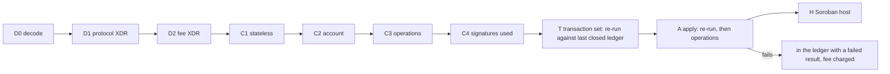

Two rules carry most of this page.

1. stellar-core validates some transaction fields and passes others through untouched. {/* claim: C-6001 */} A field that core passes through is whatever the submitter put there, so read it as attacker-controlled input. {/* claim: C-6002 */}
2. Work out who a transaction affected from ledger meta, not from the envelope. {/* claim: C-6003 */} The envelope records what the submitter claimed; meta records what core changed. {/* claim: C-6004 */}

This page is for anyone who reads `LedgerCloseMeta`, transaction envelopes or contract events: indexers, explorers, wallets, analytics pipelines and RPC gateways. Statements about stellar-core refer to release [v30.0.0](https://github.com/stellar/stellar-core/tree/v30.0.0) (Protocol 30) and link to the source lines they rest on. Patterns are named by their entry ID in a public test corpus, such as `cap-0073/sac-trust-creates-trustline`; an entry holds the ledger or XDR bytes, where they came from (pubnet or testnet history, or a stellar-core run on a local network) and the values a correct reader produces from them. The corpus is open source and published with the `xdrlint` analyzer; the [checklist](/docs/data/indexers/build-your-own/indexer-hardening/checklist) links to it.

To audit an existing indexer item by item, use the [hardening checklist](/docs/data/indexers/build-your-own/indexer-hardening/checklist); each item names the linter rule or the manual check that covers it.

The corpus repository holds a verification report, `guide/VERIFICATION.md`, that states how each statement on this page was checked and what evidence it rests on.

## Validated versus unvalidated fields {#validated-fields}

### How stellar-core validates a transaction {#validation-stages}

Validation happens in stages. A transaction that appears in a ledger passed every stateless check against the last closed ledger, because every validator re-runs those checks on every transaction in a proposed transaction set ([source](https://github.com/stellar/stellar-core/blob/v30.0.0/src/herder/TxSetFrame.cpp#L1789-L1845)). {/* claim: C-6101 */} A transaction that appears with a failed result may have failed any stateful check at apply time, and it is still in the ledger and still paid a fee ([source](https://github.com/stellar/stellar-core/blob/v30.0.0/src/transactions/TransactionFrame.cpp#L1731-L1771)). {/* claim: C-6102 */} Branch on `TransactionResult.result.code`, never on the envelope alone. {/* claim: C-6103 */}

| Stage | What it checks | Code at v30.0.0 |
| --- | --- | --- |
| D0 XDR decode | Shape, lengths, padding and union discriminants; no meaning. The decoder's stack limit is 1500 units {/* claim: C-6162 */} | [main.cpp L425](https://github.com/stellar/stellar-core/blob/v30.0.0/src/main/main.cpp#L425) |
| D1 protocol XDR check | Envelope nesting depth and which XDR arms the current protocol allows {/* claim: C-6163 */} | [TransactionUtils.cpp L1350-1378](https://github.com/stellar/stellar-core/blob/v30.0.0/src/transactions/TransactionUtils.cpp#L1350-L1378) |
| D2 fee XDR check | A Soroban transaction has a v1 envelope with Soroban data; resource fee between 0 and 2^50 stroops {/* claim: C-6164 */} | [TransactionFrame.cpp L1774-1790](https://github.com/stellar/stellar-core/blob/v30.0.0/src/transactions/TransactionFrame.cpp#L1774-L1790) |
| C1 stateless checks | Envelope type, preconditions, Soroban resources, time and ledger bounds, minimum fee, source account exists {/* claim: C-6165 */} | [TransactionFrame.cpp L1241-1495](https://github.com/stellar/stellar-core/blob/v30.0.0/src/transactions/TransactionFrame.cpp#L1241-L1495) |
| C2 account checks | Sequence number, minimum sequence age and gap, transaction signatures, balance covers the fee {/* claim: C-6166 */} | [TransactionFrame.cpp L1608-1728](https://github.com/stellar/stellar-core/blob/v30.0.0/src/transactions/TransactionFrame.cpp#L1608-L1728) |
| C3 operation checks | Operation source, operation threshold, operation-specific shape checks {/* claim: C-6167 */} | [OperationFrame.cpp L283-363](https://github.com/stellar/stellar-core/blob/v30.0.0/src/transactions/OperationFrame.cpp#L283-L363) |
| C4 signatures used | Every signature was used by some signer {/* claim: C-6168 */} | [SignatureChecker.cpp L172-191](https://github.com/stellar/stellar-core/blob/v30.0.0/src/transactions/SignatureChecker.cpp#L172-L191) |
| T transaction set | Every validator re-runs C1 to C4 for every transaction against the last closed ledger {/* claim: C-6169 */} | [TxSetFrame.cpp L1789-1845](https://github.com/stellar/stellar-core/blob/v30.0.0/src/herder/TxSetFrame.cpp#L1789-L1845) |
| A apply | C1 to C4 again against the ledger as it stands at that point, then the operations {/* claim: C-6170 */} | [TransactionFrame.cpp L2028-2098](https://github.com/stellar/stellar-core/blob/v30.0.0/src/transactions/TransactionFrame.cpp#L2028-L2098) |
| H Soroban host | Host function and authorization decoding, value conversion, authorization, execution {/* claim: C-6171 */} | [e2e_invoke.rs L470-578](https://github.com/stellar/rs-soroban-env/blob/6e6c4a87f46c7fdab0c2e2be82901b1e32378223/soroban-env-host/src/e2e_invoke.rs#L470-L578) |



A closed ledger is final: a transaction that is in a ledger stays there with the result it got. {/* claim: C-6104 */}

### The field-by-field table {#field-table}

Each line of the table has one status: validated, partially validated or passed through. A field whose parts differ is split into one line per part, such as the key and the muxed ID of a source account. Each line names the validation stage, the code that performs the check, what you may assume, what you must not assume, the result code core returns when the check fails, and the corpus entries that demonstrate it. {/* claim: C-6105 */}

#### Envelope and fee bump {#fields-envelope}

{/* BEGIN GENERATED: fields envelope */}

| ID | Field | Controlled by | Status | What core checks, and where | You may assume | You must not assume | Rejected with | Demonstrated by |
| --- | --- | --- | --- | --- | --- | --- | --- | --- |
| VF-01 | TransactionEnvelope.type | submitter | validated | C1: From Protocol 13 ENVELOPE_TYPE_TX_V0 is not supported; before Protocol 13 ENVELOPE_TYPE_TX and any muxed account are not supported. ([TransactionFrame.cpp L1256-1264](https://github.com/stellar/stellar-core/blob/v30.0.0/src/transactions/TransactionFrame.cpp#L1256-L1264)) | V0 envelopes occur only in pre-Protocol-13 history. | That V0 envelopes never need decoding: full-history readers still meet them. | `txNOT_SUPPORTED` | `protocol-13/upgrade-ledger-header-13-envelopes-v0` |
| VF-02a | Transaction.sourceAccount: The ed25519 key | submitter | validated | C1: The ed25519 key must be an existing account. ([TransactionFrame.cpp L1473-1478](https://github.com/stellar/stellar-core/blob/v30.0.0/src/transactions/TransactionFrame.cpp#L1473-L1478)) C2: The account's signers must meet the LOW threshold. ([TransactionFrame.cpp L1683-1688](https://github.com/stellar/stellar-core/blob/v30.0.0/src/transactions/TransactionFrame.cpp#L1683-L1688)) C1: The muxed ID is stripped before any use (toAccountID). ([TransactionUtils.cpp L1185-1201](https://github.com/stellar/stellar-core/blob/v30.0.0/src/transactions/TransactionUtils.cpp#L1185-L1201)) C1: From Protocol 25 an InvokeHostFunction transaction must not have a muxed source (validateSorobanMemo). ([TransactionFrame.cpp L341-369](https://github.com/stellar/stellar-core/blob/v30.0.0/src/transactions/TransactionFrame.cpp#L341-L369), [TransactionFrame.cpp L1315-1328](https://github.com/stellar/stellar-core/blob/v30.0.0/src/transactions/TransactionFrame.cpp#L1315-L1328)) | The key names a real account that authorized the transaction. | Anything about the muxed ID: it is an arbitrary 64-bit label and is never checked. | `txNO_ACCOUNT`, `txBAD_AUTH`, `txSOROBAN_INVALID` | `cap-0023/balance-id-from-muxed-source`, `cap-0027/muxed-source-and-destination-max-ids`, `cap-0027/muxed-source-id-above-2-pow-63`, `cap-0027/muxed-source-id-zero`, `cap-0046/soroban-ops-with-muxed-source` |
| VF-02b | Transaction.sourceAccount: The muxed ID | submitter | passed through | C1: The ed25519 key must be an existing account. ([TransactionFrame.cpp L1473-1478](https://github.com/stellar/stellar-core/blob/v30.0.0/src/transactions/TransactionFrame.cpp#L1473-L1478)) C2: The account's signers must meet the LOW threshold. ([TransactionFrame.cpp L1683-1688](https://github.com/stellar/stellar-core/blob/v30.0.0/src/transactions/TransactionFrame.cpp#L1683-L1688)) C1: The muxed ID is stripped before any use (toAccountID). ([TransactionUtils.cpp L1185-1201](https://github.com/stellar/stellar-core/blob/v30.0.0/src/transactions/TransactionUtils.cpp#L1185-L1201)) C1: From Protocol 25 an InvokeHostFunction transaction must not have a muxed source (validateSorobanMemo). ([TransactionFrame.cpp L341-369](https://github.com/stellar/stellar-core/blob/v30.0.0/src/transactions/TransactionFrame.cpp#L341-L369), [TransactionFrame.cpp L1315-1328](https://github.com/stellar/stellar-core/blob/v30.0.0/src/transactions/TransactionFrame.cpp#L1315-L1328)) | The key names a real account that authorized the transaction. | Anything about the muxed ID: it is an arbitrary 64-bit label and is never checked. | `txNO_ACCOUNT`, `txBAD_AUTH`, `txSOROBAN_INVALID` | `cap-0023/balance-id-from-muxed-source`, `cap-0027/muxed-source-and-destination-max-ids`, `cap-0027/muxed-source-id-above-2-pow-63`, `cap-0027/muxed-source-id-zero`, `cap-0046/soroban-ops-with-muxed-source` |
| VF-03 | Transaction.fee | submitter | validated | C1: Inclusion fee must be at least baseFee times max(1, number of operations). ([TransactionFrame.cpp L1460-1465](https://github.com/stellar/stellar-core/blob/v30.0.0/src/transactions/TransactionFrame.cpp#L1460-L1465)) C2: Available balance must cover the fee. ([TransactionFrame.cpp L1695-1708](https://github.com/stellar/stellar-core/blob/v30.0.0/src/transactions/TransactionFrame.cpp#L1695-L1708)) A: The fee charged is the declared Soroban resource fee (if any) plus min(inclusion-fee bid, base fee times max(1, number of operations)) from Protocol 11; before Protocol 11 the full bid. ([TransactionFrame.cpp L395-426](https://github.com/stellar/stellar-core/blob/v30.0.0/src/transactions/TransactionFrame.cpp#L395-L426)) | The fee source could afford the bid when the transaction was applied. | That the envelope fee was paid. Use TransactionResult.feeCharged and the fee changes in meta. | `txINSUFFICIENT_FEE`, `txINSUFFICIENT_BALANCE` | `cap-0005/fee-charged-below-bid`, `cap-0042/surge-priced-set-discounted-base-fee` |
| VF-04 | Transaction.seqNum | submitter | validated | C2: Must equal the account's sequence + 1; when minSeqNum is set (Protocol 19+) the account's sequence must instead lie in [minSeqNum, seqNum). Never the ledger's starting sequence number. ([TransactionFrame.cpp L1581-1605](https://github.com/stellar/stellar-core/blob/v30.0.0/src/transactions/TransactionFrame.cpp#L1581-L1605)) A: The sequence number is consumed even when the transaction later fails. ([TransactionFrame.cpp L1670](https://github.com/stellar/stellar-core/blob/v30.0.0/src/transactions/TransactionFrame.cpp#L1670), [TransactionFrame.cpp L2082-2085](https://github.com/stellar/stellar-core/blob/v30.0.0/src/transactions/TransactionFrame.cpp#L2082-L2085)) | The sequence number is consumed on ledger for every transaction that got past C1 at apply. | That it is consumed when the transaction failed C1 at apply (for example txTOO_LATE). | `txBAD_SEQ` | `cap-0015/fee-bump-muxed-fee-source-inner-failed`, `cap-0034/tx-too-late-with-fee-charged`, `classic/failed-and-successful-path-payment-amounts` |
| VF-05 | Transaction.ext | submitter | validated | C1: Classic transactions: from Protocol 21 ext.v must be 0. ([TransactionFrame.cpp L1417-1436](https://github.com/stellar/stellar-core/blob/v30.0.0/src/transactions/TransactionFrame.cpp#L1417-L1436)) D2: Soroban transactions: ext.v must be 1. ([TransactionFrame.cpp L1774-1790](https://github.com/stellar/stellar-core/blob/v30.0.0/src/transactions/TransactionFrame.cpp#L1774-L1790)) | A Soroban transaction in a ledger carries SorobanTransactionData. |  | `txMALFORMED` | `cap-0067/sac-transfer-to-muxed-account` |
| VF-06 | TransactionV1Envelope.signatures\<20\> | submitter | validated | D0: At most 20 by XDR. ([Stellar-transaction.x L929](https://github.com/stellar/stellar-xdr/blob/4f524bbac80c781c06e4fb5fc93a2d0d331d6705/Stellar-transaction.x#L929), [Stellar-transaction.x L972](https://github.com/stellar/stellar-xdr/blob/4f524bbac80c781c06e4fb5fc93a2d0d331d6705/Stellar-transaction.x#L972), [Stellar-transaction.x L998](https://github.com/stellar/stellar-xdr/blob/4f524bbac80c781c06e4fb5fc93a2d0d331d6705/Stellar-transaction.x#L998)) C2: Each must verify against a signer of the transaction source, an operation source, or an extra signer. ([TransactionFrame.cpp L483-528](https://github.com/stellar/stellar-core/blob/v30.0.0/src/transactions/TransactionFrame.cpp#L483-L528)) C4: Every signature must have been used. ([SignatureChecker.cpp L172-191](https://github.com/stellar/stellar-core/blob/v30.0.0/src/transactions/SignatureChecker.cpp#L172-L191)) C2: From Protocol 28 at most 1000 ed25519 verifications per transaction (enforced in overlay validation at every protocol). ([SignatureChecker.h L46-50](https://github.com/stellar/stellar-core/blob/v30.0.0/src/transactions/SignatureChecker.h#L46-L50), [SignatureChecker.cpp L31-44](https://github.com/stellar/stellar-core/blob/v30.0.0/src/transactions/SignatureChecker.cpp#L31-L44), [ProtocolVersion.h L85-86](https://github.com/stellar/stellar-core/blob/v30.0.0/src/util/ProtocolVersion.h#L85-L86)) | In txSUCCESS and most txFAILED results every signature was used. | That signatures were verified in results that failed C1 or C2 during apply (src/transactions/TransactionFrame.cpp:1533-1547). | `txBAD_AUTH_EXTRA`, `txBAD_AUTH` | `cap-0021/precond-v2-all-fields`, `cap-0040/tx-authorised-by-signed-payload-signature`, `classic/hash-x-signer-preimage-0-and-64-bytes`, `classic/operations-100-signatures-20` |
| VF-07a | DecoratedSignature.hint: That each signature counted toward a threshold verified against a real signer | submitter | validated | C2: ed25519: last 4 bytes of the public key. Hash-x: last 4 bytes of the hash. Signed payload: public-key hint XOR payload hint. ([SignatureUtils.cpp L38-46](https://github.com/stellar/stellar-core/blob/v30.0.0/src/transactions/SignatureUtils.cpp#L38-L46), [SignatureUtils.cpp L83-105](https://github.com/stellar/stellar-core/blob/v30.0.0/src/transactions/SignatureUtils.cpp#L83-L105), [SignatureUtils.cpp L127-136](https://github.com/stellar/stellar-core/blob/v30.0.0/src/transactions/SignatureUtils.cpp#L127-L136)) C4: A signature whose hint matches nothing is unused. ([SignatureChecker.cpp L172-191](https://github.com/stellar/stellar-core/blob/v30.0.0/src/transactions/SignatureChecker.cpp#L172-L191)) | In a transaction that passed C4, each hint matched the signer it verified against. | That a hint identifies a signer, or that it equals the tail of a G key: it is 4 bytes and may be XOR-ed with a payload. | `txBAD_AUTH_EXTRA` | `cap-0040/tx-authorised-by-signed-payload-signature` |
| VF-07b | DecoratedSignature.hint: The 4 hint bytes as an identifier of a signer | submitter | passed through | C2: ed25519: last 4 bytes of the public key. Hash-x: last 4 bytes of the hash. Signed payload: public-key hint XOR payload hint. ([SignatureUtils.cpp L38-46](https://github.com/stellar/stellar-core/blob/v30.0.0/src/transactions/SignatureUtils.cpp#L38-L46), [SignatureUtils.cpp L83-105](https://github.com/stellar/stellar-core/blob/v30.0.0/src/transactions/SignatureUtils.cpp#L83-L105), [SignatureUtils.cpp L127-136](https://github.com/stellar/stellar-core/blob/v30.0.0/src/transactions/SignatureUtils.cpp#L127-L136)) C4: A signature whose hint matches nothing is unused. ([SignatureChecker.cpp L172-191](https://github.com/stellar/stellar-core/blob/v30.0.0/src/transactions/SignatureChecker.cpp#L172-L191)) | In a transaction that passed C4, each hint matched the signer it verified against. | That a hint identifies a signer, or that it equals the tail of a G key: it is 4 bytes and may be XOR-ed with a payload. | `txBAD_AUTH_EXTRA` | `cap-0040/tx-authorised-by-signed-payload-signature` |
| VF-08 | DecoratedSignature.signature (opaque\<64\>) | submitter | validated | C2: ed25519: verified over the contents hash. Hash-x: sha256(signature) must equal the hash, so the 'signature' is the preimage, 0-64 bytes. Signed payload: ed25519 over the payload bytes. ([SignatureUtils.cpp L49-61](https://github.com/stellar/stellar-core/blob/v30.0.0/src/transactions/SignatureUtils.cpp#L49-L61), [SignatureUtils.cpp L83-91](https://github.com/stellar/stellar-core/blob/v30.0.0/src/transactions/SignatureUtils.cpp#L83-L91)) C2: Pre-auth-tx signers consume no signature. ([SignatureChecker.cpp L70-85](https://github.com/stellar/stellar-core/blob/v30.0.0/src/transactions/SignatureChecker.cpp#L70-L85)) | Each signature in a transaction that passed C4 satisfied one signer. | That a signature is a 64-byte ed25519 signature. | `txBAD_AUTH_EXTRA`, `txBAD_AUTH` | `cap-0028/pre-auth-signer-removed-on-failed-tx`, `cap-0040/tx-authorised-by-signed-payload-signature`, `classic/hash-x-signer-preimage-0-and-64-bytes` |
| VF-09a | FeeBumpTransaction.feeSource: The ed25519 key of the fee source | fee payer | validated | C1: Account must exist. ([FeeBumpTransactionFrame.cpp L456-460](https://github.com/stellar/stellar-core/blob/v30.0.0/src/transactions/FeeBumpTransactionFrame.cpp#L456-L460)) C2: Must sign at LOW threshold and afford the fee. ([FeeBumpTransactionFrame.cpp L273-285](https://github.com/stellar/stellar-core/blob/v30.0.0/src/transactions/FeeBumpTransactionFrame.cpp#L273-L285), [FeeBumpTransactionFrame.cpp L476-487](https://github.com/stellar/stellar-core/blob/v30.0.0/src/transactions/FeeBumpTransactionFrame.cpp#L476-L487), [FeeBumpTransactionFrame.cpp L499-502](https://github.com/stellar/stellar-core/blob/v30.0.0/src/transactions/FeeBumpTransactionFrame.cpp#L499-L502)) C1: Muxed ID stripped (getFeeSourceID). ([FeeBumpTransactionFrame.cpp L676-678](https://github.com/stellar/stellar-core/blob/v30.0.0/src/transactions/FeeBumpTransactionFrame.cpp#L676-L678)) C1: Not covered by the Protocol 25 Soroban muxed-source rule, which inspects inner transaction and operation sources only. ([TransactionFrame.cpp L361-365](https://github.com/stellar/stellar-core/blob/v30.0.0/src/transactions/TransactionFrame.cpp#L361-L365)) | The fee source key is a real account that paid the fee. | That the fee payer is the inner source, or that its muxed ID means anything. | `txNO_ACCOUNT`, `txBAD_AUTH`, `txINSUFFICIENT_BALANCE` | `cap-0015/fee-bump-muxed-fee-source-inner-failed` |
| VF-09b | FeeBumpTransaction.feeSource: The muxed ID of the fee source | fee payer | passed through | C1: Account must exist. ([FeeBumpTransactionFrame.cpp L456-460](https://github.com/stellar/stellar-core/blob/v30.0.0/src/transactions/FeeBumpTransactionFrame.cpp#L456-L460)) C2: Must sign at LOW threshold and afford the fee. ([FeeBumpTransactionFrame.cpp L273-285](https://github.com/stellar/stellar-core/blob/v30.0.0/src/transactions/FeeBumpTransactionFrame.cpp#L273-L285), [FeeBumpTransactionFrame.cpp L476-487](https://github.com/stellar/stellar-core/blob/v30.0.0/src/transactions/FeeBumpTransactionFrame.cpp#L476-L487), [FeeBumpTransactionFrame.cpp L499-502](https://github.com/stellar/stellar-core/blob/v30.0.0/src/transactions/FeeBumpTransactionFrame.cpp#L499-L502)) C1: Muxed ID stripped (getFeeSourceID). ([FeeBumpTransactionFrame.cpp L676-678](https://github.com/stellar/stellar-core/blob/v30.0.0/src/transactions/FeeBumpTransactionFrame.cpp#L676-L678)) C1: Not covered by the Protocol 25 Soroban muxed-source rule, which inspects inner transaction and operation sources only. ([TransactionFrame.cpp L361-365](https://github.com/stellar/stellar-core/blob/v30.0.0/src/transactions/TransactionFrame.cpp#L361-L365)) | The fee source key is a real account that paid the fee. | That the fee payer is the inner source, or that its muxed ID means anything. | `txNO_ACCOUNT`, `txBAD_AUTH`, `txINSUFFICIENT_BALANCE` | `cap-0015/fee-bump-muxed-fee-source-inner-failed` |
| VF-10 | FeeBumpTransaction.fee | fee payer | validated | C1: Outer inclusion fee at least the minimum and per-operation rate at least the inner rate. An inner transaction with a negative inclusion fee is accepted only for Soroban from Protocol 23, otherwise txFEE_BUMP_INNER_FAILED. ([FeeBumpTransactionFrame.cpp L402-454](https://github.com/stellar/stellar-core/blob/v30.0.0/src/transactions/FeeBumpTransactionFrame.cpp#L402-L454)) | The outer fee bid met the minimum. | That the bid was charged. Use the outer feeCharged. | `txINSUFFICIENT_FEE`, `txFEE_BUMP_INNER_FAILED` | `cap-0015/fee-bump-inner-failed`, `cap-0015/fee-bump-muxed-fee-source-inner-failed`, `cap-0046/fee-bump-soroban-refund-to-fee-source-golden`, `cap-0046/resource-fee-exceeds-uint32-golden` |
| VF-11 | FeeBumpTransactionEnvelope.signatures\<20\> | fee payer | validated | C4: Separate signature check over the fee-bump hash; all must be used. Inner signatures are checked against the inner hash. ([FeeBumpTransactionFrame.cpp L312-347](https://github.com/stellar/stellar-core/blob/v30.0.0/src/transactions/FeeBumpTransactionFrame.cpp#L312-L347)) | Outer and inner signatures were each checked against their own hash. |  | `txBAD_AUTH_EXTRA` | `cap-0015/fee-bump-muxed-fee-source-inner-failed` |
| VF-12 | Transaction.fee of the inner transaction of a fee bump | inner signer | passed through | C1: The inner transaction is validated with chargeFee = false; from Protocol 23 its fee need not even cover resourceFee. ([FeeBumpTransactionFrame.cpp L344-347](https://github.com/stellar/stellar-core/blob/v30.0.0/src/transactions/FeeBumpTransactionFrame.cpp#L344-L347), [TransactionFrame.cpp L1338-1356](https://github.com/stellar/stellar-core/blob/v30.0.0/src/transactions/TransactionFrame.cpp#L1338-L1356)) A: Only the fee-bump fee is debited, from the fee source. The inner result reports a computed feeCharged before Protocol 25 and 0 from Protocol 25; neither is debited. ([FeeBumpTransactionFrame.cpp L721-751](https://github.com/stellar/stellar-core/blob/v30.0.0/src/transactions/FeeBumpTransactionFrame.cpp#L721-L751)) |  | That the inner fee was paid. Never add it to fees paid. |  | `cap-0015/fee-bump-inner-success-inner-fee-nonzero-pre-p25`, `cap-0015/fee-bump-muxed-fee-source-inner-failed`, `cap-0015/fee-bump-soroban-inner-fee-zero-from-p25`, `cap-0046/fee-bump-soroban-refund-to-fee-source-golden`, `cap-0046/resource-fee-exceeds-uint32-golden` |

{/* END GENERATED */}

#### Preconditions {#fields-preconditions}

{/* BEGIN GENERATED: fields preconditions */}

| ID | Field | Controlled by | Status | What core checks, and where | You may assume | You must not assume | Rejected with | Demonstrated by |
| --- | --- | --- | --- | --- | --- | --- | --- | --- |
| VF-13 | Preconditions type PRECOND_V2 | submitter | validated | C1: Not supported before Protocol 19. ([TransactionFrame.cpp L1266-1272](https://github.com/stellar/stellar-core/blob/v30.0.0/src/transactions/TransactionFrame.cpp#L1266-L1272)) | PRECOND_V2 occurs only from Protocol 19. |  | `txNOT_SUPPORTED` | `cap-0021/precond-v2-all-fields`, `cap-0021/precond-v2-min-seq-num-zero`, `cap-0040/extra-signer-signed-payload-local` |
| VF-14a | Preconditions.timeBounds (minTime, maxTime): minTime and maxTime compared with the close time | submitter | validated | C1: Checked against close time; maxTime 0 means unbounded. ([TransactionFrame.cpp L1148-1195](https://github.com/stellar/stellar-core/blob/v30.0.0/src/transactions/TransactionFrame.cpp#L1148-L1195)) | For txSUCCESS and txFAILED results the bounds held at the apply close time. | That a transaction in a ledger satisfied its bounds: pubnet ledger 30379767 (Protocol 13) holds one with txTOO_LATE, its fee charged and its sequence number unchanged (`cap-0034/tx-too-late-with-fee-charged`), and the code at v30.0.0 still re-checks the bounds at apply. | `txTOO_EARLY`, `txTOO_LATE` | `cap-0021/precond-time-max-time-zero`, `cap-0034/tx-too-late-with-fee-charged`, `cap-0088/same-second-ledgers-golden.70d42ec05b0da982` |
| VF-15 | Preconditions.ledgerBounds | submitter | validated | C1: From Protocol 19: minLedger \<= ledgerSeq, and maxLedger is 0 or ledgerSeq \< maxLedger. ([TransactionFrame.cpp L1162-1166](https://github.com/stellar/stellar-core/blob/v30.0.0/src/transactions/TransactionFrame.cpp#L1162-L1166), [TransactionFrame.cpp L1189-1193](https://github.com/stellar/stellar-core/blob/v30.0.0/src/transactions/TransactionFrame.cpp#L1189-L1193)) | As VF-14. | As VF-14. | `txTOO_EARLY`, `txTOO_LATE` | `cap-0021/extra-signers-two-signed-payload-keys`, `cap-0021/precond-v2-all-fields` |
| VF-16 | Preconditions.minSeqNum | submitter | validated | C2: Relaxes the sequence-number rule of VF-04. ([TransactionFrame.cpp L1596-1600](https://github.com/stellar/stellar-core/blob/v30.0.0/src/transactions/TransactionFrame.cpp#L1596-L1600)) | The account sequence can jump by more than one. | That consecutive transactions of an account have consecutive sequence numbers. | `txBAD_SEQ` | `cap-0021/precond-v2-all-fields`, `cap-0021/precond-v2-min-seq-num-zero` |
| VF-17 | Preconditions.minSeqAge, minSeqLedgerGap | submitter | validated | C2: Checked against the source's seqTime and seqLedger. ([TransactionFrame.cpp L1198-1238](https://github.com/stellar/stellar-core/blob/v30.0.0/src/transactions/TransactionFrame.cpp#L1198-L1238)) |  |  | `txBAD_MIN_SEQ_AGE_OR_GAP` | `cap-0021/precond-v2-all-fields` |
| VF-18 | Preconditions.extraSigners\<2\> | submitter | validated | D0: At most 2 by XDR. ([Stellar-transaction.x L829](https://github.com/stellar/stellar-xdr/blob/4f524bbac80c781c06e4fb5fc93a2d0d331d6705/Stellar-transaction.x#L829)) C1: Two entries must differ; a signed-payload entry must have a non-empty payload. ([TransactionFrame.cpp L1274-1294](https://github.com/stellar/stellar-core/blob/v30.0.0/src/transactions/TransactionFrame.cpp#L1274-L1294)) C2: Each needs a matching signature (Protocol 19+). ([TransactionFrame.cpp L458-481](https://github.com/stellar/stellar-core/blob/v30.0.0/src/transactions/TransactionFrame.cpp#L458-L481), [TransactionFrame.cpp L521-525](https://github.com/stellar/stellar-core/blob/v30.0.0/src/transactions/TransactionFrame.cpp#L521-L525)) | Each extra signer really signed. | That extra signers are account signers on the ledger: they are transaction preconditions only. | `txMALFORMED`, `txBAD_AUTH` | `cap-0021/extra-signers-two-signed-payload-keys`, `cap-0021/precond-v2-all-fields`, `cap-0040/extra-signer-signed-payload-local` |

Not in this table until they are established and demonstrated:

- VF-14b Preconditions.timeBounds (minTime, maxTime), A transaction landing in a ledger with txTOO_LATE or txTOO_EARLY after CAP-34 (fee charged): not yet established: Shown only before CAP-34 (Protocol 14, which pubnet skipped): pubnet ledger 30379767 (Protocol 13) holds a txTOO_LATE result with its fee charged and the sequence number unchanged (`cap-0034/tx-too-late-with-fee-charged`), and the scan of pubnet ledgers 2 to 65,505,999 finds txTOO_LATE results only in ledgers 16,247,791 to 32,567,505, before the upgrade to Protocol 15 at ledger 32,747,293. No txTOO_EARLY result is in the corpus. Whether either can happen after CAP-34 is not established. Only part VF-14b is affected: part VF-14a (the comparison with close time) rests on the code reference and stays in the published table.

{/* END GENERATED */}

#### Memo {#fields-memo}

{/* BEGIN GENERATED: fields memo */}

| ID | Field | Controlled by | Status | What core checks, and where | You may assume | You must not assume | Rejected with | Demonstrated by |
| --- | --- | --- | --- | --- | --- | --- | --- | --- |
| VF-19 | Memo (all arms) | submitter | passed through | D0: MEMO_TEXT is at most 28 bytes by XDR; there is no UTF-8 or printable check. MEMO_ID is any 64-bit value; MEMO_HASH and MEMO_RETURN are any 32 bytes. ([Stellar-transaction.x L773-785](https://github.com/stellar/stellar-xdr/blob/4f524bbac80c781c06e4fb5fc93a2d0d331d6705/Stellar-transaction.x#L773-L785)) C1: From Protocol 25, Soroban InvokeHostFunction transactions must have no memo. ([TransactionFrame.cpp L341-369](https://github.com/stellar/stellar-core/blob/v30.0.0/src/transactions/TransactionFrame.cpp#L341-L369), [TransactionFrame.cpp L1315-1328](https://github.com/stellar/stellar-core/blob/v30.0.0/src/transactions/TransactionFrame.cpp#L1315-L1328)) | MEMO_TEXT is at most 28 bytes. | That memo text is UTF-8, printable, free of NUL bytes, or an identifier of anything. It is attacker-chosen and is copied into classic events (VF-21). | `txSOROBAN_INVALID` | `cap-0067/memo-id-and-memo-return-in-events.memo-id`, `cap-0067/memo-id-and-memo-return-in-events.memo-return`, `cap-0067/memo-text-that-looks-like-an-address`, `cap-0067/to-muxed-id-bytes-from-memo-hash`, `cap-0067/to-muxed-id-text-from-memo.pubnet-64558277`, `cap-0067/to-muxed-id-text-from-memo.pubnet-65437006`, `cap-0067/to-muxed-id-text-non-utf8-memo`, `cap-0067/to-muxed-id-u64-from-muxed-destination-over-memo`, `classic/operations-100-signatures-20` |

{/* END GENERATED */}

#### Muxed accounts and the event routing ID {#fields-muxed}

{/* BEGIN GENERATED: fields muxed */}

| ID | Field | Controlled by | Status | What core checks, and where | You may assume | You must not assume | Rejected with | Demonstrated by |
| --- | --- | --- | --- | --- | --- | --- | --- | --- |
| VF-20 | MuxedAccount.med25519.id (transaction source, operation source, fee-bump source, Payment / PathPayment / AccountMerge destination, Clawback from) | submitter | passed through | C1: Only the ed25519 part is used (toAccountID). The ID is read only for event emission and JSON printing. ([TransactionUtils.cpp L1185-1201](https://github.com/stellar/stellar-core/blob/v30.0.0/src/transactions/TransactionUtils.cpp#L1185-L1201), [TransactionUtils.cpp L2272-2299](https://github.com/stellar/stellar-core/blob/v30.0.0/src/transactions/TransactionUtils.cpp#L2272-L2299)) C3: Clawback compares the full MuxedAccount with the un-muxed source, so a muxed 'from' equal to the issuer key passes the self-clawback check. ([ClawbackOpFrame.cpp L64-70](https://github.com/stellar/stellar-core/blob/v30.0.0/src/transactions/ClawbackOpFrame.cpp#L64-L70)) | The base ed25519 key identifies the account that was debited or credited. | That the ID was validated or changes which account was affected. Two envelopes that differ only in muxed IDs touch identical ledger entries. |  | `cap-0015/fee-bump-inner-success-inner-fee-nonzero-pre-p25`, `cap-0027/account-merge-to-muxed-destination`, `cap-0027/muxed-source-and-destination-max-ids`, `cap-0027/muxed-source-id-above-2-pow-63`, `cap-0027/muxed-source-id-zero`, `cap-0035/clawback-from-muxed-account`, `cap-0067/to-muxed-id-u64-from-muxed-destination-over-memo` |
| VF-21 | Event data to_muxed_id (CAP-67 classic events) | submitter | passed through | A: Topics always use the address with muxed information dropped. Data becomes \{amount, to_muxed_id\}. ([EventManager.cpp L104-136](https://github.com/stellar/stellar-core/blob/v30.0.0/src/transactions/EventManager.cpp#L104-L136), [EventManager.cpp L365-368](https://github.com/stellar/stellar-core/blob/v30.0.0/src/transactions/EventManager.cpp#L365-L368)) A: MEMO_TEXT becomes SCV_STRING, MEMO_ID becomes SCV_U64, MEMO_HASH and MEMO_RETURN become SCV_BYTES. ([TransactionUtils.cpp L2253-2270](https://github.com/stellar/stellar-core/blob/v30.0.0/src/transactions/TransactionUtils.cpp#L2253-L2270)) A: Classic-operation events exist only when the node sets EMIT_CLASSIC_EVENTS (Protocol 23+) or BACKFILL_STELLAR_ASSET_EVENTS (earlier). ([EventManager.cpp L13-20](https://github.com/stellar/stellar-core/blob/v30.0.0/src/transactions/EventManager.cpp#L13-L20)) | In events that core emits for classic operations and for the Stellar Asset Contract, address topics are base forms (G… or C…), never muxed forms. This says nothing about events emitted by other contracts: see VF-53. | That to_muxed_id is a u64 or a muxed ID at all: it can be a string of arbitrary bytes or 32 bytes taken from the memo. Custom token contracts can also emit it as Void. |  | `cap-0027/account-merge-to-muxed-destination`, `cap-0027/muxed-source-and-destination-max-ids`, `cap-0067/address-types-in-sac-events-golden.8fe0b7272f3a072f`, `cap-0067/address-types-in-sac-events-golden.938fb779c48ac3af`, `cap-0067/memo-id-and-memo-return-in-events.memo-id`, `cap-0067/memo-id-and-memo-return-in-events.memo-return`, `cap-0067/memo-text-that-looks-like-an-address`, `cap-0067/sac-transfer-to-muxed-account`, `cap-0067/to-muxed-id-absent`, `cap-0067/to-muxed-id-bytes-from-memo-hash`, `cap-0067/to-muxed-id-text-from-memo.pubnet-64558277`, `cap-0067/to-muxed-id-text-from-memo.pubnet-65437006`, `cap-0067/to-muxed-id-text-non-utf8-memo`, `cap-0067/to-muxed-id-u64-from-muxed-destination-over-memo`, `cap-0067/to-muxed-id-void-custom-token`, `cap-0084/issuer-transfer-to-muxed-contract-emits-mint-golden.426337b02a4e2a17`, `cap-0084/sac-transfer-to-muxed-contract`, `classic/operations-100-signatures-20` |

{/* END GENERATED */}

#### Operations {#fields-operations}

{/* BEGIN GENERATED: fields operations */}

| ID | Field | Controlled by | Status | What core checks, and where | You may assume | You must not assume | Rejected with | Demonstrated by |
| --- | --- | --- | --- | --- | --- | --- | --- | --- |
| VF-22a | Operation.sourceAccount: The ed25519 key of the operation source | submitter | validated | C3: Signatures meet the operation's threshold; muxed ID stripped. The account must exist at apply; before apply a missing operation source passes if its master key signed. ([OperationFrame.cpp L216-269](https://github.com/stellar/stellar-core/blob/v30.0.0/src/transactions/OperationFrame.cpp#L216-L269), [OperationFrame.cpp L323-331](https://github.com/stellar/stellar-core/blob/v30.0.0/src/transactions/OperationFrame.cpp#L323-L331)) | The key names an account that authorized the operation, for transactions that passed C3. | That the operation took effect: check the transaction and operation result. | `opNO_ACCOUNT`, `opBAD_AUTH` | `cap-0001/bump-sequence-noop-updates-seq-time`, `cap-0027/muxed-source-and-destination-max-ids`, `cap-0046/soroban-ops-with-muxed-source`, `classic/operations-100-signatures-20` |
| VF-22b | Operation.sourceAccount: The muxed ID of the operation source | submitter | passed through | C3: Signatures meet the operation's threshold; muxed ID stripped. The account must exist at apply; before apply a missing operation source passes if its master key signed. ([OperationFrame.cpp L216-269](https://github.com/stellar/stellar-core/blob/v30.0.0/src/transactions/OperationFrame.cpp#L216-L269), [OperationFrame.cpp L323-331](https://github.com/stellar/stellar-core/blob/v30.0.0/src/transactions/OperationFrame.cpp#L323-L331)) | The key names an account that authorized the operation, for transactions that passed C3. | That the operation took effect: check the transaction and operation result. | `opNO_ACCOUNT`, `opBAD_AUTH` | `cap-0027/muxed-source-and-destination-max-ids`, `cap-0046/soroban-ops-with-muxed-source`, `classic/operations-100-signatures-20` |
| VF-23 | CreateAccountOp.destination, startingBalance | submitter | validated | C3: Balance non-negative (Protocol 14+); destination differs from source. ([CreateAccountOpFrame.cpp L175-193](https://github.com/stellar/stellar-core/blob/v30.0.0/src/transactions/CreateAccountOpFrame.cpp#L175-L193)) A: Destination must not exist. ([CreateAccountOpFrame.cpp L147](https://github.com/stellar/stellar-core/blob/v30.0.0/src/transactions/CreateAccountOpFrame.cpp#L147)) | On success an ACCOUNT entry was created (visible in operation changes). |  | `CREATE_ACCOUNT_MALFORMED`, `CREATE_ACCOUNT_ALREADY_EXIST` | `cap-0033/sponsorship-sandwich-zero-starting-balance` |
| VF-24a | PaymentOp.destination, asset, amount: Destination key, asset and amount | submitter | validated | C3: Amount \> 0; asset valid. ([PaymentOpFrame.cpp L139-152](https://github.com/stellar/stellar-core/blob/v30.0.0/src/transactions/PaymentOpFrame.cpp#L139-L152)) A: Destination must exist. ([PaymentOpFrame.cpp L105-106](https://github.com/stellar/stellar-core/blob/v30.0.0/src/transactions/PaymentOpFrame.cpp#L105-L106)) | A successful payment credited the destination's base account. | That the destination of a failed payment was affected or even exists. | `PAYMENT_MALFORMED`, `PAYMENT_NO_DESTINATION` | `cap-0027/muxed-source-and-destination-max-ids`, `cap-0067/to-muxed-id-u64-from-muxed-destination-over-memo`, `classic/amount-above-2-pow-53-stroops`, `classic/asset-code12-with-five-characters`, `classic/asset-issued-with-code-xlm`, `classic/operations-100-signatures-20` |
| VF-24b | PaymentOp.destination, asset, amount: The destination muxed ID | submitter | passed through | C3: Amount \> 0; asset valid. ([PaymentOpFrame.cpp L139-152](https://github.com/stellar/stellar-core/blob/v30.0.0/src/transactions/PaymentOpFrame.cpp#L139-L152)) A: Destination must exist. ([PaymentOpFrame.cpp L105-106](https://github.com/stellar/stellar-core/blob/v30.0.0/src/transactions/PaymentOpFrame.cpp#L105-L106)) | A successful payment credited the destination's base account. | That the destination of a failed payment was affected or even exists. | `PAYMENT_MALFORMED`, `PAYMENT_NO_DESTINATION` | `cap-0027/muxed-source-and-destination-max-ids`, `cap-0067/to-muxed-id-u64-from-muxed-destination-over-memo`, `classic/operations-100-signatures-20` |
| VF-25 | PathPayment (sendAsset, destAsset, path\<5\>, amounts) | submitter | validated | C3: Amounts \> 0; every asset valid. Path assets need not be distinct or used. ([PathPaymentStrictReceiveOpFrame.cpp L156-179](https://github.com/stellar/stellar-core/blob/v30.0.0/src/transactions/PathPaymentStrictReceiveOpFrame.cpp#L156-L179), [PathPaymentStrictSendOpFrame.cpp L149-172](https://github.com/stellar/stellar-core/blob/v30.0.0/src/transactions/PathPaymentStrictSendOpFrame.cpp#L149-L172)) | Assets in the path are well formed. | That the path describes what was traded: the offers and pools actually crossed are in the result and in meta. | `PATH_PAYMENT_STRICT_RECEIVE_MALFORMED`, `PATH_PAYMENT_STRICT_SEND_MALFORMED` | `cap-0024/path-payment-strict-send-through-offer`, `cap-0038/claim-atoms-pool-and-order-book-mixed`, `classic/failed-and-successful-path-payment-amounts`, `protocol-29/path-payment-pool-hops-beyond-crossing-limit` |
| VF-26 | Asset codes (all operations) | submitter | validated | C3: AlphaNum4: 1-4 characters of [A-Za-z0-9], zeros only trailing. AlphaNum12: 5-12 characters, same rule. ([types.cpp L147-214](https://github.com/stellar/stellar-core/blob/v30.0.0/src/util/types.cpp#L147-L214)) | Asset codes are ASCII alphanumeric. | That an issued asset code differs from 'XLM' or 'native' by case rules of an SDK; core accepts any alphanumeric code. | `<operation>_MALFORMED` | `classic/asset-code12-with-five-characters`, `classic/asset-issued-with-code-xlm` |
| VF-27 | ManageSellOffer / ManageBuyOffer / CreatePassiveSellOffer | submitter | validated | C3: Assets valid and different; amount and price positive; offerID non-negative (Protocol 15+); no delete of offer 0. ([ManageOfferOpFrameBase.cpp L600-644](https://github.com/stellar/stellar-core/blob/v30.0.0/src/transactions/ManageOfferOpFrameBase.cpp#L600-L644)) | Offer IDs in ledgers from Protocol 15 are non-negative. | That an offer ID fits in a 53-bit float. | `MANAGE_SELL_OFFER_MALFORMED`, `MANAGE_BUY_OFFER_MALFORMED` | `cap-0003/offer-creates-liabilities`, `classic/manage-offer-id-int64-max-not-found` |
| VF-28 | SetOptionsOp.homeDomain | submitter | validated | C3: Bytes 0x20-0x7E only, at most 32. ([SetOptionsOpFrame.cpp L318-325](https://github.com/stellar/stellar-core/blob/v30.0.0/src/transactions/SetOptionsOpFrame.cpp#L318-L325)) | The home domain is printable ASCII. | That it is a valid domain name. | `SET_OPTIONS_INVALID_HOME_DOMAIN` | `classic/set-options-home-domain-32-bytes` |
| VF-29 | SetOptionsOp.signer (key, weight) | submitter | validated | C3: Not the account itself; weight at most 255 (Protocol 10+); signed-payload signer only from Protocol 19 and with a non-empty payload. ([SetOptionsOpFrame.cpp L288-316](https://github.com/stellar/stellar-core/blob/v30.0.0/src/transactions/SetOptionsOpFrame.cpp#L288-L316)) D0: Payload at most 64 bytes by XDR. ([Stellar-types.x L77](https://github.com/stellar/stellar-xdr/blob/4f524bbac80c781c06e4fb5fc93a2d0d331d6705/Stellar-types.x#L77)) A: At most 20 signers. ([SetOptionsOpFrame.cpp L66](https://github.com/stellar/stellar-core/blob/v30.0.0/src/transactions/SetOptionsOpFrame.cpp#L66)) | A signed-payload signer on ledger has a payload of 1-64 bytes. | That a signer key is 32 bytes, has a G form, or that its payload is text. | `SET_OPTIONS_BAD_SIGNER`, `SET_OPTIONS_TOO_MANY_SIGNERS` | `cap-0033/sponsorship-sandwich-zero-starting-balance`, `cap-0040/signed-payload-signer-added`, `cap-0040/signed-payload-signer-reweighted-and-removed`, `cap-0040/signed-payload-signers-1-byte-and-64-byte` |
| VF-30 | SetOptionsOp flags, thresholds, inflationDest | submitter | validated | C3: Flag masks; set and clear disjoint; thresholds at most 255. ([SetOptionsOpFrame.cpp L231-286](https://github.com/stellar/stellar-core/blob/v30.0.0/src/transactions/SetOptionsOpFrame.cpp#L231-L286)) A: inflationDest must exist. ([SetOptionsOpFrame.cpp L140](https://github.com/stellar/stellar-core/blob/v30.0.0/src/transactions/SetOptionsOpFrame.cpp#L140)) |  |  | `SET_OPTIONS_*` | `cap-0035/account-flags-all-four`, `classic/set-options-thresholds-and-master-weight` |
| VF-31a | ManageDataOp.dataName, dataValue: dataName (non-empty printable ASCII, at most 64 bytes) | submitter | validated | C3: Name non-empty and printable ASCII. The value is not checked. ([ManageDataOpFrame.cpp L105-122](https://github.com/stellar/stellar-core/blob/v30.0.0/src/transactions/ManageDataOpFrame.cpp#L105-L122)) | The data name is printable ASCII, at most 64 bytes. | That the value is text: it is up to 64 arbitrary bytes. | `MANAGE_DATA_INVALID_NAME` | `classic/manage-data-binary-value-and-delete.binary-value`, `classic/manage-data-binary-value-and-delete.delete` |
| VF-31b | ManageDataOp.dataName, dataValue: dataValue (up to 64 arbitrary bytes) | submitter | passed through | C3: Name non-empty and printable ASCII. The value is not checked. ([ManageDataOpFrame.cpp L105-122](https://github.com/stellar/stellar-core/blob/v30.0.0/src/transactions/ManageDataOpFrame.cpp#L105-L122)) | The data name is printable ASCII, at most 64 bytes. | That the value is text: it is up to 64 arbitrary bytes. | `MANAGE_DATA_INVALID_NAME` | `classic/manage-data-binary-value-and-delete.binary-value` |
| VF-32 | ChangeTrustOp.line (including liquidity-pool parameters), limit | submitter | validated | C3: Limit non-negative; asset valid; not native (Protocol 10+); not the source's own asset (Protocol 16+). ([ChangeTrustOpFrame.cpp L312-342](https://github.com/stellar/stellar-core/blob/v30.0.0/src/transactions/ChangeTrustOpFrame.cpp#L312-L342)) C3: Pool share: both assets valid, assetA \< assetB by XDR field-wise comparison (raw bytes, not strkey text), fee equal to 30. ([types.cpp L132-144](https://github.com/stellar/stellar-core/blob/v30.0.0/src/util/types.cpp#L132-L144)) | Pool assets in a ledger are ordered by their XDR bytes. | That they are ordered by strkey text. A reader that re-validates order by text rejects valid ledgers. | `CHANGE_TRUST_MALFORMED` | `cap-0038/pool-issuers-order-by-bytes-not-strkey`, `cap-0038/pool-issuers-order-by-bytes-not-strkey-local-twins`, `cap-0038/pool-share-held-by-asset-issuer`, `cap-0038/pool-share-limit-only-change`, `cap-0038/pool-withdraw-then-trustline-removal-deletes-pool`, `classic/trustline-deleted-and-recreated-in-one-ledger` |
| VF-33 | AllowTrustOp / SetTrustLineFlagsOp | submitter | validated | C3: Not native; asset valid; flag masks; trustor differs from source; SetTrustLineFlags source must be the issuer. ([AllowTrustOpFrame.cpp L156-191](https://github.com/stellar/stellar-core/blob/v30.0.0/src/transactions/AllowTrustOpFrame.cpp#L156-L191), [SetTrustLineFlagsOpFrame.cpp L101-151](https://github.com/stellar/stellar-core/blob/v30.0.0/src/transactions/SetTrustLineFlagsOpFrame.cpp#L101-L151)) |  |  | `ALLOW_TRUST_MALFORMED`, `SET_TRUST_LINE_FLAGS_MALFORMED` | `cap-0018/allow-trust-maintain-liabilities`, `cap-0035/allow-trust-versus-set-trust-line-flags`, `cap-0038/auth-revocation-redeems-pool-shares` |
| VF-34 | ClawbackOp.from, asset, amount | submitter | validated | C3: Amount at least 1; non-native valid asset; source is the issuer; 'from' differs from the source. ([ClawbackOpFrame.cpp L64-98](https://github.com/stellar/stellar-core/blob/v30.0.0/src/transactions/ClawbackOpFrame.cpp#L64-L98)) | On success the 'from' account's trustline balance changed (visible in meta). |  | `CLAWBACK_MALFORMED` | `cap-0035/clawback-from-muxed-account` |
| VF-35 | CreateClaimableBalanceOp.claimants\<10\>, predicates | submitter | validated | C3: Asset valid; amount \> 0; at least one claimant; destinations unique; predicate depth at most 4 (root = 1). ([CreateClaimableBalanceOpFrame.cpp L76-126](https://github.com/stellar/stellar-core/blob/v30.0.0/src/transactions/CreateClaimableBalanceOpFrame.cpp#L76-L126), [CreateClaimableBalanceOpFrame.cpp L264-298](https://github.com/stellar/stellar-core/blob/v30.0.0/src/transactions/CreateClaimableBalanceOpFrame.cpp#L264-L298)) A: BEFORE_RELATIVE_TIME is rewritten to an absolute time in the ledger entry. ([CreateClaimableBalanceOpFrame.cpp L59-63](https://github.com/stellar/stellar-core/blob/v30.0.0/src/transactions/CreateClaimableBalanceOpFrame.cpp#L59-L63)) | Predicates in ledgers are at most 4 levels deep; ledger entries never hold a relative-time predicate. | That claimant accounts exist, or that any claimant ever receives the funds. | `CREATE_CLAIMABLE_BALANCE_MALFORMED` | `cap-0023/balance-id-from-muxed-source`, `cap-0023/claim-predicate-depth-4`, `cap-0023/claimants-max-10`, `cap-0023/relative-predicate-stored-absolute`, `cap-0035/claimable-balance-clawback-flag-ext-v1`, `cap-0067/classic-op-events-with-pool-and-balance-addresses` |
| VF-36a | ClaimClaimableBalanceOp / ClawbackClaimableBalanceOp balanceID: That the balance existed and the predicate held, when the operation succeeded | submitter | validated | C3: No stateless check: both operations accept any balance ID before apply. ([ClaimClaimableBalanceOpFrame.cpp L198-202](https://github.com/stellar/stellar-core/blob/v30.0.0/src/transactions/ClaimClaimableBalanceOpFrame.cpp#L198-L202), [ClawbackClaimableBalanceOpFrame.cpp L87-91](https://github.com/stellar/stellar-core/blob/v30.0.0/src/transactions/ClawbackClaimableBalanceOpFrame.cpp#L87-L91)) A: Balance must exist; a claim needs the source to be a claimant whose predicate holds at the close time. ([ClaimClaimableBalanceOpFrame.cpp L118-142](https://github.com/stellar/stellar-core/blob/v30.0.0/src/transactions/ClaimClaimableBalanceOpFrame.cpp#L118-L142), [ClawbackClaimableBalanceOpFrame.cpp L37-43](https://github.com/stellar/stellar-core/blob/v30.0.0/src/transactions/ClawbackClaimableBalanceOpFrame.cpp#L37-L43)) | On success the claimable-balance entry was removed (visible in meta). | That a balance ID in a failed operation refers to anything that exists. | `CLAIM_CLAIMABLE_BALANCE_DOES_NOT_EXIST`, `CLAIM_CLAIMABLE_BALANCE_CANNOT_CLAIM` | `cap-0035/claimable-balance-clawback-flag-ext-v1` |
| VF-36b | ClaimClaimableBalanceOp / ClawbackClaimableBalanceOp balanceID: The balance ID in a failed operation (no stateless check) | submitter | passed through | C3: No stateless check: both operations accept any balance ID before apply. ([ClaimClaimableBalanceOpFrame.cpp L198-202](https://github.com/stellar/stellar-core/blob/v30.0.0/src/transactions/ClaimClaimableBalanceOpFrame.cpp#L198-L202), [ClawbackClaimableBalanceOpFrame.cpp L87-91](https://github.com/stellar/stellar-core/blob/v30.0.0/src/transactions/ClawbackClaimableBalanceOpFrame.cpp#L87-L91)) A: Balance must exist; a claim needs the source to be a claimant whose predicate holds at the close time. ([ClaimClaimableBalanceOpFrame.cpp L118-142](https://github.com/stellar/stellar-core/blob/v30.0.0/src/transactions/ClaimClaimableBalanceOpFrame.cpp#L118-L142), [ClawbackClaimableBalanceOpFrame.cpp L37-43](https://github.com/stellar/stellar-core/blob/v30.0.0/src/transactions/ClawbackClaimableBalanceOpFrame.cpp#L37-L43)) | On success the claimable-balance entry was removed (visible in meta). | That a balance ID in a failed operation refers to anything that exists. | `CLAIM_CLAIMABLE_BALANCE_DOES_NOT_EXIST`, `CLAIM_CLAIMABLE_BALANCE_CANNOT_CLAIM` | `cap-0023/claim-nonexistent-balance-fails`, `cap-0023/claim-predicate-never-claimable` |
| VF-37a | AccountMergeOp.destination: The destination key | submitter | validated | C3: Destination differs from source. ([MergeOpFrame.cpp L278-287](https://github.com/stellar/stellar-core/blob/v30.0.0/src/transactions/MergeOpFrame.cpp#L278-L287)) A: Destination must exist. ([MergeOpFrame.cpp L86-92](https://github.com/stellar/stellar-core/blob/v30.0.0/src/transactions/MergeOpFrame.cpp#L86-L92)) | On success the source ACCOUNT entry was removed and the destination credited. |  | `ACCOUNT_MERGE_MALFORMED`, `ACCOUNT_MERGE_NO_ACCOUNT` | `cap-0027/account-merge-to-muxed-destination` |
| VF-37b | AccountMergeOp.destination: The destination muxed ID | submitter | passed through | C3: Destination differs from source. ([MergeOpFrame.cpp L278-287](https://github.com/stellar/stellar-core/blob/v30.0.0/src/transactions/MergeOpFrame.cpp#L278-L287)) A: Destination must exist. ([MergeOpFrame.cpp L86-92](https://github.com/stellar/stellar-core/blob/v30.0.0/src/transactions/MergeOpFrame.cpp#L86-L92)) | On success the source ACCOUNT entry was removed and the destination credited. |  | `ACCOUNT_MERGE_MALFORMED`, `ACCOUNT_MERGE_NO_ACCOUNT` | `cap-0027/account-merge-to-muxed-destination` |
| VF-38 | BumpSequenceOp.bumpTo | submitter | validated | C3: Non-negative. ([BumpSequenceOpFrame.cpp L72-81](https://github.com/stellar/stellar-core/blob/v30.0.0/src/transactions/BumpSequenceOpFrame.cpp#L72-L81)) |  | That sequence numbers stay small: bumping to INT64_MAX is valid. | `BUMP_SEQUENCE_BAD_SEQ` | `cap-0001/bump-sequence-noop-updates-seq-time`, `cap-0001/bump-sequence-to-int64-max` |
| VF-39 | BeginSponsoringFutureReserves / EndSponsoringFutureReserves / RevokeSponsorship | submitter | validated | C3: sponsoredID differs from source; RevokeSponsorship key checks. ([BeginSponsoringFutureReservesOpFrame.cpp L106-115](https://github.com/stellar/stellar-core/blob/v30.0.0/src/transactions/BeginSponsoringFutureReservesOpFrame.cpp#L106-L115), [RevokeSponsorshipOpFrame.cpp L403-456](https://github.com/stellar/stellar-core/blob/v30.0.0/src/transactions/RevokeSponsorshipOpFrame.cpp#L403-L456)) A: A dangling sponsorship at the end of the transaction fails it. ([TransactionFrame.cpp L2418-2424](https://github.com/stellar/stellar-core/blob/v30.0.0/src/transactions/TransactionFrame.cpp#L2418-L2424)) | Sponsorship relations are in entry extensions and the sponsor's counters in meta. | That the Begin/End operations name every entry that was sponsored: the entries are created by other operations. | `*_MALFORMED`, `txBAD_SPONSORSHIP` | `cap-0033/bad-sponsorship-tx-result`, `cap-0033/revoke-signer-sponsorship-null-hole`, `cap-0033/sponsorship-sandwich-zero-starting-balance` |
| VF-40 | LiquidityPoolDepositOp / LiquidityPoolWithdrawOp | submitter | validated | C3: Deposit: maximum amounts and both price bounds positive, minPrice at most maxPrice. Withdraw: amount positive, minimum amounts non-negative. ([LiquidityPoolDepositOpFrame.cpp L377-414](https://github.com/stellar/stellar-core/blob/v30.0.0/src/transactions/LiquidityPoolDepositOpFrame.cpp#L377-L414), [LiquidityPoolWithdrawOpFrame.cpp L165-176](https://github.com/stellar/stellar-core/blob/v30.0.0/src/transactions/LiquidityPoolWithdrawOpFrame.cpp#L165-L176)) |  | That the amounts in the operation are the amounts moved: use meta and the result. | `LIQUIDITY_POOL_DEPOSIT_MALFORMED`, `LIQUIDITY_POOL_WITHDRAW_MALFORMED` | `cap-0038/pool-deposit-use-count-on-asset-trustlines`, `cap-0038/pool-withdraw-then-trustline-removal-deletes-pool`, `cap-0067/classic-op-events-with-pool-and-balance-addresses` |

{/* END GENERATED */}

#### Soroban {#fields-soroban}

{/* BEGIN GENERATED: fields soroban */}

| ID | Field | Controlled by | Status | What core checks, and where | You may assume | You must not assume | Rejected with | Demonstrated by |
| --- | --- | --- | --- | --- | --- | --- | --- | --- |
| VF-41 | Soroban transaction shape | submitter | validated | C1: A Soroban operation implies exactly one operation and no mixing with classic operations (Protocol 20+). ([TransactionFrame.cpp L735-753](https://github.com/stellar/stellar-core/blob/v30.0.0/src/transactions/TransactionFrame.cpp#L735-L753), [TransactionFrame.cpp L1302-1306](https://github.com/stellar/stellar-core/blob/v30.0.0/src/transactions/TransactionFrame.cpp#L1302-L1306)) | A Soroban transaction in a ledger has exactly one operation. |  | `txMALFORMED` | `cap-0046/native-sac-transfer-golden`, `cap-0046/sac-deploy-for-issued-asset`, `cap-0046/soroban-ops-with-muxed-source`, `cap-0063/parallel-phase-single-cluster`, `cap-0067/address-types-in-sac-events-golden.8fe0b7272f3a072f`, `cap-0067/address-types-in-sac-events-golden.938fb779c48ac3af`, `cap-0067/sac-mint-three-topics`, `cap-0067/sac-transfer-to-muxed-account`, `cap-0067/sac-transfer-to-muxed-account-local-twins`, `cap-0073/native-sac-transfer-creates-account`, `cap-0073/native-sac-transfer-creates-account-local-twins`, `cap-0084/issuer-transfer-to-muxed-contract-emits-mint-golden.426337b02a4e2a17`, `cap-0084/issuer-transfer-to-muxed-contract-emits-mint-golden.7f92354d03578deb`, `cap-0084/sac-transfer-to-muxed-contract` |
| VF-42 | SorobanResources (instructions, diskReadBytes, writeBytes, entry counts), transaction size | submitter | validated | C1: Declared resources at most the network configuration limits. ([TransactionFrame.cpp L756-917](https://github.com/stellar/stellar-core/blob/v30.0.0/src/transactions/TransactionFrame.cpp#L756-L917)) | Declared resources were within the limits in force at that ledger. | That declared resources were consumed, or that today's limits applied to historic ledgers: limits change by validator vote. | `txSOROBAN_INVALID` | `cap-0046/sac-deploy-for-issued-asset`, `cap-0073/sac-trust-creates-trustline` |
| VF-43 | SorobanResources.footprint (readOnly, readWrite) | submitter | validated | C1: Key types limited to ACCOUNT, TRUSTLINE, CONTRACT_DATA, CONTRACT_CODE; key size at most the configured limit; no duplicates across the two sets. ([TransactionFrame.cpp L845-907](https://github.com/stellar/stellar-core/blob/v30.0.0/src/transactions/TransactionFrame.cpp#L845-L907), [TransactionFrame.cpp L1385-1413](https://github.com/stellar/stellar-core/blob/v30.0.0/src/transactions/TransactionFrame.cpp#L1385-L1413)) | Footprint keys are well formed. | That a footprint key was read or written, or that the entry exists: a footprint is a declaration of possible access. | `txSOROBAN_INVALID` | `cap-0046/sac-deploy-for-issued-asset`, `cap-0073/sac-trust-creates-trustline`, `cap-0073/sac-trust-noop-existing-or-contract-address.contract-address`, `cap-0073/sac-trust-noop-existing-or-contract-address.existing-trustline` |
| VF-44 | SorobanTransactionData.resourceFee | submitter | validated | D2: Between 0 and 2^50. ([TransactionFrame.cpp L65](https://github.com/stellar/stellar-core/blob/v30.0.0/src/transactions/TransactionFrame.cpp#L65), [TransactionFrame.cpp L1774-1790](https://github.com/stellar/stellar-core/blob/v30.0.0/src/transactions/TransactionFrame.cpp#L1774-L1790)) C1: At most the fee (except the inner transaction of a fee bump from Protocol 23); at least the computed fee. ([TransactionFrame.cpp L1338-1383](https://github.com/stellar/stellar-core/blob/v30.0.0/src/transactions/TransactionFrame.cpp#L1338-L1383)) A: Unused refundable fee is refunded. ([TransactionFrame.cpp L975-1014](https://github.com/stellar/stellar-core/blob/v30.0.0/src/transactions/TransactionFrame.cpp#L975-L1014)) |  | That resourceFee was charged. Use meta and the result for charged and refunded amounts. | `txMALFORMED`, `txSOROBAN_INVALID` | `cap-0046/fee-bump-soroban-refund-to-fee-source-golden`, `cap-0046/resource-fee-exceeds-uint32-golden`, `cap-0046/sac-deploy-for-issued-asset`, `cap-0063/post-tx-apply-fee-refund-golden`, `cap-0073/sac-trust-creates-trustline` |
| VF-45a | SorobanTransactionData.ext.v1.archivedSorobanEntries: Indices strictly ascending and inside the read-write footprint (Protocol 23+) | submitter | validated | C1: Protocol 23+ only; strictly ascending, within the read-write footprint, pointing at persistent entries. ([TransactionFrame.cpp L919-970](https://github.com/stellar/stellar-core/blob/v30.0.0/src/transactions/TransactionFrame.cpp#L919-L970)) A: Archived read-write entries must be marked. ([InvokeHostFunctionOpFrame.cpp L1171-1293](https://github.com/stellar/stellar-core/blob/v30.0.0/src/transactions/InvokeHostFunctionOpFrame.cpp#L1171-L1293)) | Indices are in range and ascending. | That a marked entry was archived: use LEDGER_ENTRY_RESTORED changes in meta. | `txSOROBAN_INVALID`, `INVOKE_HOST_FUNCTION_ENTRY_ARCHIVED` | `cap-0066/archived-entries-index-failure-golden`, `cap-0066/autorestore-golden.2d5c0f6baa66e3d3`, `cap-0066/autorestore-golden.3c5e93f820f1f5b6`, `cap-0066/autorestore-golden.96a64b43bce65ac0`, `cap-0066/restore-and-update-in-one-tx` |
| VF-46a | HostFunction (UploadContractWasm, CreateContract, CreateContractV2, InvokeContract): Structure of the host function, and for a successful invocation that the host accepted the arguments | submitter | validated | C3: Wasm size at most the configured limit; CreateContract from an asset requires a valid asset. ([InvokeHostFunctionOpFrame.cpp L1441-1470](https://github.com/stellar/stellar-core/blob/v30.0.0/src/transactions/InvokeHostFunctionOpFrame.cpp#L1441-L1470)) H: Everything else (contract exists, function exists, arguments convertible) is checked by the host at apply. ([e2e_invoke.rs L470-570](https://github.com/stellar/rs-soroban-env/blob/6e6c4a87f46c7fdab0c2e2be82901b1e32378223/soroban-env-host/src/e2e_invoke.rs#L470-L570)) | For a successful invocation the arguments were accepted by the host. | Anything about the arguments of a failed invocation beyond XDR validity (see VF-50). | `INVOKE_HOST_FUNCTION_*` | `cap-0046/auth-create-contract-from-claimable-balance-unconsumed`, `cap-0046/auth-unmatched-entries-succeed`, `cap-0046/contract-data-complex-key-golden`, `cap-0046/contract-error-return-values-golden.38db1ab5b5b4c24b`, `cap-0046/contract-error-return-values-golden.ac35d77c5e326f6a`, `cap-0046/event-data-map-with-colliding-keys`, `cap-0046/event-topic-count-extremes.four-topics`, `cap-0046/event-topic-count-extremes.non-token-transfer-symbol`, `cap-0046/event-topic-count-extremes.zero-topics`, `cap-0046/failed-soroban-tx-diagnostics-only-golden.ef7442f3df564e43`, `cap-0046/overly-large-values-golden.32edfd3edbfad317`, `cap-0046/overly-large-values-golden.a1774bbe0c32cf40`, `cap-0046/overly-large-values-golden.dd6bb3f5fdd36b7a`, `cap-0046/sac-deploy-for-issued-asset`, `cap-0046/scval-nested-vec-99-in-event`, `cap-0054/contract-code-entry-with-cost-inputs`, `cap-0058/create-contract-v2-constructor-golden.461bf22a4f1cb96c`, `cap-0058/create-contract-v2-constructor-golden.6d6549c0992f9142`, `cap-0058/create-contract-v2-constructor-golden.bf1c69a28fed2564`, `cap-0058/create-contract-v2-constructor-golden.c2190f875f6f59fd`, `cap-0058/create-contract-v2-constructor-golden.d0cba0f555b0639d`, `cap-0058/create-contract-v2-with-constructor`, `cap-0067/forged-token-event-from-unrelated-contract`, `cap-0067/sac-transfer-to-muxed-account`, `cap-0067/sac-transfer-to-muxed-account-local-twins`, `cap-0067/sep41-map-form-burn-approve-events`, `cap-0067/token-events-bytes-and-bad-type-muxed-id.bytes-4`, `cap-0067/token-events-bytes-and-bad-type-muxed-id.bytes-40`, `cap-0067/token-events-bytes-and-bad-type-muxed-id.i32`, `cap-0071/credentials-with-nested-delegates`, `cap-0073/sac-trust-creates-trustline`, `cap-0073/sac-trust-noop-existing-or-contract-address.contract-address`, `cap-0073/sac-trust-noop-existing-or-contract-address.existing-trustline`, `cap-0084/sac-transfer-to-muxed-contract`, `cap-0084/sac-transfer-to-muxed-contract-local-twins`, `cap-0087/ml-dsa-sized-byte-arguments` |
| VF-46b | HostFunction (UploadContractWasm, CreateContract, CreateContractV2, InvokeContract): The meaning of the arguments: arbitrary values handed to the contract | submitter | passed through | C3: Wasm size at most the configured limit; CreateContract from an asset requires a valid asset. ([InvokeHostFunctionOpFrame.cpp L1441-1470](https://github.com/stellar/stellar-core/blob/v30.0.0/src/transactions/InvokeHostFunctionOpFrame.cpp#L1441-L1470)) H: Everything else (contract exists, function exists, arguments convertible) is checked by the host at apply. ([e2e_invoke.rs L470-570](https://github.com/stellar/rs-soroban-env/blob/6e6c4a87f46c7fdab0c2e2be82901b1e32378223/soroban-env-host/src/e2e_invoke.rs#L470-L570)) | For a successful invocation the arguments were accepted by the host. | Anything about the arguments of a failed invocation beyond XDR validity (see VF-50). | `INVOKE_HOST_FUNCTION_*` | `cap-0046/contract-data-complex-key-golden`, `cap-0046/overly-large-values-golden.32edfd3edbfad317`, `cap-0046/overly-large-values-golden.a1774bbe0c32cf40`, `cap-0046/overly-large-values-golden.dd6bb3f5fdd36b7a`, `cap-0058/create-contract-v2-constructor-golden.c2190f875f6f59fd`, `cap-0067/sac-transfer-to-muxed-account`, `cap-0073/sac-trust-creates-trustline`, `cap-0084/sac-transfer-to-muxed-contract`, `cap-0087/ml-dsa-sized-byte-arguments` |
| VF-47 | SorobanAuthorizationEntry.credentials = SOURCE_ACCOUNT | submitter | validated | H: Treated as authentic by assumption; no nonce, no signature. ([InvokeHostFunctionOpFrame.cpp L691](https://github.com/stellar/stellar-core/blob/v30.0.0/src/transactions/InvokeHostFunctionOpFrame.cpp#L691), [InvokeHostFunctionOpFrame.cpp L704](https://github.com/stellar/stellar-core/blob/v30.0.0/src/transactions/InvokeHostFunctionOpFrame.cpp#L704), [auth.rs L2353-2365](https://github.com/stellar/rs-soroban-env/blob/6e6c4a87f46c7fdab0c2e2be82901b1e32378223/soroban-env-host/src/auth.rs#L2353-L2365), [auth.rs L2586-2589](https://github.com/stellar/rs-soroban-env/blob/6e6c4a87f46c7fdab0c2e2be82901b1e32378223/soroban-env-host/src/auth.rs#L2586-L2589)) | The operation source authorized what the transaction signatures cover. | That a nonce entry exists for source-account credentials. |  | `cap-0046/auth-create-contract-from-claimable-balance-unconsumed`, `cap-0046/auth-unmatched-entries-succeed`, `cap-0058/create-contract-v2-with-constructor`, `cap-0073/sac-trust-creates-trustline` |
| VF-48a | SorobanAuthorizationEntry.credentials = ADDRESS / ADDRESS_V2 / ADDRESS_WITH_DELEGATES (address, nonce, signatureExpirationLedger, signature): An entry matched by a require_auth call: signature, nonce and expiration | submitter | validated | H: Authentication is lazy: performed only when an entry matches a require_auth call. ([auth.rs L2465-2520](https://github.com/stellar/rs-soroban-env/blob/6e6c4a87f46c7fdab0c2e2be82901b1e32378223/soroban-env-host/src/auth.rs#L2465-L2520)) H: Matched entry: signature verified (account: at most 20 signatures, weight at least MEDIUM threshold; contract: its `__check_auth` decides); nonce checked and consumed; expiration checked; nonce entry written. ([auth.rs L2586-2720](https://github.com/stellar/rs-soroban-env/blob/6e6c4a87f46c7fdab0c2e2be82901b1e32378223/soroban-env-host/src/auth.rs#L2586-L2720), [account_contract.rs L175-262](https://github.com/stellar/rs-soroban-env/blob/6e6c4a87f46c7fdab0c2e2be82901b1e32378223/soroban-env-host/src/builtin_contracts/account_contract.rs#L175-L262)) H: Every entry must decode (depth 500) and convert; the address must be an account or contract. ([host_object.rs L228-248](https://github.com/stellar/rs-soroban-env/blob/6e6c4a87f46c7fdab0c2e2be82901b1e32378223/soroban-env-host/src/host_object.rs#L228-L248)) | A nonce CONTRACT_DATA entry created in meta proves that address authenticated. | That an address listed in auth authorized anything. An unmatched entry is never authenticated, its nonce is not consumed and its expiration is not checked. A contract address 'authorizing' means only that its own code accepted. | `INVOKE_HOST_FUNCTION_TRAPPED` | `cap-0046/auth-deep-tree-golden.017d69627da0cec8`, `cap-0046/auth-deep-tree-golden.6253e5d06cf58bd3`, `cap-0046/auth-duplicate-entries-golden`, `cap-0046/auth-wide-tree-golden.0c85d10caea7557c`, `cap-0046/auth-wide-tree-golden.5c7bbb9b67f13ae5`, `cap-0071/address-credentials-v2-golden`, `cap-0071/credentials-with-nested-delegates` |
| VF-48b | SorobanAuthorizationEntry.credentials = ADDRESS / ADDRESS_V2 / ADDRESS_WITH_DELEGATES (address, nonce, signatureExpirationLedger, signature): An entry matched by no require_auth call: decoded and converted, never authenticated | submitter | passed through | H: Authentication is lazy: performed only when an entry matches a require_auth call. ([auth.rs L2465-2520](https://github.com/stellar/rs-soroban-env/blob/6e6c4a87f46c7fdab0c2e2be82901b1e32378223/soroban-env-host/src/auth.rs#L2465-L2520)) H: Matched entry: signature verified (account: at most 20 signatures, weight at least MEDIUM threshold; contract: its `__check_auth` decides); nonce checked and consumed; expiration checked; nonce entry written. ([auth.rs L2586-2720](https://github.com/stellar/rs-soroban-env/blob/6e6c4a87f46c7fdab0c2e2be82901b1e32378223/soroban-env-host/src/auth.rs#L2586-L2720), [account_contract.rs L175-262](https://github.com/stellar/rs-soroban-env/blob/6e6c4a87f46c7fdab0c2e2be82901b1e32378223/soroban-env-host/src/builtin_contracts/account_contract.rs#L175-L262)) H: Every entry must decode (depth 500) and convert; the address must be an account or contract. ([host_object.rs L228-248](https://github.com/stellar/rs-soroban-env/blob/6e6c4a87f46c7fdab0c2e2be82901b1e32378223/soroban-env-host/src/host_object.rs#L228-L248)) | A nonce CONTRACT_DATA entry created in meta proves that address authenticated. | That an address listed in auth authorized anything. An unmatched entry is never authenticated, its nonce is not consumed and its expiration is not checked. A contract address 'authorizing' means only that its own code accepted. | `INVOKE_HOST_FUNCTION_TRAPPED` | `cap-0046/auth-duplicate-entries-golden`, `cap-0046/auth-unmatched-entries-succeed`, `cap-0046/auth-unused-entries-golden`, `cap-0046/auth-void-signature-custom-account-golden.44917775c201b758`, `cap-0046/auth-void-signature-custom-account-golden.a98349de3f77b108` |
| VF-49a | SorobanAuthorizedInvocation tree (rootInvocation, subInvocations\<\>): Nodes matched by a real require_auth in matching context | submitter | validated | H: Each node matched at most once against actual calls. ([auth.rs L72-85](https://github.com/stellar/rs-soroban-env/blob/6e6c4a87f46c7fdab0c2e2be82901b1e32378223/soroban-env-host/src/auth.rs#L72-L85)) H: No depth limiter of its own; bounded only by the XDR decode depth of 500 and transaction size. ([auth.rs L811-827](https://github.com/stellar/rs-soroban-env/blob/6e6c4a87f46c7fdab0c2e2be82901b1e32378223/soroban-env-host/src/auth.rs#L811-L827)) |  | That the tree describes what was called. It is a claim of what may be called. Use events and ledger changes for what happened. |  | `cap-0046/auth-deep-tree-golden.017d69627da0cec8`, `cap-0046/auth-deep-tree-golden.6253e5d06cf58bd3`, `cap-0046/auth-wide-tree-golden.0c85d10caea7557c`, `cap-0046/auth-wide-tree-golden.5c7bbb9b67f13ae5`, `cap-0071/credentials-with-nested-delegates` |
| VF-49b | SorobanAuthorizedInvocation tree (rootInvocation, subInvocations\<\>): Sub-trees no call ever exercised (3 levels executed; the maximum depth core admits is not yet measured) | submitter | passed through | H: Each node matched at most once against actual calls. ([auth.rs L72-85](https://github.com/stellar/rs-soroban-env/blob/6e6c4a87f46c7fdab0c2e2be82901b1e32378223/soroban-env-host/src/auth.rs#L72-L85)) H: No depth limiter of its own; bounded only by the XDR decode depth of 500 and transaction size. ([auth.rs L811-827](https://github.com/stellar/rs-soroban-env/blob/6e6c4a87f46c7fdab0c2e2be82901b1e32378223/soroban-env-host/src/auth.rs#L811-L827)) |  | That the tree describes what was called. It is a claim of what may be called. Use events and ledger changes for what happened. |  | `cap-0046/auth-create-contract-from-claimable-balance-unconsumed`, `cap-0046/auth-unmatched-entries-succeed`, `cap-0046/auth-unused-entries-golden` |
| VF-50a | ScVal anywhere in the envelope (arguments, auth arguments, signature): XDR validity and envelope depth at admission | submitter | validated | D1: Envelope depth in the v30.0.0 build: Rust parse at depth 1000 from Protocol 28, xdrpp depth check 500 before Protocol 28. Older core releases enforced less (before v23.0.0 only the overlay stack limit of 1000); that history is not shown by the cited lines. ([TransactionUtils.cpp L1350-1378](https://github.com/stellar/stellar-core/blob/v30.0.0/src/transactions/TransactionUtils.cpp#L1350-L1378)) H: Value nesting at most 100; map keys strictly sorted and unique; symbol character set and length. ([limits.rs L41](https://github.com/stellar/rs-soroban-env/blob/6e6c4a87f46c7fdab0c2e2be82901b1e32378223/soroban-env-host/src/budget/limits.rs#L41), [conversion.rs L432-441](https://github.com/stellar/rs-soroban-env/blob/6e6c4a87f46c7fdab0c2e2be82901b1e32378223/soroban-env-host/src/host/conversion.rs#L432-L441), [metered_map.rs L117-138](https://github.com/stellar/rs-soroban-env/blob/6e6c4a87f46c7fdab0c2e2be82901b1e32378223/soroban-env-host/src/host/metered_map.rs#L117-L138), [host_object.rs L294-315](https://github.com/stellar/rs-soroban-env/blob/6e6c4a87f46c7fdab0c2e2be82901b1e32378223/soroban-env-host/src/host_object.rs#L294-L315)) | Values in consensus meta (events, contract data, return values) obeyed host rules. | That an envelope value in a failed Soroban transaction obeys host rules: it may be nested deeper than 100, unsorted, duplicate-keyed, or hold non-UTF-8 strings. | `txMALFORMED` | `cap-0087/ml-dsa-sized-byte-arguments` |
| VF-50b | ScVal anywhere in the envelope (arguments, auth arguments, signature): Host value rules for values that never reached the host (arguments of failed transactions, unmatched auth entries) | submitter | passed through | D1: Envelope depth in the v30.0.0 build: Rust parse at depth 1000 from Protocol 28, xdrpp depth check 500 before Protocol 28. Older core releases enforced less (before v23.0.0 only the overlay stack limit of 1000); that history is not shown by the cited lines. ([TransactionUtils.cpp L1350-1378](https://github.com/stellar/stellar-core/blob/v30.0.0/src/transactions/TransactionUtils.cpp#L1350-L1378)) H: Value nesting at most 100; map keys strictly sorted and unique; symbol character set and length. ([limits.rs L41](https://github.com/stellar/rs-soroban-env/blob/6e6c4a87f46c7fdab0c2e2be82901b1e32378223/soroban-env-host/src/budget/limits.rs#L41), [conversion.rs L432-441](https://github.com/stellar/rs-soroban-env/blob/6e6c4a87f46c7fdab0c2e2be82901b1e32378223/soroban-env-host/src/host/conversion.rs#L432-L441), [metered_map.rs L117-138](https://github.com/stellar/rs-soroban-env/blob/6e6c4a87f46c7fdab0c2e2be82901b1e32378223/soroban-env-host/src/host/metered_map.rs#L117-L138), [host_object.rs L294-315](https://github.com/stellar/rs-soroban-env/blob/6e6c4a87f46c7fdab0c2e2be82901b1e32378223/soroban-env-host/src/host_object.rs#L294-L315)) | Values in consensus meta (events, contract data, return values) obeyed host rules. | That an envelope value in a failed Soroban transaction obeys host rules: it may be nested deeper than 100, unsorted, duplicate-keyed, or hold non-UTF-8 strings. | `txMALFORMED` | `cap-0046/auth-void-signature-custom-account-golden.44917775c201b758`, `cap-0046/auth-void-signature-custom-account-golden.a98349de3f77b108`, `cap-0046/failed-soroban-tx-diagnostics-only-golden.ef7442f3df564e43` |
| VF-51 | ExtendFootprintTTLOp.extendTo, footprint | submitter | validated | C3: Read-write footprint empty; read-only keys are contract data or code; extendTo at most maxEntryTTL - 1. ([ExtendFootprintTTLOpFrame.cpp L325-372](https://github.com/stellar/stellar-core/blob/v30.0.0/src/transactions/ExtendFootprintTTLOpFrame.cpp#L325-L372)) |  | That every footprint key had its TTL changed: use TTL entry changes in meta. | `EXTEND_FOOTPRINT_TTL_MALFORMED` | `cap-0046/extend-footprint-ttl-golden`, `cap-0046/soroban-ops-with-muxed-source` |
| VF-52 | RestoreFootprintOp footprint | submitter | validated | C3: Read-only footprint empty; read-write keys are persistent entries. ([RestoreFootprintOpFrame.cpp L431-460](https://github.com/stellar/stellar-core/blob/v30.0.0/src/transactions/RestoreFootprintOpFrame.cpp#L431-L460)) |  | That every key was restored: use LEDGER_ENTRY_RESTORED changes in meta. | `RESTORE_FOOTPRINT_MALFORMED` | `cap-0046/restore-footprint-golden`, `cap-0046/soroban-ops-with-muxed-source`, `cap-0066/restore-evicted-versus-expired-golden.aa7920cb4cdf3e95`, `cap-0066/restore-evicted-versus-expired-golden.cbaf8979e8727636` |

Not in this table until they are established and demonstrated:

- VF-45b SorobanTransactionData.ext.v1.archivedSorobanEntries, What happens when an index points at an entry that is live, not archived: not yet established: Behaviour when a marked index points at a live entry.
- VF-50c ScVal anywhere in the envelope (arguments, auth arguments, signature), The numeric maximum nesting core admits in each protocol era: not yet established: Maximum nesting core admits in a failed transaction's envelope, per protocol era. The measured decoder cost is 4 depth units per nested vector level in rs-stellar-xdr; the earlier derivation used 3.

{/* END GENERATED */}

#### Contract events {#fields-events}

{/* BEGIN GENERATED: fields events */}

| ID | Field | Controlled by | Status | What core checks, and where | You may assume | You must not assume | Rejected with | Demonstrated by |
| --- | --- | --- | --- | --- | --- | --- | --- | --- |
| VF-53a | ContractEvent.contractID, topics and data, for events of type CONTRACT: contractID names the contract that emitted the event | contractID: the host. topics and data: the emitting contract, which anyone can deploy. | validated | H: The contract_event host function takes only topics and data; the host fills contract_id from the current frame. ([host.rs L1252-1261](https://github.com/stellar/rs-soroban-env/blob/6e6c4a87f46c7fdab0c2e2be82901b1e32378223/soroban-env-host/src/host.rs#L1252-L1261), [mod.rs L266-278](https://github.com/stellar/rs-soroban-env/blob/6e6c4a87f46c7fdab0c2e2be82901b1e32378223/soroban-env-host/src/events/mod.rs#L266-L278)) A: The contract ID of an asset's Stellar Asset Contract is a function of the network ID and the asset (getAssetContractID); core uses it for the events it emits itself. ([TransactionUtils.cpp L2059](https://github.com/stellar/stellar-core/blob/v30.0.0/src/transactions/TransactionUtils.cpp#L2059), [EventManager.cpp L95](https://github.com/stellar/stellar-core/blob/v30.0.0/src/transactions/EventManager.cpp#L95), [EventManager.cpp L363](https://github.com/stellar/stellar-core/blob/v30.0.0/src/transactions/EventManager.cpp#L363)) | The event was emitted by the contract named in contractID. | That a transfer-shaped event moved the asset or touched the accounts it names. Key every movement on the emitting contract ID. Treat an event as a movement of a classic asset only when contractID equals the Stellar Asset Contract ID derived from that asset and the network ID. Never add a participant because an arbitrary contract's event names it. |  | `cap-0046/event-data-map-with-colliding-keys`, `cap-0046/event-topic-count-extremes.four-topics`, `cap-0046/event-topic-count-extremes.non-token-transfer-symbol`, `cap-0046/event-topic-count-extremes.zero-topics`, `cap-0046/overly-large-values-golden.a1774bbe0c32cf40`, `cap-0046/scval-nested-vec-99-in-event`, `cap-0067/forged-token-event-from-unrelated-contract`, `cap-0067/legacy-layout-mint-with-admin-topic.pubnet-64870500`, `cap-0067/legacy-layout-mint-with-admin-topic.pubnet-64870521`, `cap-0067/sac-mint-three-topics`, `cap-0067/sep41-map-form-burn-approve-events`, `cap-0067/to-muxed-id-void-custom-token`, `cap-0067/token-events-bytes-and-bad-type-muxed-id.bytes-4`, `cap-0067/token-events-bytes-and-bad-type-muxed-id.bytes-40`, `cap-0067/token-events-bytes-and-bad-type-muxed-id.i32`, `cap-0084/sac-transfer-to-muxed-contract-local-twins` |
| VF-53b | ContractEvent.contractID, topics and data, for events of type CONTRACT: Topics and data, including token-shaped transfer, mint, burn and clawback events that name an asset or an account | contractID: the host. topics and data: the emitting contract, which anyone can deploy. | passed through | H: The contract_event host function takes only topics and data; the host fills contract_id from the current frame. ([host.rs L1252-1261](https://github.com/stellar/rs-soroban-env/blob/6e6c4a87f46c7fdab0c2e2be82901b1e32378223/soroban-env-host/src/host.rs#L1252-L1261), [mod.rs L266-278](https://github.com/stellar/rs-soroban-env/blob/6e6c4a87f46c7fdab0c2e2be82901b1e32378223/soroban-env-host/src/events/mod.rs#L266-L278)) A: The contract ID of an asset's Stellar Asset Contract is a function of the network ID and the asset (getAssetContractID); core uses it for the events it emits itself. ([TransactionUtils.cpp L2059](https://github.com/stellar/stellar-core/blob/v30.0.0/src/transactions/TransactionUtils.cpp#L2059), [EventManager.cpp L95](https://github.com/stellar/stellar-core/blob/v30.0.0/src/transactions/EventManager.cpp#L95), [EventManager.cpp L363](https://github.com/stellar/stellar-core/blob/v30.0.0/src/transactions/EventManager.cpp#L363)) | The event was emitted by the contract named in contractID. | That a transfer-shaped event moved the asset or touched the accounts it names. Key every movement on the emitting contract ID. Treat an event as a movement of a classic asset only when contractID equals the Stellar Asset Contract ID derived from that asset and the network ID. Never add a participant because an arbitrary contract's event names it. |  | `cap-0046/auth-create-contract-from-claimable-balance-unconsumed`, `cap-0046/event-data-map-with-colliding-keys`, `cap-0046/event-topic-count-extremes.four-topics`, `cap-0046/event-topic-count-extremes.non-token-transfer-symbol`, `cap-0046/event-topic-count-extremes.zero-topics`, `cap-0046/overly-large-values-golden.a1774bbe0c32cf40`, `cap-0046/scval-nested-vec-99-in-event`, `cap-0067/forged-token-event-from-unrelated-contract`, `cap-0067/legacy-layout-mint-with-admin-topic.pubnet-64870500`, `cap-0067/legacy-layout-mint-with-admin-topic.pubnet-64870521`, `cap-0067/sac-mint-three-topics`, `cap-0067/sep41-map-form-burn-approve-events`, `cap-0067/to-muxed-id-void-custom-token`, `cap-0067/token-events-bytes-and-bad-type-muxed-id.bytes-4`, `cap-0067/token-events-bytes-and-bad-type-muxed-id.bytes-40`, `cap-0067/token-events-bytes-and-bad-type-muxed-id.i32` |

{/* END GENERATED */}

### Fields that are passed through {#passed-through}

For each field below, an attacker can put the value described there, and core accepts it.

**Memo.** No arm of the memo has a semantic check: `MEMO_TEXT` is up to 28 bytes (XDR limit) with no UTF-8 or printable-character check; `MEMO_ID` is any 64-bit value; `MEMO_HASH` and `MEMO_RETURN` are any 32 bytes ([XDR](https://github.com/stellar/stellar-xdr/blob/4f524bbac80c781c06e4fb5fc93a2d0d331d6705/Stellar-transaction.x#L773-L785)). {/* claim: C-6111 */} A memo with the bytes `ff fe 00 c3 28 ed a0 80 41` was accepted into a ledger (`cap-0067/to-muxed-id-text-non-utf8-memo`). {/* claim: C-6112 */} Treat memo text as bytes, never decode it as UTF-8 without a fallback, and never read a memo as an address, even when it looks like one (`cap-0067/memo-text-that-looks-like-an-address`). {/* claim: C-6113 */} The one exception: from Protocol 25 an `InvokeHostFunction` transaction must have no memo ([source](https://github.com/stellar/stellar-core/blob/v30.0.0/src/transactions/TransactionFrame.cpp#L341-L369)). {/* claim: C-6114 */}

**Muxed ID.** Core strips the 64-bit ID before any check and uses only the ed25519 key ([source](https://github.com/stellar/stellar-core/blob/v30.0.0/src/transactions/TransactionUtils.cpp#L1185-L1201)). {/* claim: C-6115 */} Any 64-bit value is accepted, including values above 2^63 (`cap-0027/muxed-source-and-destination-max-ids`, `cap-0027/muxed-source-id-above-2-pow-63`). {/* claim: C-6116 */}

**Signature hint.** The 4-byte hint is a filter for which signer to try, not an identity. For a signed-payload signer it is the key's last 4 bytes XOR the payload's last 4 bytes ([source](https://github.com/stellar/stellar-core/blob/v30.0.0/src/transactions/SignatureUtils.cpp#L93-L105), `cap-0040/tx-authorised-by-signed-payload-signature`). {/* claim: C-6117 */} Never derive who signed from a hint. {/* claim: C-6118 */}

**Signature bytes.** For a hash-x signer the "signature" is the preimage, 0 to 64 bytes long (XDR limit), and core checks only that its SHA-256 equals the signer's hash ([source](https://github.com/stellar/stellar-core/blob/v30.0.0/src/transactions/SignatureUtils.cpp#L83-L91), `classic/hash-x-signer-preimage-0-and-64-bytes`). {/* claim: C-6119 */}

**Manage-data value.** Only the name is checked; the value is up to 64 arbitrary bytes (XDR limit) ([source](https://github.com/stellar/stellar-core/blob/v30.0.0/src/transactions/ManageDataOpFrame.cpp#L105-L122), `classic/manage-data-binary-value-and-delete.binary-value`). {/* claim: C-6120 */}

**Envelope fee.** The fee in the envelope is a bid, not the amount paid; read the charged fee from the result and the fee changes in meta ([source](https://github.com/stellar/stellar-core/blob/v30.0.0/src/transactions/TransactionFrame.cpp#L395-L426)). {/* claim: C-6121 */} The inner fee of a fee bump is not charged at all: from Protocol 25 the inner result reports a charged fee of 0, and before that it reports a computed value that was never debited ([source](https://github.com/stellar/stellar-core/blob/v30.0.0/src/transactions/FeeBumpTransactionFrame.cpp#L721-L751), `cap-0015/fee-bump-soroban-inner-fee-zero-from-p25`). {/* claim: C-6122 */}

**Soroban footprint and declared resources.** Core checks that declared resources are within the network limits in force at that ledger and that footprint keys are well formed ([source](https://github.com/stellar/stellar-core/blob/v30.0.0/src/transactions/TransactionFrame.cpp#L756-L917)). {/* claim: C-6123 */} A footprint is a declaration of possible access, not a record of what was read or written (`cap-0073/sac-trust-creates-trustline`). {/* claim: C-6124 */}

**Path-payment path and claimants.** Path assets need not be distinct or used, and claimant accounts of a claimable balance need not exist ([path](https://github.com/stellar/stellar-core/blob/v30.0.0/src/transactions/PathPaymentStrictReceiveOpFrame.cpp#L156-L179), [claimants](https://github.com/stellar/stellar-core/blob/v30.0.0/src/transactions/CreateClaimableBalanceOpFrame.cpp#L264-L298), `cap-0038/claim-atoms-pool-and-order-book-mixed`). {/* claim: C-6125 */}

**Contract event topics and data.** The host records which contract emitted an event; the contract chooses everything else in it, and anyone can deploy a contract ([host.rs](https://github.com/stellar/rs-soroban-env/blob/6e6c4a87f46c7fdab0c2e2be82901b1e32378223/soroban-env-host/src/host.rs#L1252-L1261), [events/mod.rs](https://github.com/stellar/rs-soroban-env/blob/6e6c4a87f46c7fdab0c2e2be82901b1e32378223/soroban-env-host/src/events/mod.rs#L266-L278)). {/* claim: C-6126 */} A token-shaped `transfer` or `mint` event proves only that the emitting contract said so: in `cap-0067/forged-token-event-from-unrelated-contract` a contract that is not USD's Stellar Asset Contract emits a `transfer` event naming two accounts and the asset `USD:G…`, and the operation changes no ledger entry (see also `cap-0067/to-muxed-id-void-custom-token`). {/* claim: C-6127 */}

**Values in the envelope of a failed Soroban transaction.** Only XDR validity and the admission depth apply to them. {/* claim: C-6128 */} Host rules — value nesting of at most 100 levels, map keys sorted and unique, the symbol character set — apply only to values that reached the host ([limits.rs](https://github.com/stellar/rs-soroban-env/blob/6e6c4a87f46c7fdab0c2e2be82901b1e32378223/soroban-env-host/src/budget/limits.rs#L41), [metered_map.rs](https://github.com/stellar/rs-soroban-env/blob/6e6c4a87f46c7fdab0c2e2be82901b1e32378223/soroban-env-host/src/host/metered_map.rs#L117-L138)). {/* claim: C-6129 */}

### Three places where the usual shorthand needs care {#shorthand}

The common summary — signatures, sequence numbers, fees and time bounds are validated; memos, Soroban authorization trees and muxed IDs are not — is right as a first approximation. {/* claim: C-6130 */} Three refinements matter for an indexer.

**1. Soroban authorization: matched entries are authenticated, unmatched entries are not.** An authorization entry that a `require_auth` call matches is fully authenticated: its signature is verified, its nonce is consumed, its expiration is checked, and a nonce ledger entry is written ([auth.rs L2465-2520](https://github.com/stellar/rs-soroban-env/blob/6e6c4a87f46c7fdab0c2e2be82901b1e32378223/soroban-env-host/src/auth.rs#L2465-L2520), [L2586-2720](https://github.com/stellar/rs-soroban-env/blob/6e6c4a87f46c7fdab0c2e2be82901b1e32378223/soroban-env-host/src/auth.rs#L2586-L2720)). {/* claim: C-6131 */} An entry that no call matches is only decoded and converted: its signature is never verified, its nonce is not consumed and its expiration is not checked. {/* claim: C-6132 */} A transaction can therefore succeed while its `auth` list names addresses that authorized nothing (`cap-0046/auth-unmatched-entries-succeed`: a void signature, expiration ledger 1, a three-level tree, transaction successful, no nonce entry). {/* claim: C-6133 */} The proof that an address authenticated is the nonce entry created in meta, or, for source-account credentials, the transaction signatures. {/* claim: C-6134 */}

**2. A trustline created by the Stellar Asset Contract is a ledger-entry change with no event.** When a contract calls the Stellar Asset Contract's `trust` function, the operation's changes contain a created `TRUSTLINE` entry and an updated owner account. {/* claim: C-6135 */} There is no `ChangeTrust` operation and no event: CAP-73 states that the `trust` function emits none ([CAP-73](https://github.com/stellar/stellar-protocol/blob/ced008c3727005ca4a775f430fe6fe346c30f58f/core/cap-0073.md)). {/* claim: C-6136 */} An indexer that derives trustlines from classic operations or from events misses it; one that reads ledger-entry changes does not (`cap-0073/sac-trust-creates-trustline`). {/* claim: C-6137 */}

**3. The event routing ID `to_muxed_id` can be a u64, text or bytes.** For classic operations core copies the destination's muxed ID if the destination is muxed. {/* claim: C-6138 */} Otherwise, and only when the destination is an account, the memo is not `MEMO_NONE` and the operation allows it, core copies the transaction memo: text becomes a string of the raw memo bytes, an ID becomes a u64, a hash or return hash becomes 32 bytes ([EventManager.cpp L104-136](https://github.com/stellar/stellar-core/blob/v30.0.0/src/transactions/EventManager.cpp#L104-L136), [TransactionUtils.cpp L2253-2270](https://github.com/stellar/stellar-core/blob/v30.0.0/src/transactions/TransactionUtils.cpp#L2253-L2270)). {/* claim: C-6139 */} In every other case the key is absent, and custom token contracts can also emit an explicit void (`cap-0067/to-muxed-id-text-from-memo`, `cap-0067/to-muxed-id-u64-from-muxed-destination-over-memo`, `cap-0067/to-muxed-id-bytes-from-memo-hash`, `cap-0067/to-muxed-id-absent`, `cap-0067/to-muxed-id-void-custom-token`). {/* claim: C-6140 */} Type-switch on the value, and never build an address from it. {/* claim: C-6141 */}

Two further caveats. Signatures of a transaction that failed an early check at apply time may never have been verified ([source](https://github.com/stellar/stellar-core/blob/v30.0.0/src/transactions/TransactionFrame.cpp#L1533-L1547)). {/* claim: C-6142 */} From Protocol 25 a memo or a muxed source is invalid on an `InvokeHostFunction` transaction; before that only the transaction queue filtered them, so Protocol 20 to 24 history may hold such transactions ([source](https://github.com/stellar/stellar-core/blob/v30.0.0/src/herder/TransactionQueue.cpp#L498-L507)). {/* claim: C-6143 */}

### Failed transactions: what still lands in the ledger {#failed-transactions}

- The fee is charged, so the fee source's balance changes (`cap-0015/fee-bump-muxed-fee-source-inner-failed`). {/* claim: C-6144 */}
- Operation-level changes are rolled back; transaction-level changes — the sequence-number bump and the removal of one-time pre-authorized-transaction signers — are kept ([source](https://github.com/stellar/stellar-core/blob/v30.0.0/src/transactions/TransactionFrame.cpp#L2369-L2431)). {/* claim: C-6145 */}
- A failed host invocation returns no contract events and no ledger changes ([source](https://github.com/stellar/rs-soroban-env/blob/6e6c4a87f46c7fdab0c2e2be82901b1e32378223/soroban-env-host/src/e2e_invoke.rs#L549-L577), `cap-0046/failed-soroban-tx-with-sac-transfers-in-diagnostics`). {/* claim: C-6146 */}
- A transaction can be in a ledger with `txTOO_LATE` and its fee charged. Pubnet ledger 30379767 (Protocol 13) holds one: its `maxTime` is 1593508579, the ledger's close time 1593508580, 100 stroops are charged, the source's sequence number is unchanged in meta and no operation has a result (`cap-0034/tx-too-late-with-fee-charged`). {/* claim: C-6161 */} A scan of every pubnet ledger from 2 to 65,505,999 finds the `txTOO_LATE` result in ledgers 16,247,791 to 32,567,505, all before the upgrade to Protocol 15 at ledger 32,747,293, and in none after it; [CAP-34](https://github.com/stellar/stellar-protocol/blob/ced008c3727005ca4a775f430fe6fe346c30f58f/core/cap-0034.md) (Protocol 14, which pubnet skipped) closed the race between the close time used to build a transaction set and the one used to apply it. {/* claim: C-6172 */}

### Which parts of meta are consensus {#meta-consensus}

| Part of meta | Status | Source |
| --- | --- | --- |
| Contract events and the return value of a Soroban call | Consensus: they are hashed into the operation result. {/* claim: C-6147 */} | [InvokeHostFunctionOpFrame.cpp L974-987](https://github.com/stellar/stellar-core/blob/v30.0.0/src/transactions/InvokeHostFunctionOpFrame.cpp#L974-L987) |
| Events for classic operations and fees | Node configuration: present only when the node sets `EMIT_CLASSIC_EVENTS` (Protocol 23 and later) or `BACKFILL_STELLAR_ASSET_EVENTS` (earlier); not hashed. {/* claim: C-6148 */} | [EventManager.cpp L13-20](https://github.com/stellar/stellar-core/blob/v30.0.0/src/transactions/EventManager.cpp#L13-L20) |
| Diagnostic events | Not consensus; need `ENABLE_SOROBAN_DIAGNOSTIC_EVENTS`, which cannot be enabled on validators; carry attacker-influenced data such as call arguments. {/* claim: C-6149 */} | [stellar-core_example.cfg L800-807](https://github.com/stellar/stellar-core/blob/v30.0.0/docs/stellar-core_example.cfg#L800-L807) |

The meta version is a property of the core version and flags that wrote it, not only of the protocol: the Protocol 1 to 22 ledgers in the public AWS ledger data set were regenerated by stellar-core 23.0.1 and carry `TransactionMeta` v4 with backfilled events (`protocol-01/earliest-ledger-v0-envelope-text-memo`). {/* claim: C-6150 */}

The order of the changes inside an operation's change list and the timing values in diagnostic events are node-dependent, so two nodes can write different meta bytes for the same ledger; stellar-core's own golden comparison sorts the changes and zeroes the timing before comparing, and `cap-0038/pool-share-limit-only-change` reproduces only up to that normalisation.

### Decoder strictness {#decoder-strictness}

What SDKs do by default with malformed XDR was measured on current releases; what the table says about stellar-core is its own offline decoder, which shows how core decodes, not what it admits into a ledger. {/* claim: C-6151 */}

| Rule | Lenient by default (measured) | Corpus entry |
| --- | --- | --- |
| A boolean is 0 or 1 | Decoders differ on other values: stellar-core's decoder reads any non-zero value as true. {/* claim: C-6152 */} | `xdr-strict/bool-value-2` |
| An optional flag is 0 or 1 | stellar-core's decoder rejects other values. {/* claim: C-6153 */} | — |
| Padding bytes are zero | stellar-core's decoder rejects non-zero padding. {/* claim: C-6154 */} | — |
| No bytes follow a top-level value | stellar-core's decoder rejects trailing bytes. Go's `SafeUnmarshal` rejects them on raw bytes and the plain `UnmarshalBinary` accepts them; `SafeUnmarshalBase64`, and so `txnbuild.TransactionFromXDR`, accepts 1 or 2 trailing bytes that share the last base64 quantum, which lengths depending on the value's length (go-stellar-sdk#6039) {/* claim: C-6155 */} | `xdr-strict/api-transaction-parse-trailing-bytes` |
| Declared enum values only | Every SDK measured rejects an undeclared value. stellar-core's decoder rejects an undeclared union discriminant but accepts an undeclared value in a plain enum field; whether core's admission path checks enum fields is not established, so do not assume every enum field in ledger data holds a declared value. {/* claim: C-6156 */} | `xdr-strict/union-discriminant-undeclared.scaddress-type-6` |
| A length does not exceed the declared maximum or the remaining input | All reject; Go v0.7.1 first requests the full allocation (fixed in go-xdr#34). {/* claim: C-6157 */} | `xdr-strict/length-prefix-exceeds-input` |
| Strings are bytes | JavaScript 16.x conversion helpers replace invalid UTF-8 with U+FFFD, which changes the bytes on re-encoding. {/* claim: C-6158 */} | — |

Decode raw bytes, not base64 text, with the strict entry point where an SDK has two (`SafeUnmarshal` in Go, explicit `Limits` in Rust) and check that every byte was consumed; treat XDR `string` as bytes, and never re-encode a value that went through a lossy native conversion. {/* claim: C-6159 */} Whether core-emitted meta can ever carry a non-canonical encoding is not established, so these rules apply to meta readers too. {/* claim: C-6160 */}

### Not yet established {#not-yet-established}

These questions are open. The field table leaves out the lines that depend on them until a demonstration exists, and the caps above state their bounds without them.

- Whether a transaction can still land in a ledger with `txTOO_LATE` or `txTOO_EARLY` after CAP-34; the corpus holds `txTOO_LATE` only from Protocol 13 and no `txTOO_EARLY` result. {/* claim: C-6173 */}
- What happens when an archived-entry index of a Soroban transaction points at a live entry.
- The maximum value nesting core admits in a failed transaction's envelope in each protocol era, which envelope depth the core releases live before Protocol 28 enforced, and how deep a tree of authorized sub-invocations can be.
- Whether core's admission path checks plain enum fields, and whether core-written meta can carry a non-canonical encoding (see [Decoder strictness](#decoder-strictness)).

## Caps {#caps}

A reader of ledger meta must never use a cap below what stellar-core admitted into the ledger. {/* claim: C-7001 */} A reader of untrusted input before submission may use tighter caps, and must document that it rejects transactions core would accept. {/* claim: C-7002 */} The table gives a value for each cap with its source; the sections after it give the measurements and the code behind each value.

### Caps at a glance {#caps-summary}

| Cap | Reader of ledger meta | Reader of untrusted input | Source |
| --- | --- | --- | --- |
| Decode depth | At or above core's decoder bound, 499 nested vector levels or 374 nested map levels of a bare `ScVal`, plus the wrapper levels of the enclosing structure; for vectors that is at least 998 Go units or 1,996 Rust or js-xdr 5 units, which the Go default of 1500 units covers {/* claim: C-7049 */} | No looser than core's admission depth for the current protocol: from Protocol 28, 1000 units in the Rust measure | stellar-core's decoder stack limit (code; levels measured) and its envelope admission depth (code) |
| Value nesting | No cap of its own: a value in the envelope of a failed transaction can nest deeper than the host allows {/* claim: C-7050 */} | May cap at the host's limit, where a contract can emit 99 nested vectors and not 100, if the service documents that it rejects transactions core would accept | host value limit (code; levels measured) |
| Envelope size | No fixed cap; bounded by the input {/* claim: C-7051 */} | The network's transaction size limit, read from the network configuration: 132,096 bytes on mainnet at ledger 65438008 | network configuration (read from the network) |
| Ledger size | No fixed cap; pubnet ledger 19967410 alone is 6.47 MB of `LedgerCloseMetaBatch` {/* claim: C-7052 */} | — | measured on pubnet |
| Length prefix | Never allocate more than the bytes that remain {/* claim: C-7053 */} | The same | XDR |
| Counts and lengths | Take them from the XDR: 20 signatures, 2 extra signers, 100 operations (1 for Soroban), memo text of 28 bytes, signed payload of 1 to 64 bytes {/* claim: C-7054 */} | The same | XDR and code |

### Two kinds of reader {#reader-kinds}

| Reader | Input | Goal | What a cap that is too low does |
| --- | --- | --- | --- |
| Meta reader: indexer, explorer, analytics | `LedgerCloseMeta` that core already validated | Read every valid ledger | Ingestion halts on, or silently drops, a valid ledger {/* claim: C-7003 */} |
| Pre-submission reader: API server, wallet, simulator, RPC gateway | Bytes from an untrusted client | Bound the work per request | Rejects a transaction core would accept, which is acceptable if documented {/* claim: C-7004 */} |

### Units: decoder depth is not nesting depth {#depth-units}

Every decoder counts depth in its own units, so every figure here states its unit. A "level" is one nested `ScVal` vector (`SCV_VEC`) or map (`SCV_MAP`).

| Decoder | Depth units per nested vector level | Status |
| --- | --- | --- |
| Go SDK v0.7.1 to v0.8.0 | 2 | measured {/* claim: C-7005 */} |
| js-xdr 4.0.0 (JavaScript SDK 16.x) | 3 | measured {/* claim: C-7008 */} |
| js-xdr 5.0.0 (JavaScript SDK 17.x) | 4 | measured {/* claim: C-7009 */} |
| rs-stellar-xdr 28.0.0 to 30.0.0 | 4 | measured {/* claim: C-7010 */} |
| stellar-core's decoder (xdrpp) | 3 per vector level, 4 per map level | measured {/* claim: C-7011 */} |

The cost of other recursive shapes, such as one level of Soroban authorization sub-invocations, has not been measured in any decoder. {/* claim: C-7012 */}

### What stellar-core admits {#core-limits}

| Limit | Value and unit | Applies to | Status |
| --- | --- | --- | --- |
| Decoder stack limit | 1500 xdrpp units per decoded value, counted from the top-level type; a bare `ScVal` decodes at 499 nested vector levels and fails at 500, and at 374 nested map levels and fails at 375 | everything core decodes | limit from code; levels measured with the release binary {/* claim: C-7013 */} |
| Envelope admission depth | Protocol 28 and later: 1000 units in the Rust (rs-stellar-xdr) measure. Before Protocol 28, as coded in v30.0.0: 500 xdrpp units. What older core releases enforced while earlier protocols were live is not shown by the v30.0.0 code | every transaction envelope | code {/* claim: C-7014 */} |
| Host decode depth | 500 units in the Rust measure for the host function and each authorization entry | Soroban host | limit from code {/* claim: C-7015 */} |
| Host value nesting | 100 in the host's code; at Protocol 30 a contract can emit a value of 99 nested vectors, and the host refuses 100 | every value that reaches the host: arguments of successful calls, events, contract data, return values | limit from code; levels measured {/* claim: C-7016 */} |
| Claim predicate depth | 4 levels, the root counting as 1 | `CreateClaimableBalance` | code {/* claim: C-7017 */} |
| Counts and lengths | 20 signatures; 2 extra signers; signed payload 1 to 64 bytes; memo text 28 bytes; 100 operations, 1 for Soroban | envelope | XDR and code {/* claim: C-7018 */} |

From those limits and the measured unit costs, a reader can meet these nestings. The first is shown by a ledger; the others are derived:

| Where | Derived bound | Basis |
| --- | --- | --- |
| A value in an event, contract data or a return value | at most 99 nested vectors: a contract emits 99 in an event and a return value (`cap-0046/scval-nested-vec-99-in-event`), and the host refuses 100 | host value limit, measured {/* claim: C-7019 */} |
| A value in the envelope of a failed Soroban transaction, Protocol 28 and later | can nest deeper than any value the host decodes: core's admission limit and the host's decode depth are different limits, so a reader cannot take its bound from the host's | derived {/* claim: C-7020 */} |
| The same, before Protocol 28 as coded in v30.0.0 | bounded by 500 xdrpp units at 3 units per vector or 4 per map level, less wrapper levels, assuming the admission check counts like the decoder | derived {/* claim: C-7021 */} |
| Any value in any envelope core has decoded | at most 499 nested vector levels or 374 nested map levels (1500 xdrpp units), less wrapper levels | derived from the measured decoder bound {/* claim: C-7022 */} |
| Authorization sub-invocation nesting | not yet known: the cost per level is not measured | none {/* claim: C-7023 */} |

### Measured SDK defaults {#sdk-defaults}

Nested vector levels a bare `ScVal` can have and still decode at each SDK's default entry point. All figures are measured.

| SDK | Default accepts | How to change it |
| --- | --- | --- |
| JavaScript SDK 16.x (js-xdr 4.0.0) | 66 levels | not exposed by the SDK {/* claim: C-7024 */} |
| Rust `stellar-xdr` | no default: the depth the caller passes, at 4 units per nested vector level | `Limits` on every call {/* claim: C-7026 */} |
| JavaScript SDK 17.x (js-xdr 5.0.0) | 374 levels | not exposed by the SDK {/* claim: C-7028 */} |
| Go SDK v0.7.1 to v0.8.0 | 749 levels | `DecodeOptions.MaxDepth` {/* claim: C-7029 */} |
| Rust `stellar-xdr` with `Limits::none()` | no limit; the process aborts on stack overflow near 12,170 levels on an 8 MiB stack, varying between runs | — {/* claim: C-7030 */} |

The JavaScript SDK 16.x default rejects a bare value nested 67 levels, below the 99 nested vectors the host converts, so it can fail on values the host accepts into events and contract data (`limits/scvec-nesting-99`, `cap-0046/scval-nested-vec-99-in-event`). {/* claim: C-7031 */}

### Recommendations for meta readers {#caps-meta-readers}

1. Set the decode depth explicitly instead of relying on an SDK default, and set it at or above what stellar-core admits, in your decoder's own unit. {/* claim: C-7033 */} Where you cannot tell which admission limit applied to the ledgers you read, use core's decoder bound as the floor: 499 nested vector levels (measured), which is at least 998 Go units or 1,996 Rust or js-xdr 5 units plus the wrapper levels of the enclosing structure (derived). {/* claim: C-7034 */} The Go default of 1500 units covers it (measured: 749 levels). {/* claim: C-7035 */} In Rust, pass `Limits` on every call and decode on a thread with an adequate stack. {/* claim: C-7036 */}
2. Bound length by the input: never allocate more than the bytes that remain (`xdr-strict/length-prefix-exceeds-input`). {/* claim: C-7037 */}
3. Do not set an absolute ledger-size cap near observed sizes: no protocol rule caps meta size, and the largest ledger observed so far is 6.47 MB of `LedgerCloseMetaBatch` (measured, pubnet ledger 19967410, `cap-0003/p10-upgrade-liabilities-50936-changes`). {/* claim: C-7038 */}
4. Make application-level recursion — value conversion, authorization-tree walks — iterative, or bound it at or above the same level as the decoder. {/* claim: C-7039 */}
5. Never use votable network settings (event size, entry size, key size, transaction size) as decode limits: historic ledgers were written under other values and future votes change them. {/* claim: C-7040 */}
6. Process one ledger at a time and keep batches small, so memory does not grow with the number of ledgers. {/* claim: C-7041 */}
7. Decide in advance what the reader does at a bound, write the decision down, make the code do exactly that, and keep the raw XDR so the value can be derived again. {/* claim: C-7042 */}

### What to do at a bound: a trade-off {#at-a-bound}

A meta reader that meets a structure beyond its bound has two defensible choices, each with a cost. {/* claim: C-7043 */}

|  | Stop at the ledger (fail closed) | Skip the field, flag it, continue |
| --- | --- | --- |
| What happens | Ingestion stops at that ledger with a typed error and an alert | The record is stored without the field and marked incomplete; ingestion continues |
| What you keep | Correctness: nothing wrong or partial is stored | Availability: later ledgers are still ingested |
| What it costs | Availability: the ledger is valid, so ingestion stays down until someone raises the bound | Correctness: something is missing until the record is derived again, and for balances or participants this is a silent partial drop unless the flag is surfaced, monitored and repaired |
| Fits | Output that is complete or absent: balances, compliance, accounting | Secondary fields: display, search, analytics |
| What makes it safe | An alert someone acts on, and a bound at or above what core admits | A queryable flag, the raw XDR kept, and a repair job |

A third behaviour nobody chose — a panic, an exit, or a walk that silently truncates — is never acceptable. {/* claim: C-7044 */}

### Recommendations for readers of untrusted input {#caps-untrusted}

1. Cap the envelope size at the network's current transaction size limit, read from the network configuration rather than hard-coded (132,096 bytes on mainnet at ledger 65438008, read from the network). {/* claim: C-7045 */}
2. A decode depth no looser than core's admission limit for the current protocol rejects nothing core would admit. {/* claim: C-7046 */}
3. A tighter cap is allowed — for example value nesting of at most 100 levels, which the host enforces at apply time — but document that the service rejects transactions core would accept into a ledger, where they would fail and pay a fee. {/* claim: C-7047 */}
4. Bound decode memory with a process or request limit as well as a depth limit: a 4-byte length prefix can request gigabytes from a decoder without a length limit. {/* claim: C-7048 */}

## Participants from meta {#participants-from-meta}

The envelope records what the submitter claimed; ledger meta records what core changed. {/* claim: C-8001 */} The authoritative sources of who a transaction affected are the fee-processing changes, the transaction-level changes before and after, each operation's ledger-entry changes, the Soroban ledger changes and consensus contract events. {/* claim: C-8002 */} Events for classic operations and fees are a convenience view that exists only on nodes with the flag set. {/* claim: C-8003 */}

### Deriving participants {#participant-algorithm}

<Steps>

<Step title="Fee payer">

The account whose balance changes in fee processing and in the post-apply refund. For a fee bump this is the outer fee source, not the inner source (`cap-0015/fee-bump-muxed-fee-source-inner-failed`). {/* claim: C-8004 */}

</Step>

<Step title="Transaction-level changes">

Accounts in the transaction changes before and after the operations: the sequence-number bump and one-time signer removals. {/* claim: C-8005 */}

</Step>

<Step title="Stop if the transaction failed">

A failed transaction changes only the fee source's balance and transaction-level state, so its participants are the fee payer and the transaction source. {/* claim: C-8006 */} Operation sources and destinations in its envelope are claimed, not affected. {/* claim: C-8007 */}

</Step>

<Step title="Each successful operation">

Every account, trustline owner, offer seller, liquidity pool, claimable balance and contract named by a ledger key in the operation's created, updated, removed or restored changes. This includes counterparties the envelope never names, such as the sellers of crossed offers and liquidity pools (`cap-0038/claim-atoms-pool-and-order-book-mixed`). {/* claim: C-8008 */}

</Step>

<Step title="Contract events, keyed by the emitting contract">

An event is evidence of what its emitting contract says, nothing more: the host sets the contract ID, the contract chooses topics and data, and anyone can deploy a contract. {/* claim: C-8009 */} Record a token movement under the emitting contract ID, and treat it as a movement of a classic asset only when that ID equals the Stellar Asset Contract ID derived from the asset and the network ID; the asset named in the fourth topic does not prove it. {/* claim: C-8010 */} Do not add an account to the participant set because an event names it: an account is a participant when ledger-entry changes show it was touched. {/* claim: C-8011 */} If the product needs "addresses named in events of contract C", store that as its own relation, attributed to C. {/* claim: C-8012 */}

</Step>

<Step title="Soroban authorizers">

The owners of nonce entries created in the operation's changes, plus the operation source for source-account credentials. {/* claim: C-8013 */} Never the addresses listed in `auth` (`cap-0046/auth-unmatched-entries-succeed`). {/* claim: C-8014 */}

</Step>

<Step title="Normalise">

Reduce every muxed form to its base account or contract, and keep the muxed ID as separate routing information. {/* claim: C-8015 */}

</Step>

<Step title="Keep envelope addresses apart">

If the product needs envelope addresses, store them as separate claimed fields; never merge them into the participant set. {/* claim: C-8016 */}

</Step>

</Steps>

<CodeGroup>

```go Go
// Sketch: participants of one transaction from its meta.
func participants(tx Tx) Set {
	p := NewSet()
	p.AddAccounts(tx.FeeProcessingChanges()) // fee payer; outer source of a fee bump
	p.AddAccounts(tx.TxChangesBefore(), tx.TxChangesAfter())
	if !tx.Successful() {
		return p
	}
	for _, op := range tx.Operations() {
		p.AddLedgerKeys(op.Changes()) // created, updated, removed, restored
		p.AddNonceOwners(op.Changes()) // Soroban authorizers
	}
	return p.Normalised() // base accounts and contracts; muxed IDs kept apart
}
```

```js JavaScript
// Sketch: participants of one transaction from its meta.
function participants(tx) {
  const p = new ParticipantSet();
  p.addAccounts(tx.feeProcessingChanges()); // fee payer; outer source of a fee bump
  p.addAccounts(tx.txChangesBefore(), tx.txChangesAfter());
  if (!tx.successful()) return p;
  for (const op of tx.operations()) {
    p.addLedgerKeys(op.changes()); // created, updated, removed, restored
    p.addNonceOwners(op.changes()); // Soroban authorizers
  }
  return p.normalised(); // base accounts and contracts; muxed IDs kept apart
}
```

```rust Rust
// Sketch: participants of one transaction from its meta.
fn participants(tx: &Tx) -> ParticipantSet {
    let mut p = ParticipantSet::default();
    p.add_accounts(tx.fee_processing_changes()); // fee payer; outer source of a fee bump
    p.add_accounts(tx.tx_changes_before().chain(tx.tx_changes_after()));
    if !tx.successful() {
        return p;
    }
    for op in tx.operations() {
        p.add_ledger_keys(op.changes()); // created, updated, removed, restored
        p.add_nonce_owners(op.changes()); // Soroban authorizers
    }
    p.normalised() // base accounts and contracts; muxed IDs kept apart
}
```

</CodeGroup>

### Where envelope and meta disagree {#envelope-versus-meta}

| Case | Envelope says | Meta shows | Corpus entry |
| --- | --- | --- | --- |
| Failed transaction | Operations, destinations, authorizations {/* claim: C-8025 */} | Only the fee source's balance and transaction-level changes | `cap-0015/fee-bump-muxed-fee-source-inner-failed` |
| Fee bump | The inner source {/* claim: C-8026 */} | The fee debited from the outer fee source; the sequence number from the inner source | `cap-0015/fee-bump-muxed-fee-source-inner-failed` |
| Muxed IDs | M addresses {/* claim: C-8027 */} | Only base-account entries change; the ID appears only in event data | `cap-0027/muxed-source-and-destination-max-ids` |
| Memo | A memo {/* claim: C-8028 */} | Possibly an event `to_muxed_id`, a different concept | `cap-0067/to-muxed-id-text-from-memo` |
| Muxed contract destination | A `W…` address {/* claim: C-8029 */} | A `C…` address in the event plus `to_muxed_id` | `cap-0084/sac-transfer-to-muxed-contract` |
| Stellar Asset Contract `trust` | One `InvokeHostFunction`, no `ChangeTrust` {/* claim: C-8030 */} | A created `TRUSTLINE` and an updated owner account, no event | `cap-0073/sac-trust-creates-trustline` |
| Path payment | Source, destination, path assets {/* claim: C-8031 */} | Every crossed offer's seller, trustlines and liquidity pools | `cap-0038/claim-atoms-pool-and-order-book-mixed` |
| Soroban authorization | Addresses in `auth` {/* claim: C-8032 */} | A nonce entry only for each matched address entry | `cap-0046/auth-unmatched-entries-succeed` |
| Transaction refused at apply (`txTOO_LATE`, Protocol 13) | An operation and the accounts it names {/* claim: C-8033 */} | Only the fee debited from the fee source; no sequence-number change and no operation result | `cap-0034/tx-too-late-with-fee-charged` |

Sponsorship (`cap-0033/sponsorship-sandwich-zero-starting-balance`), clawback (`cap-0035/clawback-from-muxed-account`), claimable balances (`cap-0023/relative-predicate-stored-absolute`, `cap-0023/claim-predicate-never-claimable`) and account merge (`cap-0027/account-merge-to-muxed-destination`) follow the same rule.

#### Worked example: a transaction refused at apply {#worked-example}

Transaction `a11c4fcc…22cb0` in pubnet ledger 30379767 (`cap-0034/tx-too-late-with-fee-charged`), with the values the ledger's bytes hold:

|  | Envelope | Meta |
| --- | --- | --- |
| Source account | `GC4XWL3FA4CWBRIODF3DSZBUWUVH3K7HXTP62PMZD6WLKUQGY3SF5GKV`, sequence number 101289369087770714 | Sequence number stays 101289369087770713 |
| Operation | `CreateAccount` of `GBSDKSFI3MCYIDQTURUP3ITXCHHAD5VCKR5IUEEU2M3WPNEYVX37CL24` with 49,004,696,112 stroops | No operation result and no ledger-entry change |
| Fee | A bid of 100 stroops | `feeCharged` 100; the source's balance goes from 49,014,687,312 to 49,014,687,212 stroops |
| Time bounds | `maxTime` 1593508579 | Close time 1593508580; result `txTOO_LATE` |

From meta, the only participant is the source account, as the fee payer. {/* claim: C-8034 */} A reader that takes participants from the envelope also records `GBSDK…` and an account creation that did not happen. {/* claim: C-8035 */}

### Keep the raw XDR beside every derived value {#keep-raw-xdr}

Store the exact XDR next to each derived row, so that a wrong derivation can be repaired by deriving it again instead of re-ingesting history; the [XDR-JSON page](/docs/learn/fundamentals/data-format/xdr-json) gives the same advice because JSON renderings change between protocol versions and XDR does not. {/* claim: C-8017 */} A value that decodes cleanly is not necessarily correct: test a reader against expected values, not only against a successful decode. {/* claim: C-8018 */}

### Fail closed at protocol boundaries {#protocol-boundaries}

Declare the highest protocol version and `LedgerCloseMeta` version the indexer has been reviewed for, and above them stop with a typed error that raises an alert instead of guessing. {/* claim: C-8019 */} A reader built before Protocol 30 fails on every ledger after the upgrade, because the first one carries a new `StellarValue` arm for the close time in milliseconds (CAP-88); every SDK without the Protocol 30 schema rejects it cleanly (`cap-0088/first-ledger-with-signed-ms`). {/* claim: C-8020 */} Alert on a stalled tip and test the SDK you plan to use on testnet before the mainnet vote, because a halted indexer whose alert nobody acts on is an outage. {/* claim: C-8021 */}

<Warning>

**The upgrade ledger is built under the old protocol.**

On a protocol-upgrade ledger the header shows the new protocol, while the transactions in it were applied under the old one and the `LedgerCloseMeta` version follows the old protocol ([LedgerCloseMetaFrame.cpp](https://github.com/stellar/stellar-core/blob/v30.0.0/src/ledger/LedgerCloseMetaFrame.cpp#L15-L33), [LedgerManagerImpl.cpp](https://github.com/stellar/stellar-core/blob/v30.0.0/src/ledger/LedgerManagerImpl.cpp#L1955-L1960)). {/* claim: C-8022 */} A reader that picks its parser from the header version gets that ledger wrong (`protocol-13/upgrade-ledger-header-13-envelopes-v0`, `protocol-20/upgrade-ledger-lcm-v0-header-20`, `protocol-23/upgrade-ledger-lcm-v1-header-23`, `cap-0088/upgrade-ledger-header-30-whole-second-value`). {/* claim: C-8023 */}

</Warning>

Take enum values and union arms from the XDR at a release tag, never from CAP text: draft CAPs can reuse numbers that released XDR already uses. {/* claim: C-8024 */}

## Muxed and signed-payload handling {#muxed-and-signed-payload}

### Every SEP-23 address form {#strkey-forms}

| Form | Prefix | Version byte | Payload | Characters | XDR types that render to it |
| --- | --- | --- | --- | --- | --- |
| Account | G | `0x30` | 32-byte key | 56 | `AccountID`, `MuxedAccount` without ID, `ScAddress` account, `SignerKey` ed25519 |
| Muxed account | M | `0x60` | key, then 64-bit ID | 69 | `MuxedAccount` with ID, `ScAddress` muxed account |
| Secret seed | S | `0x90` | 32 bytes | 56 | A secret seed never appears in ledger XDR. {/* claim: C-9032 */} |
| Pre-authorized transaction | T | `0x98` | 32-byte hash | 56 | `SignerKey` |
| Hash-x | X | `0xb8` | 32-byte hash | 56 | `SignerKey` |
| Signed payload | P | `0x78` | key, 4-byte length, payload, zero padding | 69 to 165 | `SignerKey` signed payload |
| Contract | C | `0x10` | 32-byte ID | 56 | `ScAddress` contract, `ContractID` |
| Liquidity pool | L | `0x58` | 32-byte ID | 56 | `ScAddress` liquidity pool, `PoolID` |
| Claimable balance | B | `0x08` | type byte, then 32-byte hash | 58 | `ScAddress` claimable balance, `ClaimableBalanceID` |
| Muxed contract (CAP-84, Protocol 30) | W | `0xb0` | contract ID, then 64-bit ID | 69 | `ScAddress` muxed contract |

The table follows [SEP-23 v1.4.0](https://github.com/stellar/stellar-protocol/blob/ced008c3727005ca4a775f430fe6fe346c30f58f/ecosystem/sep-0023.md), whose 10 valid and 20 invalid test vectors are corpus entries (`strkey/sep-0023-v1.4.0-vectors`). {/* claim: C-9001 */} The widest address a reader can meet at Protocol 30 is a signed-payload signer: 165 characters, 103 binary bytes (`strkey/synthetic-gap-vectors.signed-payload-64-byte`). {/* claim: C-9002 */} Among addresses that hold or receive value the widest are M and W, at 69 characters. {/* claim: C-9003 */}

### Storage widths {#storage-widths}

A 56-character column sized for G and C addresses truncates or rejects M and W (69 characters), B (58) and P (69 to 165); a 32- or 33-byte binary column loses the muxed ID, the claimable-balance type byte and the signed payload. {/* claim: C-9004 */} A truncated muxed address can still pass the checksum: SEP-23 says the checksum does not guarantee that a strkey was not truncated, and a 56-character truncation of an M address is accepted by the JavaScript SDK 16.x and Go SDK v0.7.1 decoders (`strkey/truncated-muxed-address-56-chars`). {/* claim: C-9005 */} Store addresses as text of at least 165 characters or unbounded text, or as the base key plus a nullable unsigned 64-bit ID plus a separate signer table. {/* claim: C-9006 */}

### Muxed accounts {#muxed-accounts}

The muxed ID has no effect on what a transaction does and is never stored in ledger entries or results; it appears in envelopes and, from Protocol 23, in event data (`cap-0027/muxed-source-and-destination-max-ids`). {/* claim: C-9007 */} A muxed account can appear as the transaction source, an operation source, the fee-bump fee source, a payment or path-payment destination, an account-merge destination and the `from` of a clawback. {/* claim: C-9008 */}

- Key identity, balances and participants on the base account, and store the muxed ID separately as an unsigned 64-bit value — a decimal string or `NUMERIC(20)`, never a signed 64-bit integer or a float (`cap-0027/muxed-source-id-above-2-pow-63`). {/* claim: C-9009 */}
- Never build an M address from a memo, and never make up an M address with ID 0 to mean "no ID": ID 0 is a real ID (`cap-0027/muxed-source-id-zero`). {/* claim: C-9010 */}
- Store both forms, base first: storing only the M form makes a query for the G account miss payments, and storing only the G form loses the routing ID. {/* claim: C-9011 */}
- See also the [muxed accounts and memos guide](/docs/build/guides/transactions/pooled-accounts-muxed-accounts-memos).

#### Worked example: a muxed account {#muxed-example}

SEP-23 valid vector 3 (`strkey/sep-0023-v1.4.0-vectors.valid-03`) is the M address `MA7QYNF7SOWQ3GLR2BGMZEHXAVIRZA4KVWLTJJFC7MGXUA74P7UJVAAAAAAAAAAAAAJLK`, 69 characters. Decoded, it is the version byte `0x60`, the 32-byte key `3f0c34bf…7fe89a`, then the 8-byte ID `8000000000000000`, which is 9223372036854775808 (2^63), and a 2-byte checksum. {/* claim: C-9033 */} In XDR the same account is a `MuxedAccount` of type `KEY_TYPE_MUXED_ED25519` whose `med25519` holds the ID first and the key second. {/* claim: C-9034 */} Store it as the base account `GA7QYNF7SOWQ3GLR2BGMZEHXAVIRZA4KVWLTJJFC7MGXUA74P7UJVSGZ` (`strkey/sep-0023-v1.4.0-vectors.valid-01`, the same key) and the ID as the decimal string `9223372036854775808`; a signed 64-bit column overflows on this ID. {/* claim: C-9035 */}

### The event routing ID {#event-routing-id}

Type-switch on `to_muxed_id`: it can be a u64, a string, 32 bytes, a void or absent (`cap-0067/to-muxed-id-text-from-memo` shows the non-void forms on pubnet). {/* claim: C-9012 */} Treat a string or bytes value as memo content, not as an ID. {/* claim: C-9013 */} A muxed destination takes precedence over a memo (`cap-0067/to-muxed-id-u64-from-muxed-destination-over-memo`). {/* claim: C-9014 */} An explicit void comes from custom token contracts, not from the Stellar Asset Contract (`cap-0067/to-muxed-id-void-custom-token`). {/* claim: C-9015 */} Record exactly one movement per event whatever the routing form. {/* claim: C-9016 */} Stellar Asset Contract transfer events have four topics, while custom tokens may use three or another layout, and legacy and current mint layouts coexist (`cap-0067/legacy-layout-mint-with-admin-topic`). {/* claim: C-9017 */} The number and shape of topics never identify the Stellar Asset Contract; only the emitting contract ID does. {/* claim: C-9018 */}

### Muxed contracts (CAP-84) {#muxed-contracts}

From Protocol 30 a `W…` address is accepted only as the destination of a Stellar Asset Contract transfer; the event carries the plain `C…` address and the ID in `to_muxed_id`, and the memo-copy rule does not apply ([CAP-84](https://github.com/stellar/stellar-protocol/blob/ced008c3727005ca4a775f430fe6fe346c30f58f/core/cap-0084.md), `cap-0084/sac-transfer-to-muxed-contract`). {/* claim: C-9019 */}

<Warning>

**The ID comes first in XDR and last in the strkey.**

In XDR the 64-bit ID comes before the key in both `MuxedContract` and the muxed form of `MuxedAccount` ([Stellar-contract.x](https://github.com/stellar/stellar-xdr/blob/4f524bbac80c781c06e4fb5fc93a2d0d331d6705/Stellar-contract.x#L189-L199), [Stellar-transaction.x](https://github.com/stellar/stellar-xdr/blob/4f524bbac80c781c06e4fb5fc93a2d0d331d6705/Stellar-transaction.x#L21-L31)); in the strkey the key or contract ID comes first. {/* claim: C-9020 */} Never copy bytes between the two forms; convert field by field (`cap-0084/api-muxed-address-field-order`). {/* claim: C-9021 */}

</Warning>

### Signed-payload signers (CAP-40) {#signed-payload}

Signed-payload signers appear as account signers (set by `SetOptions`, stored in account entries, named in revoke-sponsorship keys) and as transaction extra signers (`cap-0040/signed-payload-signer-added`, `cap-0021/extra-signers-two-signed-payload-keys`). {/* claim: C-9022 */} The payload is 1 to 64 arbitrary bytes on ledger: XDR allows 0, and core rejects an empty payload ([SetOptions](https://github.com/stellar/stellar-core/blob/v30.0.0/src/transactions/SetOptionsOpFrame.cpp#L308-L315), [extra signers](https://github.com/stellar/stellar-core/blob/v30.0.0/src/transactions/TransactionFrame.cpp#L1285-L1293), `cap-0040/signed-payload-signers-1-byte-and-64-byte`). {/* claim: C-9023 */} The signature is an ed25519 signature over the payload bytes themselves ([source](https://github.com/stellar/stellar-core/blob/v30.0.0/src/transactions/SignatureUtils.cpp#L49-L61)). {/* claim: C-9024 */}

Do not assume that a signer key is 32 bytes or has a G form, that signers are unique by ed25519 key, that the payload is text, that extra signers are account signers, or that P strings have one length. {/* claim: C-9025 */} A signed-payload strkey with an empty payload is refused by stellar-core and by strict decoders, yet some encoders emit one: the Go SDK (go-stellar-sdk#5981) and `stellar-strkey` before 1.0.0, which refuses it (`strkey/api-encode-signed-payload-empty`). {/* claim: C-9026 */}

#### Worked example: a signed-payload signer {#signed-payload-example}

SEP-23 valid vector 5 (`strkey/sep-0023-v1.4.0-vectors.valid-05`) is the P address `PA7QYNF7SOWQ3GLR2BGMZEHXAVIRZA4KVWLTJJFC7MGXUA74P7UJUAAAAAOQCAQDAQCQMBYIBEFAWDANBYHRAEISCMKBKFQXDAMRUGY4DUAAAAFGBU`, 114 characters. Decoded, it is the version byte `0x78`, the 32-byte key of `GA7QYNF7SOWQ3GLR2BGMZEHXAVIRZA4KVWLTJJFC7MGXUA74P7UJVSGZ`, the 4-byte length `0000001d` (29), the 29 payload bytes `01 02 … 1d`, three zero padding bytes and a 2-byte checksum. {/* claim: C-9036 */} In XDR it is a `SignerKey` of type `SIGNER_KEY_TYPE_ED25519_SIGNED_PAYLOAD`, whose encoding is the same key, length, payload and padding: the strkey payload is the XDR of the signer. {/* claim: C-9037 */} A signature for it carries the hint `e664f487`: the key's last 4 bytes `fc7fe89a` XOR the payload's last 4 bytes `1a1b1c1d`, unlike the account's own hint `fc7fe89a`. {/* claim: C-9038 */}

### Decoding addresses safely {#decoding-addresses}

Parse addresses with the SDK and never branch on the first character, as the [address conversions guide](/docs/build/guides/conversions/address-conversions) says. {/* claim: C-9027 */} A strkey is valid only if encoding the decoded value again yields the same string: no padding characters, unused bits zero, the length checked per type, signed-payload padding present and zero, and a claimable-balance type byte of 0 (`strkey/sep-0023-v1.4.0-vectors`). {/* claim: C-9028 */} Test a decoder beyond the SEP's own vectors, which a decoder can pass while still accepting malformed text: every character in the base32 alphabet, uppercase only, signed-payload padding zero; the JavaScript SDK 16.x, for one, accepts wrong-length payloads (`strkey/synthetic-gap-vectors`). {/* claim: C-9029 */}

### 64-bit IDs {#64-bit-ids}

Muxed IDs and offer IDs are unsigned and signed 64-bit integers; carry them as strings or big integers from end to end. {/* claim: C-9030 */} Decoding them is exact in every SDK tested; the losses happen in builders and native conversions, such as the JavaScript SDK up to 17.2.1 rounding through a float (`classic/api-offer-id-encoding`, `cap-0027/api-muxed-account-id-encoding`, `classic/muxed-id-max-and-offer-id-max-roundtrip`). {/* claim: C-9031 */}

## Checklist {#checklist}

The [hardening checklist](/docs/data/indexers/build-your-own/indexer-hardening/checklist) turns this page into one item per check, grouped as trusting fields core passes through, missing depth and size caps, participants taken from the envelope, assumptions about the ledger's form, and storage and protocol boundaries. Each item names the `xdrlint` rule that checks it in Go code, or says why it is checked by hand and how, and names a corpus entry that a reader gets wrong when the item does not hold. Teams in any language can audit an indexer item by item with it.
